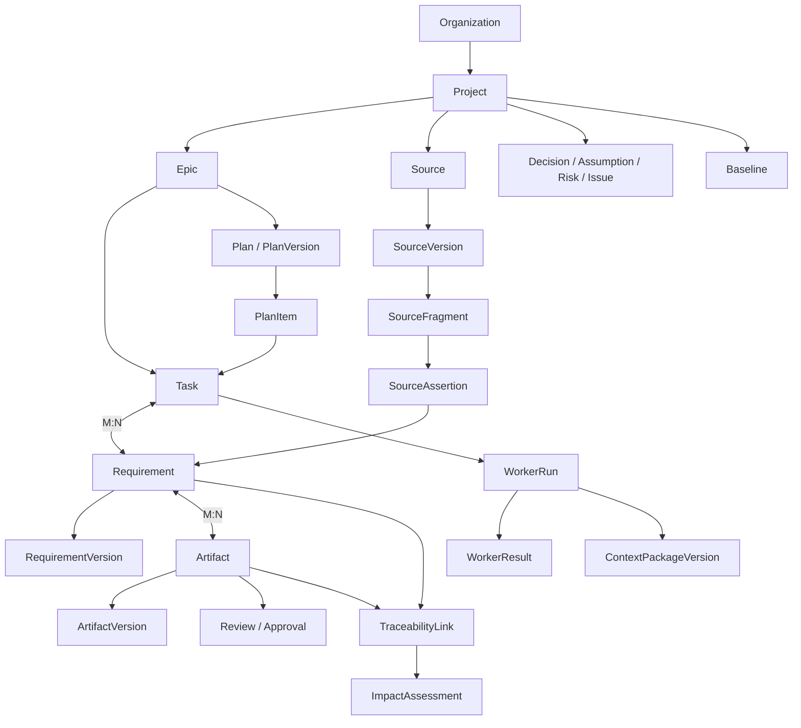

# AI RES — Доменная модель и логическая модель данных

**Версия:** 1.9
**Дата:** 10.11.2026  
**Статус:** архитектурное решение для MVP; физическая схема и точные поля отдельных типов уточняются при реализации и проверяются миграциями/тестами.  
**Назначение:** определить доменные границы, канонические сущности, связи, правила идентичности, версионирования, целостности и хранения данных AI RES.

## 1. Принятое архитектурное решение

AI RES использует **модульный Backend с единой доменной базой PostgreSQL `ai_res_db`**, разделённой на логические PostgreSQL schemas по доменным областям. В MVP не создаётся отдельная БД на каждый Bounded Context и не вводится отдельная графовая СУБД.

Это решение соответствует ранее выбранной инфраструктуре: один PostgreSQL instance/container в Docker Compose, отдельная БД `temporal_db`, отдельные роли доступа, отдельное хранилище LangGraph checkpoints и MinIO для файлов. Выделение отдельных сервисов или БД допускается позднее только при измеренной необходимости и без изменения доменных контрактов.

Основные принципы:

1. Модель строится вокруг предметных объектов инженерии требований и проектной работы, а не вокруг чатов или агентов.
2. Доменное состояние AI RES хранится в PostgreSQL; Temporal хранит состояние исполнения Workflow, но не является источником истины для Project/Epic/Task/Requirement.
3. Файловое содержимое хранится в MinIO; PostgreSQL хранит метаданные, версии, связи, ACL и ссылки на объекты.
4. Worker Run, Task, Requirement и Artifact — разные сущности с разными жизненными циклами.
5. Версии источников, требований, планов, артефактов и Baseline сохраняют историю; утверждённые/зафиксированные версии не перезаписываются.
6. Трассируемость — типизированные отношения с происхождением и статусом, а не массивы ID или произвольные текстовые ссылки.
7. Межмодульные события публикуются через Transactional Outbox; распределённая транзакция между PostgreSQL, Temporal, MinIO и внешними системами не предполагается.
8. Все операции чтения, поиска, трассировки и построения контекста обязаны учитывать организационные и проектные права.

## 2. Статус решений и границы

В документе:
- **Архитектурное решение для MVP** — рекомендуемая целевая реализация, которую следует использовать при проектировании и реализации.
- **Параметр реализации** — значение, которое выбирается при разработке (например, точный набор индексов или конкретный enum), но не меняет доменный принцип.
- **Открытый вопрос** — вопрос, для которого нужны продуктовые или эксплуатационные данные.

Данная модель является проектной адаптацией AI RES. Конспекты книги поддерживают общие принципы структурированного контекста, provenance, графов знаний, workflow, валидации и тестирования, но не задают готовую схему БД, конкретные таблицы, поля или UUIDv7.

## 3. Bounded Contexts и модульные границы

В MVP это логические модули Backend, не микросервисы.

| Schema / модуль | Ответственность | Основные сущности |
|---|---|---|
| `iam` | Пользователи, членство и назначения доступа | User, Membership, RoleAssignment |
| `organization` | Организационная область и настройки | Organization |
| `project` | Проекты, участники, проектные настройки | Project, ProjectMember, ProjectConfiguration |
| `work` | Планирование и выполнение проектной работы | Epic, Task, TaskDependency, Plan, PlanVersion, PlanItem |
| `requirements` | Требования и их версии | Requirement, RequirementVersion, RequirementLink/TaskRequirement |
| `sources` | Исходные источники и неизменяемые версии | Source, SourceVersion, SourceFragment |
| `knowledge` | Извлечение и производные знания | ExtractionRecord, SourceAssertion, DerivedFinding |
| `decisions` | Решения и неопределённость | Decision, Assumption, Risk, Issue, Unknown, Hypothesis, Conflict |
| `artifacts` | Артефакты, версии, представления и генерация | Artifact, ArtifactVersion, ArtifactRepresentation, GenerationJob |
| `traceability` | Связи, зависимости и анализ влияния | TraceabilityLink, ChangeSet, ImpactAssessment, ImpactItem |
| `governance` | Проверки, согласования, baseline и change control | Review, ReviewComment, Approval, Baseline, ChangeRequest |
| `agents` | Конфигурации специализаций и результаты исполнения | WorkerDefinition, WorkerRun, WorkerResult |
| `context` | Контекстные пакеты и их версии | ContextPackage, ContextPackageVersion, ContextPackageItem |
| `integrations` | Внешние системы, mapping и синхронизация | Connector, ExternalConnection, ExternalObjectMapping, SyncRun, SyncCheckpoint |
| `audit` | Доменный аудит и transactional outbox | AuditEvent, OutboxEvent |
| `platform` | Справочники и платформенные настройки | ReferenceData, SchemaVersion (при необходимости) |

Схемы PostgreSQL — средство логического разделения и контроля доступа. Не требуется создавать схему на каждый мелкий тип или отдельный сервис для каждой строки таблицы.

## 4. Карта доменной модели

Диаграмма показывает концептуальные отношения, а не полную кардинальность всех связей. Например, Source может быть общим для нескольких Epic; Requirement может связываться с несколькими Epic и Tasks; TraceabilityLink соединяет разрешённые типы доменных объектов.

## 5. Организация, проект и рабочая область

### 5.1 Organization

Организация — верхний контекст владения и доступа. Содержит настройки, участников и организационные правила. Для локального MVP может существовать одна организация, но `organization_id` должен быть предусмотрен в доменных объектах, чтобы не блокировать будущую multi-tenant модель.

### 5.2 User и Membership

`User` представляет идентичность пользователя. `OrganizationMembership` и `ProjectMembership` связывают пользователя с областью доступа. Роли и назначения отделяются от пользовательской идентичности. Сервисные идентичности Manager, Worker Runtime, API и Connector не моделируются как обычные люди.

### 5.3 Project

Project — корневая область работы. Основные данные: стабильный ID, organization, имя, описание, цель, тип Greenfield/Brownfield/Hybrid/UNKNOWN, scope, ограничения, статус, владельцы, настройки, правила, участники и ссылки на источники. Project не должен содержать все дочерние данные в одном JSON.

### 5.4 Epic

Epic группирует цель/область аналитической работы внутри Project. Epic имеет собственные goal, scope, acceptance/outcome criteria, статус, приоритет, владельца и историю. Manager может предложить Epic, но предложение не становится подтверждённой проектной областью без предусмотренного человеческого решения.

### 5.5 Task

Task — самостоятельная единица работы. Поля включают цель, описание, тип, статус, приоритет, инициатора, владельца, допустимого исполнителя, критерии приёмки, сроки (если заданы), блокировки и историю. Task может быть создан аналитиком или предложен Manager. Предложенные Manager задачи имеют состояние PROPOSED и не запускаются до требуемого подтверждения и Readiness Gate.

Task не является Requirement. Связь Task–Requirement — M:N через `work.task_requirement` с типом отношения и обоснованием. Task может затрагивать несколько требований, а требование может быть предметом нескольких задач анализа, проектирования, проверки и изменения.

### 5.6 Plan, PlanVersion и PlanItem

Plan — стабильная идентичность плана работы Epic. PlanVersion — неизменяемый снимок цели, scope, элементов, зависимостей, ожидаемых результатов, acceptance criteria, допущений, рисков и rationale. PlanItem — элемент конкретной версии: ссылка на существующую Task, предложение Task, checkpoint или research direction. Утверждение PlanVersion не означает утверждение бизнес-требований или Baseline.

## 6. Требования

### 6.1 Requirement и RequirementVersion

`Requirement` — стабильная идентичность требования и его жизненный цикл. `RequirementVersion` — неизменяемая редакция содержимого и атрибутов требования. Минимальные атрибуты версии: statement, rationale, type, priority (если применимо), source/provenance references, acceptance/verification information, constraints, author, timestamp, change reason и version number.

Типы требований поддерживают уже принятую классификацию: BR, StR, UR, FR, NFR, SyR, IR, DR, IntR, CON, TR и расширяемый реестр типов. Неизвестный тип не должен автоматически превращаться в ближайший знакомый тип.

Требование может быть зарегистрировано предварительно. `EXTRACTED/CANDIDATE` не означает подтверждение аналитиком; `CONFIRMED` не обязательно означает бизнес-approval; `APPROVED` фиксирует решение уполномоченного лица; включение в Baseline — отдельная операция.

### 6.2 Связи требований

- Requirement ↔ Epic: M:N, поскольку одно требование может влиять на несколько областей.
- Requirement ↔ Task: M:N через явную таблицу.
- Requirement ↔ Artifact: M:N через типизированные ссылки/TraceabilityLink.
- Requirement ↔ SourceAssertion/DerivedFinding: связь происхождения, поддерживающая доказательство и историю.
- Requirement ↔ Requirement: типизированные отношения (например, REFINES, DEPENDS_ON, CONFLICTS_WITH, DUPLICATES, SUPERSEDES), регистрируемые в Traceability.

### 6.3 Версионирование

Изменение содержания создаёт новую RequirementVersion. Нельзя незаметно менять текст утверждённой версии. Текущая версия определяется контролируемой ссылкой в Requirement и проверяется транзакционно. Утверждённые версии и версии, включённые в Baseline, сохраняются неизменными.

## 7. Источники и знания

### 7.1 Source и SourceVersion

Source — стабильная идентичность документа, репозитория, API или иного внешнего источника. SourceVersion — неизменяемое состояние источника с checksum/version marker, временем получения, provenance, media type, обработчиком и ссылкой на объект MinIO или внешнюю ссылку/snapshot.

### 7.2 SourceFragment

SourceFragment относится к конкретной SourceVersion и хранит locator (страница, раздел, диапазон строк, JSON Pointer, путь файла/символа и т.п.), текст/нормализованное представление в пределах политики хранения, checksum и метаданные извлечения. Локатор должен быть специфичен для типа источника; универсальная колонка `page_number` недостаточна.

### 7.3 ExtractionRecord, SourceAssertion и DerivedFinding

ExtractionRecord фиксирует факт извлечения: pipeline/version, время, модель/инструмент (если применимо), статус, ошибки и ссылки на входные версии. SourceAssertion представляет то, что утверждает сам источник. DerivedFinding — вывод/интерпретация AI RES, привязанная к доказательствам и методу. Нельзя смешивать assertion источника с выводом агента.

### 7.4 Хранение

Бинарное содержимое исходных файлов и крупных артефактов хранится в MinIO. PostgreSQL хранит метаданные, версии, ACL, checksums и ссылки на object keys. Объекты MinIO версионируются/создаются immutable; новая версия Source создаёт новый объект. Embeddings и поисковые индексы — производные данные, которые можно перестроить из канонических источников и не использовать как единственное доказательство.

## 8. Решения и неопределённость

Decision, Assumption, Risk, Issue, Unknown, Hypothesis и Conflict остаются отдельными типизированными объектами со своими lifecycle и обязательными полями. Не следует сводить их к общей таблице заметок с одним нестрогим JSON без доменной валидации.

Допустим общий технический набор полей: ID, scope (organization/project/epic/task), status, owner, created/updated metadata, evidence references, provenance и audit. Специфические поля различаются:

- Decision: вопрос, варианты, выбранный вариант, rationale, последствия, уполномоченный approver, область действия и review trigger.
- Assumption: утверждение, владелец, последствия ошибочности, способ/критерии проверки и срок/триггер.
- Risk: причина, событие, последствия, вероятность/влияние или UNKNOWN, владелец, триггеры, mitigation, contingency и residual risk.
- Issue: обнаруженная проблема, фактическое влияние, владелец, статус и разрешение.
- Unknown: конкретный информационный пробел, затронутые решения/задачи и условие закрытия.
- Hypothesis: проверяемое предположение, основания, проверка и результат.
- Conflict: конфликтующие объекты/утверждения, доказательства, классификация и способ разрешения.

Uncertainty — характеристика объектов и оценок, а не универсальная сущность/один confidence score.

## 9. Артефакты и governance

### 9.1 Artifact

Artifact — стабильная идентичность результата с типом, назначением, владельцем, scope, source-of-truth mode и жизненным циклом. ArtifactVersion хранит неизменяемый снимок содержимого/структуры, schema version, checksum, provenance и change reason. ArtifactRepresentation связывает точную ArtifactVersion с форматом/рендерером и object storage key. DOCX/PDF-экспорт обычно является представлением, а не каноническим содержимым; OpenAPI/JSON Schema/диаграмма-as-code могут быть нативным source of truth в зависимости от типа.

### 9.2 Generation и validation

GenerationJob фиксирует попытку генерации/обновления/импорта/композиции. ValidationReport относится к точной версии и конкретному набору валидаторов/версий. Validation, Review, Approval и Publication — разные факты и разные жизненные циклы.

### 9.3 Review, Approval и Baseline

Review фиксирует проверку и замечания. Approval фиксирует решение уполномоченного человека или явно разрешённого процесса относительно конкретного объекта и версии. Baseline — неизменяемый снимок набора конкретных версий требований, артефактов, решений и иных включаемых объектов. Изменение Baseline — через Change Request, Impact Assessment, требуемые approvals и создание новой Baseline; существующая Baseline не переписывается.

## 10. Трассируемость и анализ влияния

### 10.1 TraceabilityLink

Для универсальной трассируемости применяется типизированная таблица `traceability.traceability_link` с полями:

- `id`;
- `project_id` и при необходимости `epic_id`;
- `source_object_type`, `source_object_id`;
- `target_object_type`, `target_object_id`;
- `link_type`;
- `status` (PROPOSED, CONFIRMED, REJECTED, SUPERSEDED);
- `origin` (HUMAN, AGENT, IMPORT, RULE);
- `evidence_refs`/связанные evidence records;
- `rationale`;
- `created_by`, `created_at`, `confirmed_by`, `confirmed_at`, `superseded_at`;
- version/validity metadata при необходимости.

**Ограничение полиморфных ссылок:** FK PostgreSQL не может условно ссылаться на разные таблицы по `object_type`. Поэтому критичные бизнес-связи (например, Task–Requirement, ArtifactVersion–ValidationReport, Approval–target version, Source–SourceVersion) реализуются специализированными таблицами с реальными FK. Универсальный TraceabilityLink используется для расширяемых семантических связей; Traceability Service проверяет допустимые типы, существование объектов, scope и ACL. Нельзя принимать произвольные `object_type`/`link_type` из пользовательского ввода.

### 10.2 Зависимости — не один тип

Отдельно моделируются:
- TaskDependency — порядок/блокировка задач;
- RequirementDependency — предметная зависимость требований;
- ArtifactDependency — зависимость артефактов;
- RuntimeDependency — зависимость исполнения;
- Provenance/TraceabilityLink — происхождение и смысловые отношения.

Их нельзя сводить к одной таблице `dependencies` без `dependency_type`, семантики и правил проверки.

### 10.3 Impact Analysis

ChangeSet фиксирует исходное изменение/набор изменённых версий. ImpactAssessment фиксирует запуск анализа, версии графа/правил, автора/метод, детерминированные результаты и семантические выводы. ImpactItem содержит затронутый объект, путь/основание, категорию, evidence, статус и рекомендуемое действие. Классы I0–I4 и прежние правила остаются рекомендацией AI RES, не вероятностью риска и не confidence score.

Детерминированные проверки (прямые связи, формальные зависимости, baseline membership, обязательные gates) выполняются до/параллельно с семантическим анализом. Manager/Workers могут расширять оценку, но не понижать обязательную детерминированную категорию.

## 11. Агентное исполнение и контекст

### 11.1 WorkerDefinition и WorkerRun

WorkerDefinition — логическая специализация/компетенция. Worker Runtime Instance — экземпляр общего пула, не отдельная доменная специализация. WorkerRun — конкретный запуск с Task, WorkerDefinition, инициатором, версией Plan, ContextPackageVersion, модельным профилем, разрешениями, инструментами, temporal workflow ID, langgraph thread ID, timestamps, статусом и результатом.

WorkerRun не заменяет Task и не является самостоятельным бизнес-требованием. Одна Task может иметь несколько WorkerRun (повтор, новая версия контекста, исправление, независимая проверка). История предыдущих запусков сохраняется.

### 11.2 WorkerResult

WorkerResult хранит структурированный итог, ссылки на созданные/обновлённые доменные объекты и артефакты, evidence, ограничения, неопределённость, ошибки и self-assessment. Отдельно фиксируются независимый Review, Manager orchestration acceptance и human Approval — эти состояния не объединяются.

### 11.3 ContextPackage

ContextPackage — логическая идентичность набора контекста. ContextPackageVersion — неизменяемый снимок точных версий источников, требований, решений, артефактов, правил, разрешений и других включённых элементов. ContextPackageItem связывает пакет с конкретным объектом и версией, ролью включения, locator и provenance. WorkerRun всегда ссылается на конкретную версию. Обновление источника не мутирует уже использованный пакет.

### 11.4 Внешние workflow identifiers

`temporal_workflow_id`, `langgraph_thread_id`, queue/activity identifiers и trace_id — технические correlation identifiers. Они не заменяют первичные ключи доменных объектов и не являются единственным местом хранения их состояния.

## 12. Интеграции

Connector, ExternalConnection, ExternalObjectMapping, SyncRun и SyncCheckpoint отделены от доменных сущностей. Mapping использует устойчивые `provider + tenant/instance + object_type + external_id`, а не имя/заголовок. Ownership Policy задаёт владельца данных и направления синхронизации по типу объекта/полю. Внешние изменения проходят Source Version/Change Set/Impact Assessment; синхронизация не должна незаметно перезаписывать утверждённые доменные данные.

## 13. Аудит, события и межмодульное взаимодействие

### 13.1 AuditEvent

AuditEvent фиксирует субъект, действие, объект, результат, время, scope, correlation IDs, основание и ссылки на связанные версии. Обычные пользователи и Worker Runtime не могут изменять/удалять audit records. Не записывать секреты, токены и полные приватные промпты по умолчанию. Audit Event — доказательство доменного/административного действия, а не копия технического лога.

### 13.2 Transactional Outbox

При изменении доменного объекта и создании события соответствующая запись Outbox создаётся в той же транзакции PostgreSQL. Отдельный dispatcher публикует событие с at-least-once доставкой; потребители идемпотентны и отслеживают обработку. События имеют `event_id`, `event_type`, `schema_version`, `occurred_at`, `aggregate_type`, `aggregate_id`, `aggregate_version`, `organization_id`, `project_id`, `correlation_id`, `causation_id` и минимальный payload/reference. Большие документы и секреты в событие не помещаются.

Не следует пытаться синхронно включать Temporal, MinIO и внешние API в транзакцию PostgreSQL. Для побочных эффектов применяются idempotency keys, retry, reconciliation и явные состояния частичного успеха.

## 14. Логическая структура PostgreSQL

Рекомендуемые схемы `ai_res_db`:

| Schema | Примеры таблиц |
|---|---|
| `iam` | users, service_identities, organization_memberships, project_memberships, role_assignments |
| `organization` | organizations |
| `project` | projects, project_configurations, project_rules_refs |
| `work` | epics, tasks, task_dependencies, task_requirements, plans, plan_versions, plan_items |
| `requirements` | requirements, requirement_versions |
| `sources` | sources, source_versions, source_fragments |
| `knowledge` | extraction_records, source_assertions, derived_findings |
| `decisions` | decisions, assumptions, risks, issues, unknowns, hypotheses, conflicts |
| `artifacts` | artifacts, artifact_versions, artifact_representations, artifact_types, generation_jobs, validation_reports |
| `traceability` | traceability_links, change_sets, impact_assessments, impact_items |
| `governance` | reviews, review_comments, approvals, baselines, baseline_items, change_requests |
| `agents` | worker_definitions, worker_runs, worker_results |
| `context` | context_packages, context_package_versions, context_package_items |
| `integrations` | connectors, external_connections, external_object_mappings, sync_runs, sync_checkpoints |
| `audit` | audit_events, outbox_events, outbox_delivery_attempts |
| `platform` | controlled_reference_data, optional schema metadata |

Это рекомендуемая схема именования. Точный физический расклад может быть упрощён при реализации, если границы модулей, права, миграции и ответственность останутся явными.

## 15. Идентификаторы, поля и типы данных

1. Для новых доменных PK рекомендуется UUIDv7. Он даёт временную сортируемость и глобальную уникальность. Если выбранная библиотека/СУБД-интеграция не поддерживает UUIDv7 надёжно, допускается UUIDv4 как совместимая альтернатива; не следует реализовывать самодельный генератор.
2. Человекочитаемые номера (`REQ-000123`, `TASK-000045`) являются display/business identifiers, не PK. Их уникальность ограничивается соответствующей организацией/проектом согласно правилам нумерации.
3. Время хранится как `timestamptz` в UTC; timezone пользователя/проекта — отдельная настройка.
4. Денежные значения не хранятся в float; применяются decimal/numeric и явная валюта.
5. Статусы и типы контролируются enum/reference registry/schema validation; произвольные строки из LLM не принимаются напрямую.
6. JSONB используется для типизированных расширений, provider-specific metadata и versioned payload, но не вместо нормализованных FK, ключевых полей и запросных связей.
7. Для содержимого, требующего поиска/индексации, сохраняются нормализованное представление, checksum и ссылка на исходный объект; большие blobs не помещаются в PostgreSQL.
8. У всех доменных таблиц должны быть явные `created_at`/`created_by` и, где объект изменяем, `updated_at`/`updated_by`; не все таблицы обязаны иметь одинаковый набор полей.

## 16. Ограничения целостности и транзакции

- Все проектные объекты должны иметь корректную принадлежность к organization/project; cross-project links запрещены, если связь явно не разрешена (например, shared Source) и проверена ACL.
- FK применяются для обычных отношений внутри схем и между схемами одной БД.
- Уникальные ограничения защищают external mappings, номера версий и активную текущую версию.
- Изменение current_version pointer и создание новой версии выполняются одной транзакцией с optimistic concurrency/version check.
- TaskDependency должен предотвращать самозависимость; циклы выявляются детерминированной проверкой до активации плана.
- BaselineItem ссылается на конкретную версию объекта; включённая версия неизменяема.
- Approval должен ссылаться на конкретную версию и scope; approval на «текущий объект без версии» запрещён.
- ContextPackageItem должен ссылаться на конкретную версию; WorkerRun не может стартовать без ContextPackageVersion и успешного Readiness Gate.
- TraceabilityLink валидируется по registry допустимых пар object/link types; подтверждение связи сохраняет субъект и evidence.
- Удаление ограничивается FK RESTRICT/soft-delete/archive; каскадное удаление крупных доменных историй по умолчанию запрещено.
- Для конкурентных обновлений применяются optimistic locking (`row_version`/version counter) или блокировки только на коротких транзакциях.

## 17. Индексы и производительность

Минимальные группы индексов:
- PK на UUID;
- FK columns и часто используемые `organization_id`, `project_id`, `epic_id`, `task_id`;
- уникальные индексы на `(source_id, version_number)`, `(requirement_id, version_number)`, `(artifact_id, version_number)`, `(plan_id, version_number)`;
- индексы статуса/приоритета/updated_at для очередей и списков Workspace;
- индексы `traceability_links` по source endpoint, target endpoint, link_type и status;
- индексы external mappings по provider/tenant/object type/external ID;
- индексы audit по occurred_at, actor, project и object reference;
- GIN/JSONB и full-text индексы только для подтверждённых поисковых сценариев;
- частичные индексы для активных/открытых задач и текущих версий, где они дают измеримую пользу.

Не вводить преждевременно partitioning, sharding или отдельную graph DB. Решение принимается по измерениям объёма, задержек, планов запросов и retention.

## 18. Удаление, архивирование и retention

По умолчанию основные доменные объекты архивируются/закрываются, а не физически удаляются. История версий, Baseline, approvals и audit сохраняется согласно политике retention. Удаление персональных данных выполняется отдельной контролируемой процедурой с оценкой юридических требований, ссылочной целостности и необходимости обезличивания. Временные объекты и производные индексы могут иметь TTL/процедуру очистки. Архивирование не должно разрушать историческую трассируемость.

## 19. Безопасность данных

- Все запросы ограничиваются organization/project scope; проверка ACL выполняется на серверной стороне и применяется также к traceability traversal, search, aggregation, exports и summaries.
- Не полагаться на скрытие элементов интерфейса или только на PostgreSQL schema separation.
- Отдельные DB roles для API, Manager/Worker-facing services, migrations, audit writer и observability; минимальные права.
- Worker Runtime не получает прямой unrestricted SQL-доступ к доменным таблицам; взаимодействует через разрешённые сервисные операции.
- Секреты не помещаются в контекст модели, Outbox payload, AuditEvent, логи или артефакты.
- Источники и внешние payload считаются недоверенными данными; их содержимое не может менять system rules или ACL.

## 20. Миграции и совместимость

- Каждая доменная schema имеет контролируемый migration history; миграции выполняются CI/CD и deployment runbook.
- Предпочтителен expand → migrate → contract для изменений, затрагивающих работающие компоненты.
- Не выполнять автоматический destructive migration без backup, плана восстановления и подтверждения.
- Temporal persistence migrations, AI RES domain migrations и LangGraph checkpoint migrations независимы.
- Миграция должна проверять актуальную версию схемы, предусловия, postconditions и совместимость приложения.
- Релиз фиксирует migration version в Release Manifest.

## 21. Обязательные сценарии проверки модели

1. Создать Organization, Project, Epic и участников; проверить изоляцию двух проектов.
2. Создать задачу и несколько требований; связать M:N; убедиться, что Task не создаёт и не заменяет Requirement.
3. Извлечь требование из Source Fragment; проверить SourceAssertion/DerivedFinding, provenance и candidate status.
4. Создать новую RequirementVersion; убедиться, что старая версия и ссылки Baseline остаются неизменными.
5. Сформировать PlanVersion с предложенными и существующими Task; отклонить предложение и проверить, что задача не запускается.
6. Запустить WorkerRun с immutable ContextPackageVersion; изменить Source и проверить, что старый пакет не мутирует.
7. Создать несколько WorkerRun для одной Task; проверить сохранность результатов и связь с версиями контекста.
8. Создать ArtifactVersion, ValidationReport, Review и Approval; проверить, что это разные состояния и approval относится к точной версии.
9. Создать Baseline с конкретными версиями; изменить Requirement и создать CR/new Baseline без перезаписи прежней.
10. Создать TraceabilityLink с недопустимым типом/несуществующим объектом и убедиться, что сервис отклоняет связь.
11. Проверить TaskDependency cycle detection и локализацию блокировки.
12. Сгенерировать доменное событие через Outbox, прервать dispatcher и проверить повторную идемпотентную доставку.
13. Проверить ACL на прямое чтение, поиск, графовые обходы, экспорт и агрегированные результаты.
14. Восстановить БД и MinIO snapshot; выполнить reconciliation незавершённых Temporal Workflow и WorkerRun.

## 22. Что не входит в решение MVP

- Отдельная графовая СУБД (Neo4j и аналоги).
- Отдельная БД на каждый Bounded Context.
- Полная event sourcing архитектура: Outbox и audit не означают хранение всего доменного состояния только как event stream.
- Автоматическое создание физических микросервисов по доменным модулям.
- Универсальная EAV-модель для всех атрибутов.
- Универсальный JSON-объект для всех типов требований/решений/артефактов без typed validation.
- Автоматическое удаление исторических данных без retention/approval policy.

## 23. Открытые параметры реализации

1. Конкретный ORM/query layer и migration tool для доменного Backend.
2. Выбор UUIDv7 implementation и способа генерации.
3. Точная модель пользователей/SSO и identity provider.
4. Полные словари статусов/типов для всех сущностей.
5. Конкретные поля и схемы JSON для специализированных типов Artifact и Requirement.
6. Retention сроки для audit, traces, source snapshots и временных объектов.
7. Объёмы, нагрузочные профили и решение о partitioning.
8. Точный механизм ACL enforcement и database row-level security (RLS) после threat modeling.
9. Конкретная реализация event dispatcher и схема Outbox retry/dead-letter.
10. Точный набор индексов после анализа реальных запросов.

Эти параметры не блокируют концептуальное решение о модульном Backend и единой доменной БД PostgreSQL.

## 24. Связанные документы

- `AI_RES_Agent_Architecture_Concept_v3.9.md`
- `AI_RES_Requirements_Lifecycle_v2.5.md`
- `AI_RES_MVP_Capability_Matrix_v2.6.md`
- `AI_RES_Infrastructure_Deployment_Operations_v1.1.md`
- `AI_RES_Traceability_Dependencies_Impact_Analysis_v1.0.md`
- `AI_RES_Documentation_Artifacts_Lifecycle_v1.0.md`
- `AI_RES_Source_and_Context_Lifecycle_v1.1.md`
- `AI_RES_External_Integrations_and_Project_Context_v1.0.md`

---

# Дополнение v1.1. Границы API и application services

**Нормативная спецификация:** `AI_RES_API_and_Interaction_Contracts_v1.2.md`.

Доменная модель остаётся каноническим источником предметного состояния. Публичные API DTO не являются ORM/domain entities и не должны напрямую отражать физическую схему PostgreSQL. Входящие запросы преобразуются в typed application commands; чтение выполняется через authorized query services/read models.

Внутри модульного Backend доменные области взаимодействуют через application service interfaces и domain events. HTTP между модулями одного процесса не вводится. Межпроцессные границы Manager Runtime, Worker Runtime и Backend используют внутренние authenticated interfaces; Temporal остаётся основным durable orchestration transport.

Каждый API read/query обязан применять organization/project/object ACL. Любая versioned mutation использует expected version/ETag; approval и baseline operations ссылаются на точную версию. Долгие процессы представлены Operation resource, а не блокирующим HTTP запросом.

Доменные события публикуются через Transactional Outbox и имеют CloudEvents envelope. Delivery at-least-once; consumers идемпотентны и учитывают aggregate version. Event payload не заменяет доменную запись и не содержит секреты/полные приватные документы.

Состав endpoint, DTO, WorkerRunEnvelope, WorkerResult, Temporal/LangGraph contracts, event types, error model и compatibility policy зафиксированы в `AI_RES_API_and_Interaction_Contracts_v1.2.md` и machine-readable YAML contracts.

**Дополнительный машинный контракт:** `AI_RES_Worker_Contracts_v1.1.schema.json`.

---

# Дополнение v1.2. WorkerCoordinationRequest и производные WorkerRuns

## 1. WorkerCoordinationRequest

Добавляется типизированная доменная запись координации Worker:
- `id`, `organization_id`, `project_id`, `epic_id`, `task_id`;
- `source_worker_run_id`;
- `request_type` (`CONSULTATION`, `DELEGATED_SUBTASK`, `HANDOFF`);
- `purpose`, `rationale`, `target_capability`;
- `input_refs`, `expected_output_schema`, `acceptance_criteria`;
- `proposed_dependency`;
- `manager_decision_id`, `policy_decision_id`;
- `resulting_task_id` и/или `resulting_worker_run_id`;
- `status`, `requested_at`, `decided_at`, `completed_at`;
- `correlation_id`, `idempotency_key`.

Запрос является отдельным объектом аудита и координации. Он не является
разрешением на исполнение сам по себе.

## 2. Связи

- Один WorkerRun может породить несколько Coordination Requests в
  пределах ограничений.
- Один Coordination Request может породить ноль или один одобренный
  consultation/delegated/handoff execution chain; retries/повторные
  попытки связываются отдельными WorkerRuns.
- Производный WorkerRun содержит `parent_worker_run_id` и
  `coordination_request_id`.
- Independent QA связывается с `Review` и `review_id`; не маскируется
  под консультацию.
- WorkerRun принадлежит Task; при consultation может относиться к той
  же Task, при delegated subtask Manager создаёт отдельную Task.
- Все связи проверяются по project/org scope и ACL; произвольные ссылки
  между проектами запрещены.

## 3. Ограничения целостности

- Уникальность idempotency key в пределах authenticated service/run
  scope.
- Запрещены циклы parent_worker_run_id и превышение configured
  coordination depth.
- Нельзя одобрить запрос от неактивного/отменённого source Run без
  отдельной policy.
- `APPROVED` требует manager decision и положительного policy decision.
- Отзыв grant до запуска переводит запрос/Run в BLOCKED/RECHECK; новый
  Gate обязателен.
- Worker не имеет права напрямую изменять coordination status после
  отправки запроса.

---

## Дополнение v1.3 — каноническое хранение Operation и Readiness Gate

### 25.1. Operation (каноническая доменная запись длительного действия)

`Operation` хранится в PostgreSQL `ai_res_db`, логическая schema `operations`. Она представляет длительную команду и её пользовательски наблюдаемый lifecycle; не заменяет Task, Epic, Artifact или WorkerRun. Temporal хранит техническое состояние Workflow/Execution, но не является источником истины для доменного Operation read model.

Обязательные таблицы:
- `operations.operations` — текущая проекция состояния, инициатор, область, subject ref, idempotency metadata, timestamps, result/problem refs, Temporal workflow/run refs, row_version.
- `operations.operation_events` — append-only последовательность переходов и подтверждённых milestones, уникальная по `(operation_id, sequence)`.
- `operations.operation_workflow_links` — вводить только если одна Operation действительно может иметь несколько Workflow Execution; иначе достаточно refs в основной записи.

Создание Operation со статусом `ACCEPTED` и Outbox command выполняется одной транзакцией. Dispatcher идемпотентно запускает Temporal Workflow с Workflow ID, детерминированным от Operation ID. API читает Operation из PostgreSQL. Temporal status не копируется напрямую без доменной интерпретации. Доверенные application services меняют Operation через валидатор переходов и атомарно записывают OperationEvent + Outbox.

Operation имеет собственный state machine; канонический список статусов и переходов приведён в `AI_RES_Operation_and_Readiness_Gate_Architecture_Decision_v1.0.md` и `AI_RES_Operation_and_Readiness_Gate_State_Machine_v1.0.json`. `CANCEL_REQUESTED` не терминален; запрос отмены не гарантирует отмену уже совершённого внешнего side effect. Терминальные статусы не открываются повторно.

### 25.2. ReadinessEvaluation и ReadinessCheckResult

В логической schema `execution` хранятся:
- `readiness_evaluations` — неизменяемый результат одной оценки допуска конкретного WorkerRun;
- `readiness_check_results` — детальные typed результаты проверок.

`GateResult` — представление/термин оценки и дочерних проверок, а не вторая сущность хранения. `gateResultId` в прежнем event contract указывает на ID `ReadinessEvaluation`; при следующей версии события поле следует переименовать в `readinessEvaluationId`.

Каждая evaluation фиксирует версии/хэши Task state, PlanVersion/PlanItem, WorkerDefinition, ContextPackageVersion/manifest, ruleset, grant set, tool allowlist, output contract, budget profile, dependency snapshot, evaluator и policy engine. Она содержит outcome, check results, blockers, limitations и evidence refs. Старая evaluation не редактируется при изменении условий; создаётся новая evaluation, а связь supersession фиксируется событием/указателем.

`READY` и `READY_WITH_LIMITATIONS` допускают только финальную pre-start revalidation. `READY_WITH_LIMITATIONS` требует enforceable ограничений, которые переносятся в WorkerRun envelope/grants/budgets. Обязательный HIGH/CRITICAL FAIL, недоступность Policy Engine, невозможность подтвердить ACL/grants или ошибка evaluator блокируют запуск. `STALE` означает несовпадение snapshot с актуальным состоянием и требует новой evaluation.

WorkerRun должен хранить `latest_readiness_evaluation_id` и неизменяемый `started_with_readiness_evaluation_id`. Запуск без точной успешной evaluation запрещён. Каждая производная/повторная попытка WorkerRun получает собственную Gate evaluation.

### 25.3. Разделение ответственности и целостность

- Manager отвечает за semantic readiness assessment там, где это требуется task-class policy; он не может переопределить deterministic/security/policy failure.
- Platform Gate Evaluator выполняет детерминированные проверки и сохраняет evaluation/check records.
- Policy & Permission Engine независимо подтверждает ACL, grants и tool permissions; Gate не выдаёт полномочия.
- Context Builder формирует immutable ContextPackageVersion; Gate проверяет ссылку/версию/hash, но не мутирует пакет.
- Temporal исполняет workflow после Gate и финальной revalidation; в history передаются IDs/refs, не большие payload.
- Worker Runtime не может изменить Gate outcome или обойти его; per-tool-call authorization остаётся обязательной.
- Operation и ReadinessEvaluation доступны только с organization/project/object ACL; скрытые evidence не раскрываются через summary.

---

## Дополнение v1.4 — Operation/Task/WorkerRun lifecycle и связи

Считать дополнение v1.2 Architecture Decision нормативным. Дополнение уточняет доменные отношения и persistence.

### 26.1. Кардинальности
- `Operation 1 — N Task` (через `operation_id` owning reference); `Task N — 1 Operation` в MVP.
- `Task 1 — N WorkerRun`; каждый WorkerRun имеет обязательные `task_id` и `operation_id`, причём `worker_run.operation_id = task.operation_id`.
- `WorkerRun 0..1 — 1 WorkerRun` через `derived_from_worker_run_id`; у исходного запуска может быть N производных запусков.
- `Operation 0..1 parent — N child Operations`; дочерняя операция самостоятельна и не наследует ACL автоматически.
- `Operation 1 — N OperationEvent`; `WorkerRun 1 — N WorkerRunEvent`; обе истории append-only.
- WorkerRun ссылается на неизменяемые `ContextPackageVersion`, `WorkerDefinitionVersion`, output contract и `ReadinessEvaluation`.

### 26.2. Поля WorkerRun
Минимально обязательные поля доменной модели: `id`, `operation_id`, `task_id`, `worker_definition_version_id`, `status`, `created_at`, `updated_at`, `row_version`, `context_package_version_id` (до старта), `latest_readiness_evaluation_id`, `started_with_readiness_evaluation_id` (после старта), `temporal_workflow_id`, `temporal_run_id`, `started_at`, `finished_at`, `result_ref`, `problem_ref`, `derived_from_worker_run_id`, `derivation_reason`, `attempt_number`, `execution_deadline_at`, `cancel_requested_at`, `completed_at`.

`WorkerRunEvent` содержит `id`, `worker_run_id`, `sequence`, `event_type`, `from_status`, `to_status`, `actor_type/id`, `reason_code`, `occurred_at`, `correlation_id`, `causation_id`, typed payload refs. Unique `(worker_run_id, sequence)`. Event log не хранит полный prompt, секреты или полный result payload.

### 26.3. Task и Operation
Task в MVP имеет owning `operation_id`; `operation_id` также фиксируется в WorkerRun для query/index performance, но DB constraint/trigger/application invariant гарантирует совпадение с Task. Если позднее потребуется повторное использование Task в нескольких Operation, вводится отдельная association table и отдельная миграция, не меняя смысл текущего поля задним числом.

### 26.4. Operation aggregation
Operation status является проекцией по Operation criteria + Task/PlanItem dependency graph + WorkerRun/Review outcomes + human wait/dependency state. Сохранять `completion_policy_snapshot` или ссылку на immutable policy/version, `aggregate_version`, `last_aggregated_event_sequence`, `result_summary_ref`, `partial_result_reasons`. Агрегатор работает детерминированно и идемпотентно; сохраняет причину каждого перехода. Он не выводит статус из простого count(success/failure).

### 26.5. Retention и безопасность
Operation/WorkerRun/Events сохраняются независимо от Temporal history retention. ACL применяется к каждой сущности и result/evidence refs; child Operation не наследует права по умолчанию. Уникальные sequence/optimistic row_version защищают конкурентные переходы. Физические индексы/DDL остаются предметом миграционного дизайна.

## Дополнение v1.5 — Operation/WorkerRun Event Model

Нормативный event contract: `AI_RES_Operation_WorkerRun_Event_Model_v1.0.md`; machine-readable catalogue: AsyncAPI v1.5. Domain events являются immutable facts, не commands или telemetry. Для Operation и WorkerRun отдельно хранятся current projection, append-only aggregate event history и Transactional Outbox. Inbox deduplication — на стороне каждого durable consumer.

### Event persistence и ordering
- `operation_events`: append-only, unique `(operation_id, sequence)`, `event_id` globally unique, `aggregate_version`, `event_type`, `schema_version`, `actor`, `reason_code`, `correlation_id`, `causation_id`, typed refs/payload, `occurred_at`.
- `worker_run_events`: аналогично, unique `(worker_run_id, sequence)`.
- `outbox_events`: event envelope/dispatch metadata, unique `event_id` и `(aggregate_type, aggregate_id, aggregate_sequence)`; не является canonical history.
- `inbox_messages`: consumer-scoped dedupe/checkpoint; unique `(consumer_name, event_id)`.
- Event history + Outbox + current projection write атомарно в одной PostgreSQL transaction. Delivery is at-least-once; ordering гарантируется только per aggregate.
- Sequence выдаётся атомарно через aggregate row/version lock; `MAX(sequence)+1` запрещён.

### Event envelope
CloudEvents 1.0; обязательны `id`, `source`, `type` с major version, `subject`, `time`, `datacontenttype`, `dataschema`; payload содержит `eventId`, `schemaVersion`, `aggregateType/id/sequence/version`, organization/project/operation IDs, actor type/id, correlation/causation, reason code, transition и ACL-protected refs. Payload не содержит prompts, secrets, full result/source content или raw provider payload.

Подробные каталоги `operation.*` и `worker_run.*`, схемы, dedupe, schema evolution, recovery и тесты определены в Event Model v1.0. `worker_run.accepted` deprecated; canonical terminal success event — `worker_run.completed`. ReadinessEvaluation events принадлежат evaluation aggregate; WorkerRun event лишь ссылается на evaluation ID/outcome.

---

## Дополнение v1.6 — физическая модель execution persistence

**Статус:** нормативное дополнение к доменной модели. Полная схема AI RES не заменяется; описан физический execution persistence slice.

### Канонические физические таблицы

- `operations.operations`, `operations.operation_events`;
- `work.tasks` с обязательным `operation_id` в MVP и уникальностью `(operation_id,id)`;
- `agents.worker_runs`, `agents.worker_run_events`;
- `execution.readiness_evaluations`, `execution.readiness_check_results`;
- `audit.outbox_events`, `audit.inbox_messages`;
- `platform.idempotency_records`.

### Кардинальности и ограничения

Operation 1:N Task; Task 1:N WorkerRun; Operation 1:N WorkerRun как owning reference; composite FK `(operation_id,task_id)` WorkerRun → Task защищает соответствие. WorkerRun 1:N ReadinessEvaluation. Event History 1:N по aggregate sequence. Outbox 1:N event per destination. Inbox unique `(consumer_name,event_id)`.

`started_with_readiness_evaluation_id` immutable после старта и должен ссылаться на completed READY/READY_WITH_LIMITATIONS evaluation того же WorkerRun. `latest_readiness_evaluation_id` может изменяться до старта при новой оценке. ReadinessEvaluation/check results immutable после completion.

### Физические правила

UUIDv7 app-generated; timestamptz UTC; JSONB только для versioned payload/refs/snapshots; FK RESTRICT; soft archive вместо cascade delete. Статусы — TEXT + CHECK/domain validation. Текущие проекции и append-only event history меняются атомарно. Design DDL snapshot находится в `AI_RES_PostgreSQL_Physical_Model_v1.0.sql`; актуальные логика, транзакции, индексы и миграционные требования — `AI_RES_PostgreSQL_Physical_Model_and_Transactions_v1.2.md` и `AI_RES_PostgreSQL_Migration_and_Access_Strategy_v1.1.md`.

---

## Дополнение 1.7 — Migration strategy и PostgreSQL access

**Нормативное решение:** для `ai_res_db` применяется Alembic + SQLAlchemy 2.x; migration execution отделён от runtime. Используется expand → backfill/migrate → validate → contract. Alembic autogenerate создаёт только candidate migrations и всегда требует ручного review. Temporal и LangGraph persistence мигрируются отдельными владельцами.

PostgreSQL access разделяется по process identity: `ai_res_owner` (NOLOGIN), отдельный `ai_res_migrator`, `ai_res_api`, `ai_res_outbox_dispatcher`, `ai_res_event_consumer`, `ai_res_auditor` и backup identity. Manager Runtime и Worker Runtime не получают прямые DB credentials. Runtime роли не имеют DDL, object ownership, SUPERUSER, BYPASSRLS или доступа к owner role.

RLS + FORCE применяется к tenant/project scoped таблицам; transaction-local `app.organization_id`/`app.project_id` устанавливаются только после серверной авторизации. Отсутствующий контекст — default deny. RLS является defense-in-depth и не заменяет Policy & Permission Engine; GUC-based policies не защищают от произвольного SQL под скомпрометированной общей API identity. Все query/retrieval/export/cache/event paths сохраняют объектную ACL-проверку.

Подробная стратегия, роли, политики, миграционный runbook и acceptance criteria — `AI_RES_PostgreSQL_Migration_and_Access_Strategy_v1.0.md`; SQL reference — `AI_RES_PostgreSQL_Roles_RLS_v1.0.sql`. Реальное внедрение и runtime tests не заявляются.

## Дополнение v1.8 — Persistence Implementation Blueprint

Для persistence slice Operation/Task/WorkerRun/ReadinessEvaluation нормативным реализационным контрактом является `AI_RES_Persistence_Implementation_Blueprint_v1.0.md`. Приняты Alembic + SQLAlchemy 2.x, один migration environment и один version table в `platform`, явный schema allowlist, отдельный one-shot migrator job, immutable revisions, ручной review autogenerate, PostgreSQL integration tests на целевом major.

Domain/Application Services владеют транзакцией и единственным путём доменных записей. Projection + append-only event + Outbox destination rows фиксируются атомарно. Tenant context выставляется transaction-local после серверной авторизации; RLS является defense-in-depth и не заменяет Policy Engine. Legacy Task mapping выполняется только по доказуемому provenance; неоднозначные записи направляются на ручное разрешение, synthetic legacy Operation требует отдельного approval. Runtime agents не получают DB credentials.

---

## Дополнение v1.9 — reconciliation актуальных контрактов

**Статус:** BASELINED на уровне доменной архитектуры.

Текущие нормативные зависимости: Architecture Concept v4.6; Process Design v1.9; API Contracts v1.10; Operation/WorkerRun Event Model v1.4; PostgreSQL Physical Model v1.2; Migration & Access Strategy v1.1; Persistence Implementation Blueprint v1.0; Identity & Access Control v1.5. Выбор конкретных файлов выполняется по Registry v4.0.

Модель остаётся модульным PostgreSQL persistence design, не полной Event Sourcing системой. Projection, Event History и Outbox фиксируются атомарно. Runtime agents не имеют прямых DB credentials. RLS — defense-in-depth и не заменяет Policy & Permission Engine. Физическая реализация и PostgreSQL runtime acceptance остаются implementation gates.
