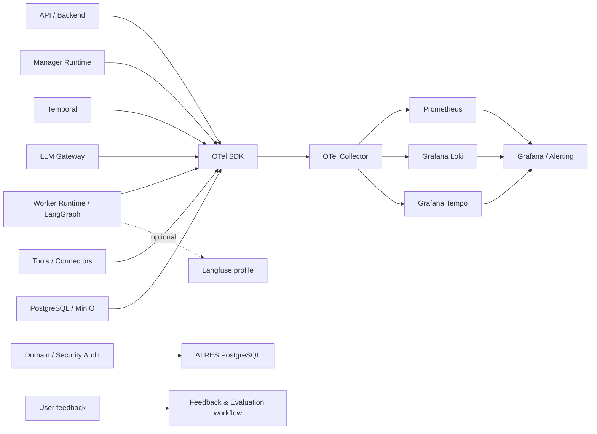

# AI RES — Архитектура наблюдаемости (Observability Architecture)

**Версия:** 1.2 | **Статус:** BASELINED — observability design; numeric SLO, retention and deployment sizing remain deployment gates

## 1. Назначение и границы
Определяет сбор, корреляцию, хранение и использование технических, workflow-, агентных, качественных и пользовательских сигналов AI RES. Observability не является источником истины доменных сущностей и не заменяет Audit Log. Потеря обычной telemetry не должна останавливать выполнение задач; критический доменный аудит сохраняется отдельно и надёжно.

## 2. Принципы
1. Сквозная видимость: API → Manager → Temporal → Worker/LangGraph → LLM Gateway → Tools/Connectors → Artifact.
2. Раздельные контуры: operational telemetry, agent/product quality, domain/security audit, user feedback.
3. OpenTelemetry (OTel) — единый стандарт инструментации и корреляции.
4. Минимально достаточная telemetry; у каждого сигнала есть цель, владелец, retention и действие.
5. Fail-open для logs/metrics/traces; fail-closed для доменного действия, если обязательная запись Audit Log не удалась.
6. По умолчанию не собирать секреты, полные prompts/responses, документы, source fragments и чувствительные данные.
7. Коррелировать события с версиями release, WorkerDefinition, model, prompt, tool, workflow, ruleset и Context Package.
8. Высококардинальные IDs хранить в logs/traces, но не в Prometheus labels.
9. Метрика — сигнал для расследования, а не доказательство первопричины.
10. Разделять техническую успешность выполнения и семантическое качество результата.

## 3. Логическая схема

Схема логическая; сервисы развёртываются в Docker Compose. Temporal Web UI — внутренний административный интерфейс, не пользовательская observability-панель.

## 4. Стек MVP и роли
| Компонент | Назначение | Статус |
|---|---|---|
| OpenTelemetry SDK | Instrumentation traces/metrics/logs | MVP |
| OTel Collector | Приём, enrichment, filtering, redaction, sampling, routing | MVP |
| Prometheus | Метрики | MVP |
| Grafana | Dashboards | MVP |
| Grafana Loki | Логи | MVP |
| Grafana Tempo | Traces | MVP |
| Alertmanager / Grafana Alerting | Маршрутизация alerts; выбрать один основной путь | MVP |
| AI RES PostgreSQL Audit Log | Доменный/безопасностный аудит | MVP, отдельно |
| Langfuse | LLM/agent traces, sessions, evaluations | Optional profile |
| Sentry | Исключения/stack traces | Возможное дополнение |
| PagerDuty/аналог | On-call escalation | После MVP |
| Evidently AI | Drift monitoring | После MVP |

Это сохраняет уже выбранный стек из Infrastructure v1.3 и уточняет его границы. ELK не добавлять параллельно без потребности в расширенном поиске журналов. SigNoz/Phoenix — альтернативы, а не дополнительные обязательные backend. Langfuse не заменяет OTel или Audit Log; content capture выключен по умолчанию.

## 5. Домены наблюдаемости
**Инфраструктура:** health/restarts, CPU, memory, disk, network, PostgreSQL connections/latency/locks, MinIO capacity/errors, Temporal availability, queues, schedule-to-start, Activity failures/retries, LLM Gateway/provider errors/latency/rate limits.

**Workflow:** Epic/Plan/Task/WorkerRun lifecycle, duration, queue wait, retries, timeout, cancellation, pause/resume, escalation, Readiness Gate, coordination types CONSULTATION / DELEGATED_SUBTASK / HANDOFF / INDEPENDENT_QA.

**Agent execution:** Manager planning/decomposition, WorkerRun, LangGraph nodes, context build/retrieval, LLM calls, tool calls, validation, result submission, fallback and recovery actions.

**Product & quality:** completion, accepted-for-orchestration, verification status, independent QA outcomes, rework, artifact validation, traceability coverage, pending approvals, feedback. Не сводить к единому score.

**Drift:** изменения языка/домена, tool usage, retrieval coverage, retry/fallback, latency, tokens/cost, quality. KS/KL/PSI/embedding similarity применять только при достаточной выборке и калибровке; примеры порогов из главы 10 не являются нормативами AI RES.

## 6. Корреляция и taxonomy
Использовать W3C Trace Context / OTel trace_id и span_id. Дополнительные атрибуты (где применимо и разрешено): request_id, organization_id, project_id, epic_id, plan_version_id, task_id, worker_run_id, temporal_workflow_id, context_package_version_id, source_version_id, artifact_version_id, worker_definition_version, prompt_version, model_provider/model_name, tool_name/version, ruleset_version, release_id.

Высококардинальные IDs запрещены в metric labels. Секреты и raw session identifiers не передавать в baggage.

Рекомендуемые spans: `ai_res.request`, `ai_res.manager.plan`, `ai_res.readiness_gate`, `ai_res.temporal.workflow`, `ai_res.worker.run`, `ai_res.langgraph.node`, `ai_res.context.build`, `ai_res.retrieval`, `ai_res.llm.call`, `ai_res.tool.call`, `ai_res.artifact.generate`, `ai_res.validation`, `ai_res.review`, `ai_res.approval`, `ai_res.feedback.capture`, `ai_res.recovery.action`.

## 7. Поток данных и деградация
1. SDK создаёт telemetry.
2. Collector выполняет фильтрацию, redaction, enrichment, sampling и routing.
3. Prometheus/Loki/Tempo хранят соответствующие сигналы.
4. Grafana связывает dashboards с logs/traces.
5. Alerting направляет actionable alerts ответственным.
6. Langfuse получает только явно разрешённые события при включённом profile.
7. Audit Log записывается доменными сервисами в PostgreSQL, независимо от Collector.

При недоступности telemetry backend экспорт не блокирует API/Workflow. Буферы и retries ограничены; потеря telemetry измеряется. При отказе обязательной записи Audit Log защищённое доменное действие не выполняется.

## 8. Безопасность, доступ и retention
Запрещено по умолчанию: passwords, reset tokens, cookies/session secrets, MFA seeds, recovery codes, API/OAuth tokens, private keys, connection strings, full prompts/responses, документы, source fragments, код, confidential payloads, unredacted tool arguments/results.

Разрешены с минимизацией: opaque IDs, bounded categories, durations, counts, status codes, versions, token counts, estimated cost. Content samples — только по отдельному opt-in с ACL, purpose, redaction, retention и audit.

Operational dashboards — operations/admin roles; detailed logs/traces — restricted support/SRE roles с project/tenant ACL; Langfuse — restricted; Audit Log — отдельные permissions; Temporal UI — internal admin only. Проверять отсутствие cross-project leakage в поиске, dashboards и агрегатах.

Retention отдельно для metrics, logs, traces, LLM traces, feedback и Audit Log. Конкретные сроки OPEN до sizing/privacy review. Учесть backup expiry, deletion и legal hold.

## 9. Dashboards и alerting
MVP dashboards:
1. Platform Overview — health, availability, errors, saturation, disk.
2. Temporal & Workflow — backlog, schedule-to-start, retries, stuck workflows.
3. Manager & Workers — run duration/outcomes, blockers, readiness, QA.
4. LLM & Tools — latency, tokens, cost estimate, errors, fallback, tool success.
5. Product Quality — completion, verification distribution, rework, approvals, feedback.
6. Telemetry Pipeline — Collector export errors/dropped signals/backend health.

Каждый alert содержит name, severity, scope, condition/window, owner, runbook, user impact, auto_action и silence policy. Alert должен быть actionable, дедуплицированным и устойчивым к flapping. Не выполнять автоматически approval, publication, permission changes, model/provider switch или deletion.

## 10. Связь с соседними подсистемами
Temporal — источник execution state; PostgreSQL domain model — источник business state; Audit Log — значимые доменные/security события; Evaluation Framework — формальные evaluation sets/results. Production traces являются кандидатами в evidence, но не ground truth. Feedback проходит review и не запускает обучение автоматически.

## 11. MVP и последующие расширения
**MVP:** OTel API→Manager→Temporal→Worker→LLM Gateway→Tools; Collector с redaction/bounded buffers; Prometheus/Grafana/Loki/Tempo; базовые dashboards/alerts; correlation IDs/version attrs; разделение Audit Log; retention/access policies; token/cost/latency/tool metrics.

**После MVP:** Langfuse profile, Sentry, PagerDuty, Evidently, advanced drift, shadow/canary comparison. Для single-node Compose MVP canary traffic splitting не является обязательным; использовать staged validation/shadow там, где безопасно.

## 12. Критерии приёмки
- Сквозной тестовый запрос прослеживается по компонентам.
- В default config отсутствуют secrets и raw content.
- High-cardinality IDs отсутствуют в metric labels.
- Есть dashboards инфраструктуры, workflow, agent, LLM/tools, telemetry pipeline.
- Критические alerts имеют owner и runbook.
- Backend telemetry outage не блокирует выполнение; loss bounded и измерим.
- Audit failure блокирует защищённое действие, если audit обязателен.
- Audit отделён от operational telemetry по ACL/retention.
- Temporal/domain state reconciled независимо от telemetry.
- Failure trace становится regression candidate только после sanitization/review.
- Langfuse отключается без нарушения core workflows.
- Retention задан отдельно для каждого signal class.

## 13. Открытые решения
Численные SLO/thresholds; retention и sizing; alert destinations/on-call; включение Langfuse; разрешение content capture; OTel exporter/instrumentation versions; Sentry; drift feature set/sample sizes; конкретный feedback scope.

## 14. Методологическая основа
Глава 10 обосновывает OTel, spans, dashboards/alerts, shadow/canary, regression traces, feedback, drift, RACI и lifecycle checklist. Точная топология, security boundaries, data model, MVP priority и acceptance criteria — проектная адаптация AI RES.

---

# Дополнение v1.1 — observability baseline clarification

Статус: BASELINED (design). Core stack: OpenTelemetry SDK/Collector, Prometheus, Grafana, Loki, Tempo, Alertmanager/Grafana Alerting; PostgreSQL audit is separate from telemetry. Langfuse remains optional profile; content capture disabled by default. Telemetry may fail-open with bounded buffers; protected mutation audit is durable/fail-closed. High-cardinality identifiers are trace/log attributes, not Prometheus labels. Retention and numeric SLOs are deployment policy decisions to be set after sizing/legal review; do not invent defaults as guarantees.

---

# Дополнение v1.2 — статус и нормативная карта

**Статус:** BASELINED — observability design. Numeric SLO/thresholds, retention periods, sizing and alert destinations are deployment-specific gates and are not asserted as measured guarantees.

MVP stack: OpenTelemetry SDK/Collector, Prometheus, Grafana, Loki, Tempo, Alertmanager/Grafana Alerting (один основной alert routing path выбирается в deployment profile), отдельный PostgreSQL Audit Log. Langfuse остаётся optional profile; content capture disabled by default. Operational telemetry fail-open with bounded buffers; protected mutation audit durable/fail-closed. High-cardinality IDs остаются в logs/traces, не в Prometheus labels.

**Актуальные нормативные зависимости:** `AI_RES_Document_Registry_v4.1.md`, `AI_RES_Infrastructure_Deployment_Operations_v1.7.md`, `AI_RES_Security_Controls_and_Requirements_v1.2.md`, `AI_RES_Agent_Observability_and_Evaluation_v1.2.md`, `AI_RES_Evaluation_and_Release_Gates_v1.0.md`, `AI_RES_Post_Implementation_Productization_Plan_v1.3.md`.

Runtime instrumentation, alert drills, retention/legal review, numerical SLO and capacity validation remain implementation/release gates.
