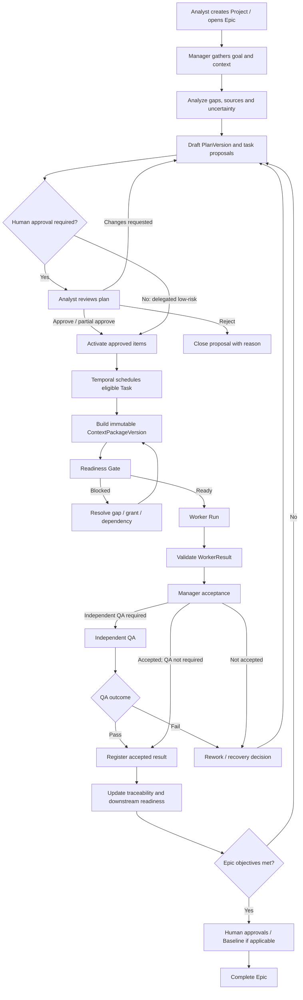
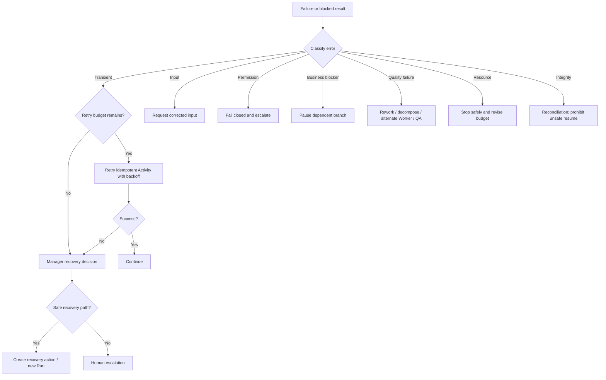
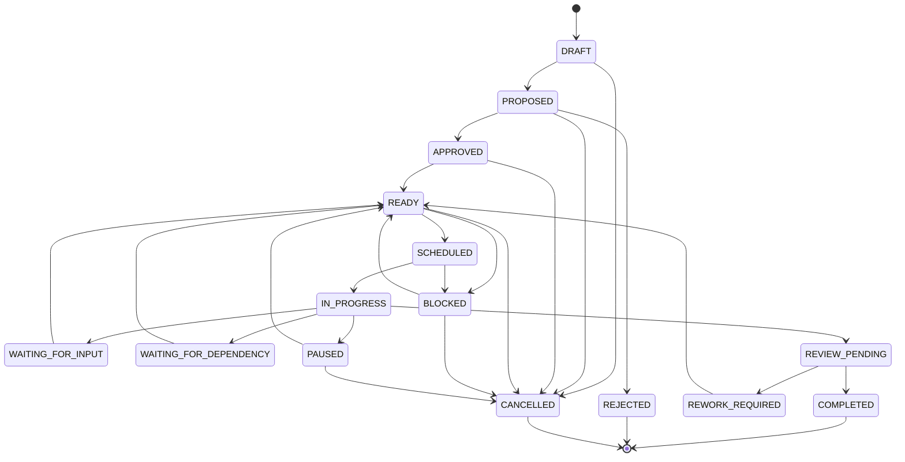
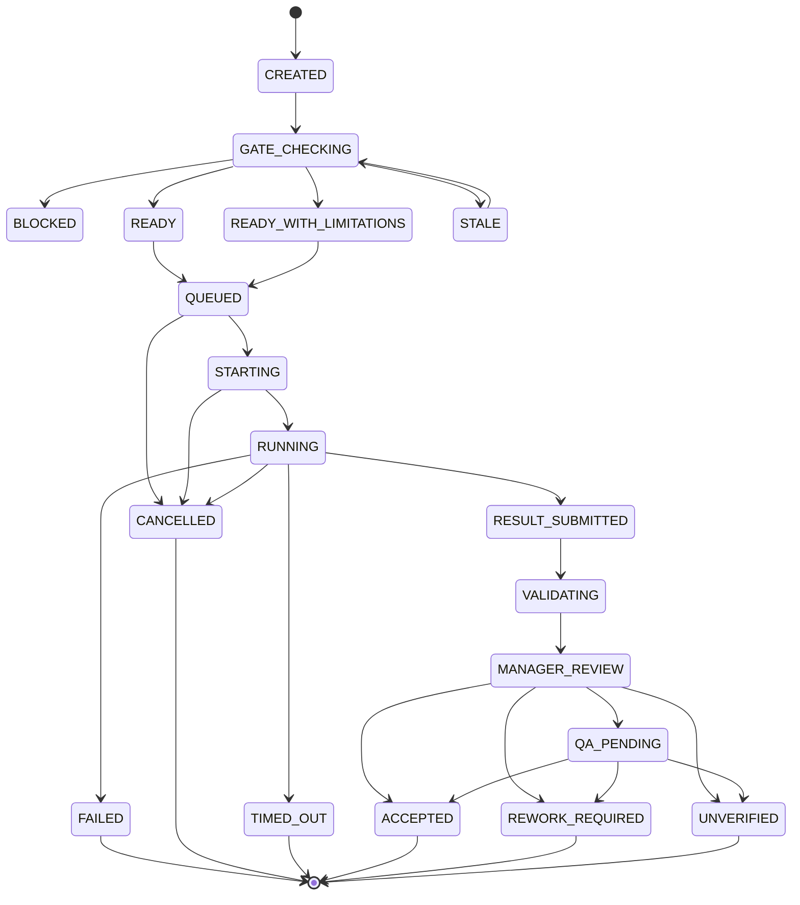
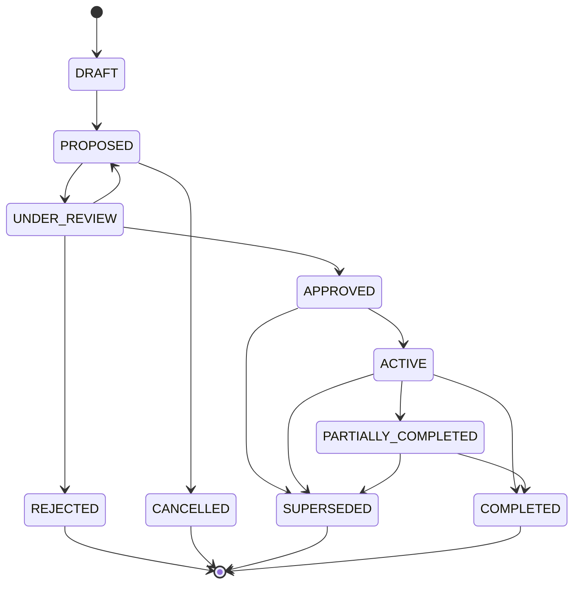
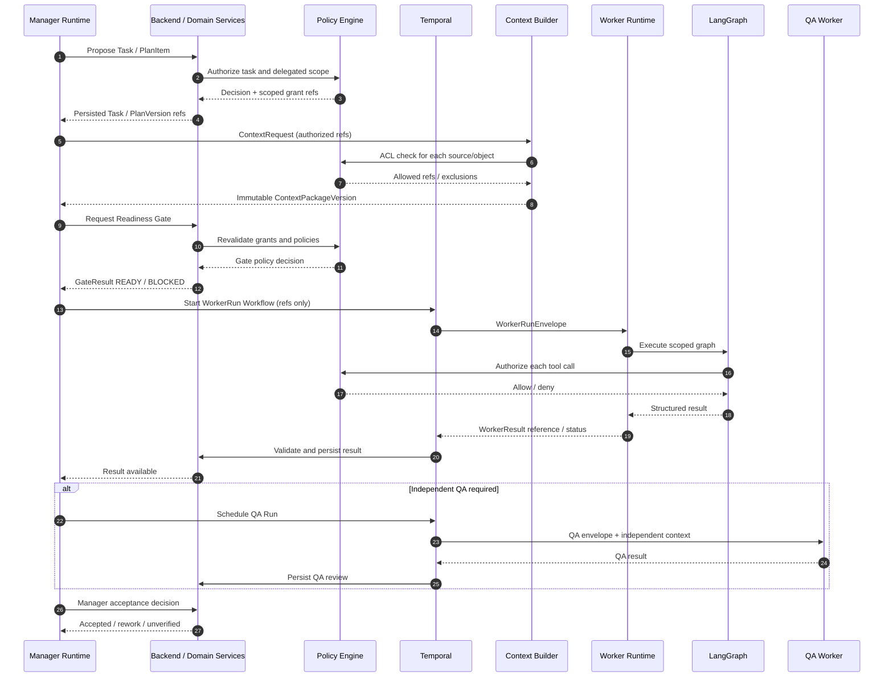
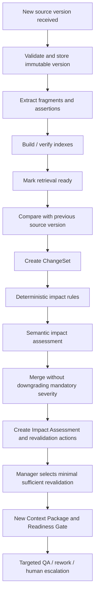
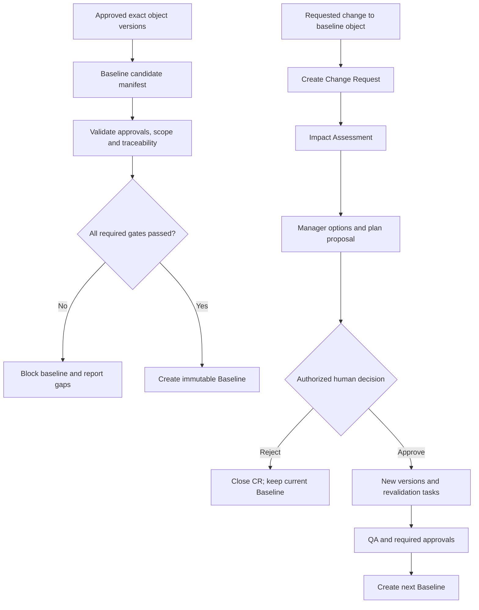

# AI RES — Детальное проектирование процессов и алгоритмов

**Версия:** 1.9  
**Дата:** 10.11.2026  
**Статус:** целевая спецификация процессов MVP; согласована с ранее утверждёнными архитектурными решениями.  
**Назначение:** определить исполнимые процессы, алгоритмы оркестрации, состояния, контрольные точки, восстановление и критерии приёмки AI RES.

---

## 1. Цель и границы

Документ переводит архитектуру AI RES в конкретные процессы и алгоритмы, пригодные для реализации и тестирования. AI RES — workspace полного цикла инженерии требований, а не чат-бот и не фиксированный конвейер агентов. Manager адаптивно выбирает направления и порядок работ, но действует в пределах доменной модели, правил, прав, зависимостей и контрольных точек.

### 1.1. Принципы

1. **Domain-first:** процессы изменяют доменные объекты через Domain/Application Services; чат и история LLM не являются источником истины.
2. **Manager plans, Workflow Engine executes:** Manager принимает содержательные решения; Temporal обеспечивает durable execution, timers, retries, waiting, cancellation и resumption.
3. **Readiness before every Run:** каждый Worker Run проходит Readiness Gate непосредственно перед запуском.
4. **Immutable execution context:** Worker Run привязан к неизменяемой версии Context Package, плана, правил и разрешений.
5. **Proposal is not approval:** предложение, регистрация извлечения, принятие результата Manager, человеческое утверждение требования и Baseline — разные действия.
6. **Least privilege:** Worker получает scoped grants для конкретного Run; права не наследуются от пользователя и не расширяются самим Worker.
7. **Evidence and provenance:** существенный вывод имеет ссылки на источник/фрагмент либо явно обозначается как inference, hypothesis, assumption или unknown.
8. **Minimum sufficient work:** при изменении данных повторно выполняется минимально достаточный набор проверок; полный rerun не является умолчанием.
9. **Human control:** значимые бизнес-решения, scope changes, утверждение требований, Baseline, расширение прав и необратимые внешние действия остаются под контролем человека.
10. **Recoverability:** каждый длительный процесс имеет timeout, retry, cancellation, resume и reconciliation semantics.
11. **No silent overwrite:** версии, результаты, решения и утверждённые артефакты не перезаписываются незаметно.
12. **Observable by design:** важные переходы имеют доменное событие, аудит и correlation IDs.

### 1.2. Границы

- Не хранить chain-of-thought и не требовать его раскрытия.
- Не вводить универсального агента с неограниченными полномочиями.
- Не запускать все аналитические направления по обязательному фиксированному pipeline.
- Не заменять Temporal логикой LangGraph и наоборот.
- Не вводить BPMN engine в MVP: Mermaid — документация, исполняемая логика — application services, Temporal и LangGraph.
- Числовые пороги качества/риска калибровать на Evaluation Sets, а не угадывать.

## 2. Модель исполнения и ответственность

| Участник | Ответственность | Ограничения |
|---|---|---|
| Analyst / Approver | Цель, контекст, значимые решения и утверждения в пределах роли | Не обходит system/org/project rules |
| Backend / Domain Services | Валидация команд, ACL, транзакции, lifecycle, audit, outbox | Не выполняет длительное рассуждение в HTTP request |
| Manager Runtime | Цель, план, декомпозиция, выбор Worker, оценка результата, эскалация | Не подменяет специализированных Workers, не утверждает бизнес-решения/Baseline, не меняет права |
| Temporal | Durable lifecycle, зависимости, timers, retries, ожидание, cancellation/resume | Не принимает семантические решения по требованиям |
| Worker Runtime + LangGraph | Специализированное выполнение в рамках WorkerRunEnvelope | Не пишет в доменные таблицы, не меняет global plan и permissions |
| Context Builder | Сбор immutable Context Package с provenance/ACL | Не принимает бизнес-решения и не расширяет доступ |
| Policy & Permission Engine | Проверка субъекта, действия, объекта, scope, срока и ограничений | Не доверяет тексту из источника/LLM как основанию прав |
| QA Worker | Независимая проверка по критериям и доказательствам | Не заменяет обязательное человеческое утверждение |
| Artifact/Traceability/Integration Services | Владение соответствующими доменными объектами | Не допускают обход ACL/сервисных границ |

### 2.1. Два уровня управления

- **Внешний durable workflow:** Epic/Plan/Task lifecycle, зависимости, ожидание человека, retries, cancellation/resumption — Temporal.
- **Внутренний reasoning graph:** шаги конкретного Manager/Worker, разрешённые tool calls, локальные проверки — LangGraph.

LangGraph Interrupt допустим для внутренней паузы Run. Долгое ожидание решения, влияющего на Epic/Task, оформляется доменной командой и Temporal Signal/Update.

## 3. Сквозная модель жизненного цикла

Упрощённая цепочка: `Project → Epic → Plan → PlanVersion → PlanItem → Task → WorkerRun → WorkerResult`. Requirements, Sources, Decisions, Assumptions, Risks, Artifacts, Reviews, Approvals, Baselines и Traceability Links связываются по смыслу, а не превращаются искусственно в дочерние Task. Один Task может иметь несколько Worker Runs; каждый Run привязан к конкретной версии контекста.

## 4. Процесс: создание проекта и первая работа с Manager

### Вход

Имя Project обязательно; описание/цель, Greenfield/Brownfield/Hybrid/UNKNOWN, участники и источники — по наличию. Источники можно добавить позже.

### Алгоритм

1. Backend валидирует команду, права и scope; создаёт Project в начальном состоянии.
2. Запись Project, Audit Event и Outbox Event фиксируются атомарно.
3. Аналитик открывает Manager Panel в контексте Project/Epic.
4. Manager читает разрешённые метаданные, правила, решения, неопределённости и источники.
5. Manager выявляет наиболее важный пробел и задаёт один основной вопрос за раз; не повторяет ответы, допускает UNKNOWN.
6. Manager разделяет факты, утверждения источника, выводы, гипотезы, предположения и открытые вопросы.
7. Предлагает цель/scope, Epic при необходимости, направления, draft plan, задачи, зависимости, ожидаемые результаты, критерии, риски и вопросы.
8. Предложение сохраняется как DRAFT/PROPOSED; Worker не запускается, пока нет approval либо явного делегирования соответствующего low-risk класса.
9. Человек подтверждает, редактирует, отклоняет или запрашивает уточнения.

Создание Project не требует полного технического брифа. Manager не создаёт фиктивные требования ради заполнения модели. UNKNOWN — допустимое состояние. Создание Epic/Plan/Task — отдельные доменные команды с аудитом.

## 5. Процесс: elicitation и регистрация требований

1. Manager формирует контекст диалога: Project/Epic, цель, известные ответы, gaps, ограничения, решения и релевантные версии источников.
2. Выбирает следующий вопрос по покрытию цели, риску, неопределённости и зависимостям.
3. Задаёт один основной вопрос простым языком и кратко объясняет его необходимость.
4. Ответ сохраняется как пользовательское утверждение с автором, временем и контекстом.
5. Elicitation/Requirements Workers выявляют потенциальные требования, ограничения, правила, акторов, события, исключения, критерии и открытые вопросы.
6. Для каждого кандидата формируются тип, формулировка, rationale, evidence refs, scope, ambiguity, assumptions и unresolved questions.
7. Candidate Requirement регистрируется предварительно; extraction/registration не равны бизнес-подтверждению.
8. Проверяются атомарность, однозначность, полнота, реализуемость и тестируемость.
9. Дубликаты/пересечения создают предложения MERGE/RELATES/DUPLICATES; исходные объекты не удаляются автоматически.
10. Конфликт источников регистрируется с обеими сторонами, authority metadata и вариантами разрешения.
11. Manager задаёт следующий вопрос или предлагает аналитическую проверку.
12. Уполномоченный человек подтверждает бизнес-содержание, когда это требует политика.

**Выходы:** Candidate/confirmed Requirement или RequirementVersion, SourceAssertion/DerivedFinding, evidence links, Decision/Assumption/Conflict/Unknown при необходимости, обновлённая coverage map и предложения задач.

## 6. Процесс: планирование и перепланирование

### 6.1. Структура

- `Plan` — стабильная идентичность плана Epic.
- `PlanVersion` — immutable snapshot цели/scope, items, dependencies, outputs, acceptance criteria, assumptions, risks и rationale.
- `PlanItem` — ссылка на существующий Task, предложение Task, checkpoint или research direction.
- `Task` — самостоятельная доменная единица работы.
- `WorkerRun` — конкретное исполнение Task.

### 6.2. Алгоритм Manager

1. Получить цель/scope Epic.
2. Получить Requirements, Sources/Versions, Decisions, Assumptions, Risks, Issues, Conflicts, Artifacts, Traceability и открытые Tasks.
3. Определить outcomes и критерии завершения Epic.
4. Выбрать релевантные work directions; не запускать все направления по умолчанию.
5. Декомпозировать их в tasks/checkpoints/research items.
6. Для каждого PlanItem определить rationale, inputs, expected output, acceptance, dependencies, risk, required capability, permissions/tools, human gate и evidence needs.
7. Построить dependency graph; проверить циклы, недостижимые узлы и отсутствующие predecessors.
8. Выбрать sequential, parallel/fan-out/fan-in, iterative или human-in-the-loop.
9. Проверить безопасный параллелизм: независимые inputs/outputs, отсутствие конфликтующих writes, resource limits.
10. Создать новую PlanVersion.
11. Показать rationale и diff относительно предыдущей версии.
12. Получить approval согласно делегированию и значимости изменения.

### 6.3. Перепланирование

Триггеры: новая/изменившаяся информация, конфликт, блокировка, QA failure, изменение требований/scope/приоритета/ограничений, недоступность зависимости, critical source change.

1. Зарегистрировать trigger/evidence.
2. Найти затронутые PlanItems/Tasks по deterministic dependencies.
3. Выполнить semantic impact assessment; он не может понизить обязательную deterministic severity.
4. Сохранить результаты незатронутых ветвей.
5. Выбрать минимум: continue/pause/cancel/rework/new task/new PlanVersion.
6. Независимые задачи продолжаются, если это безопасно.
7. Значимое изменение цели/scope требует human review/approval.
8. Создать новую PlanVersion с diff/rationale; старую не переписывать.
9. Для затронутых Run собрать новый ContextPackageVersion и повторить Readiness Gate.

Approval PlanVersion не равен approval Requirement/Artifact/Baseline. Partial approval допустим только для независимых PlanItems. Зависимая задача не запускается до завершения обязательных predecessors.

## 7. Readiness Gate — обязательный перед каждым Worker Run

### 7.1. Проверки

| Область | Условие допуска |
|---|---|
| Task/goal | Task существует, активна, цель/scope ясны для порученной работы |
| Plan | Есть применимая PlanVersion; PlanItem одобрен или делегирован |
| Context | ContextPackageVersion собран, immutable, правильного scope |
| Sources | Версии/provenance зафиксированы; ACL соблюдён |
| Completeness | Нет blocking gaps/contradictions для этой задачи |
| Dependencies | Обязательные predecessors завершены в допустимом состоянии |
| Worker fit | WorkerDefinition имеет нужную компетенцию и поддерживает schema |
| Tools | Инструменты доступны и разрешены для этого Run |
| Permissions | Scoped grants выданы Policy Engine, актуальны и не отозваны |
| Output | Заданы schema, expected output и acceptance criteria |
| Risk | Определены risk и verification mode; mandatory QA запланирована |
| Budget | Установлены лимиты стоимости, токенов, времени и попыток |
| Compatibility | Совместимы Worker contract, rules, model profile и runtime |

### 7.2. Результат

`READY`, `BLOCKED`, `READY_WITH_LIMITATIONS`.

- `BLOCKED`: Run не запускается; создаётся Blocker/Information Gap с владельцем и следующим действием.
- `READY_WITH_LIMITATIONS`: допустим только при неblocking ограничениях и разрешении policy; ограничения входят в Envelope и раскрываются в результате.
- `READY`: запуск разрешён.

Gate сохраняет версии/refs, результат каждого check, причины, время и rules version. Изменение существенного входа инвалидирует Gate.

### 7.3. Race protection

Непосредственно перед стартом Activity повторно проверяет grants/revocation, Task/Plan state, cancellation и critical refs. При устаревании Gate становится `STALE`, Run не стартует, проверки выполняются заново. Используются уникальный `worker_run_id` и idempotency key.

## 8. Worker Run и контролируемый handoff

### 8.1. WorkerRunEnvelope

Содержит `worker_run_id`, `task_id`, `epic_id`, `project_id`, `plan_version_id`, `plan_item_id`, `context_package_version_id`, `worker_definition_id`, input refs, explicit instructions, output schema/version, acceptance criteria, scoped tool grant refs, model profile/routing policy refs, budget/deadline/retry policy, verification mode и correlation/causation/trace IDs. Полные документы, секреты и длинные prompts в Temporal payload не помещаются — только ссылки и компактные параметры.

### 8.2. Алгоритм Worker

1. Runtime валидирует Envelope/schema.
2. Проверяет Run state, grants, context и contract version.
3. Создаёт/восстанавливает LangGraph thread, scoped к WorkerRun.
4. Выполняет специализированный graph.
5. Каждый tool call проходит Tool Gateway/Policy authorization с конкретным grant и resource.
6. Side effects выполняются через разрешённые Activities/Connector Platform; операции идемпотентны или имеют reconciliation.
7. Worker фиксирует evidence/provenance и различает facts, source assertions, inferences, assumptions, hypotheses и unknowns.
8. При нехватке данных возвращает WorkerNotice: clarification/blocker/risk/conflict/missing evidence/handoff proposal.
9. Не назначает другого исполнителя, не меняет global plan и не расширяет permissions.
10. Возвращает schema-valid WorkerResult либо typed error/notice.
11. Trusted platform service валидирует и сохраняет immutable WorkerResult; Worker не пишет напрямую в domain DB и не получает private state другого Worker.
12. Результаты публикуются в логическом Blackboard через доменные сервисы и доступны другим участникам только через ACL-checked queries/Context Builder.
13. Manager решает дальнейшую маршрутизацию.

### 8.3. Handoff

Неограниченный peer-to-peer запуск запрещён. Worker предлагает reason, target capability, input refs, expected output, dependency и rationale. Manager проверяет необходимость и роль; Policy Engine — grants; Workflow Engine создаёт дочернюю/следующую Task или Run. Новый Run проходит собственный Readiness Gate. Исходный Run остаётся waiting либо возвращает partial result с явной зависимостью. Для MVP handoff всегда проходит через Manager/Temporal.

## 9. Проверка результата и Manager acceptance

Не смешивать четыре уровня:
1. Worker self-check;
2. Independent QA Review;
3. Manager orchestration acceptance;
4. Human approval.

### Алгоритм

1. Валидировать schema, обязательные поля, версии и refs.
2. Проверить evidence существенных выводов; неподтверждённое пометить явно.
3. Проверить acceptance criteria, ограничения, вопросы, dependencies и tool/permission compliance.
4. Сверить с актуальными доменными версиями и контекстом.
5. Выбрать verification mode: `STANDARD` (Manager), `ELEVATED` (Manager + targeted QA), `CRITICAL` (independent QA mandatory), `HUMAN` (formal approval required).
6. Независимый QA получает достаточный отдельный context/permission scope и выполняет собственную проверку.
7. QA возвращает PASS/FAIL/NEEDS_CLARIFICATION/UNABLE_TO_VERIFY с evidence.
8. При материальном disagreement результат не считается полностью verified; сохраняются обе позиции, выполняется дополнительная проверка или эскалация.
9. Manager принимает результат для orchestration, запрашивает rework либо эскалирует.
10. Результат/reviews неизменяемы; доработка создаёт новый Run/Result.

Независимая QA обязательна для high/critical risk, security/privacy/compliance/legal, критической архитектуры/интеграции, material source conflict, weak evidence, высокой значимой неопределённости и случаев, заданных policy. Если QA недоступна — не имитировать проверку: оставить unverified/blocked либо эскалировать.

## 10. Ingestion источников и изменение знаний

### 10.1. Два конвейера

**Knowledge Update:** upload/source sync → validation → SourceVersion → extraction → normalization → fragments/assertions → indexing → retrieval readiness.

**Project Change Assessment:** сравнение SourceVersion → ChangeSet → deterministic impact rules → semantic assessment → affected objects → revalidation actions.

Успешная индексация не означает повторную проверку проектных решений.

### 10.2. Ingestion

1. Создать UploadIntent/Connector Sync Job.
2. Проверить ACL, размер, MIME/type, checksum, malware policy и source allowlist.
3. Сохранить immutable object в MinIO и SourceVersion metadata в PostgreSQL.
4. Извлечь текст/структуру в ограниченном processing job.
5. Создать SourceFragments с locator, SourceAssertions и ExtractionRecords.
6. Зафиксировать parser/extractor/config versions и provenance.
7. Построить full-text/semantic indexes как производные данные.
8. Проверить completeness/index status; пометить версию доступной для retrieval.
9. Опубликовать `source.version_available`.
10. Для обновлённого связанного источника инициировать Change Assessment.

Повторная обработка идемпотентна по source_version + extractor/config version. Новая версия parser/config создаёт новый ExtractionRecord, не переписывает старый.

### 10.3. Change Assessment

1. Сравнить SourceVersions по fragments/structure.
2. Создать ChangeSet (added/removed/changed fragments).
3. Выполнить deterministic impact rules: direct links, formal dependencies, Baseline, critical object types.
4. Manager/Workers оценивают semantic/indirect impacts.
5. Semantic assessment не понижает обязательную deterministic severity.
6. Зафиксировать Impact Assessment и Revalidation Actions.
7. Critical change требует QA reassessment, но не автоматически полный rerun исходного Worker.
8. Выбрать минимально достаточные revalidation tasks и новый ContextPackageVersion.
9. Не изменять утверждённые Requirement/Baseline автоматически.

Использовать утверждённую в Traceability спецификации шкалу I0–I4 для impact class. Не смешивать её с вероятностью риска или confidence.

## 11. Генерация, изменение и публикация артефактов

1. Manager предлагает артефакт на основании целей, scope, аудитории, требований, рисков и уже существующих документов.
2. Artifact Proposal содержит type, purpose, owner, source-of-truth mode, input version refs, template и acceptance criteria.
3. Proposal подтверждается человеком, если не входит в явно делегированный low-risk класс.
4. Artifact Service создаёт GenerationJob с exact input refs.
5. Worker генерирует typed content/native spec; для OpenAPI/JSON Schema/diagram-as-code сохраняется исходная спецификация и render.
6. Создаётся новая immutable ArtifactVersion; ручные правки не перезаписываются.
7. Type-specific validators проверяют структуру, ссылки, синтаксис и consistency.
8. При ошибке статус Validation Failed; новая попытка создаёт исправленную версию/результат по правилам, не маскирует ошибку.
9. Review/QA выполняется по типу и риску.
10. Human Approval — отдельный шаг по policy.
11. Publication — отдельная операция; Approval не означает автоматическую публикацию.
12. Baseline содержит точные версии.
13. Изменение зависимого объекта инициирует Impact Analysis и оценку свежести артефакта.

## 12. Change Request и Baseline

Baseline — immutable snapshot конкретных утверждённых версий в заданном scope: scope, included object/version refs, approvals, traceability snapshot/version, approver, rationale, timestamps и checksum/manifest. Нельзя включать неподтверждённую версию только потому, что она current.

Change Request:
1. Зарегистрировать изменение утверждённого объекта, инициатора, rationale и затронутую Baseline/scope.
2. Выполнить Impact Analysis для requirements/tasks/artifacts/tests/approvals/dependencies.
3. Manager предлагает options, consequences, risks и plan.
4. Уполномоченный человек принимает решение по CR.
5. При одобрении создаются новые версии и revalidation/rework tasks.
6. Повторяются QA и необходимые approvals.
7. Создаётся новая Baseline; старая сохраняется.
8. При отказе CR закрывается с причиной; текущая Baseline остаётся активной.

## 13. Ошибки, retry, recovery, pause и cancellation

### 13.1. Классы ошибок

| Класс | Примеры | Поведение |
|---|---|---|
| `TRANSIENT` | network timeout, rate limit, temporary provider outage | bounded retry, exponential backoff + jitter |
| `PERMANENT_INPUT` | invalid schema, unsupported type, missing mandatory input | не retry без изменения input |
| `PERMISSION` | ACL denied, grant revoked, scope mismatch | fail closed, не retry автоматически |
| `BUSINESS_BLOCKER` | conflict, missing decision/dependency/data | pause dependent branch, resolve blocker |
| `QUALITY_FAILURE` | QA/acceptance failure | rework, decomposition, alternate Worker, escalation |
| `RESOURCE` | budget/time/memory limit | safe stop, Manager revises budget/scope |
| `INTEGRITY` | DB/object store/Temporal/domain mismatch | reconciliation; resume prohibited until resolved |
| `CANCELLED` | authorized cancellation | cooperative cancel, record effects/compensation |

### 13.2. Retry rules

- Retry только классифицированные transient failures и разрешённые Activities.
- Ограничить attempts, elapsed time и total cost.
- Exponential backoff + jitter; параметры — конфигурация по типу Activity.
- Не retry permanent input/permission/business errors без изменения условий.
- Сначала provider-level retries в LLM Gateway, затем bounded Activity/Workflow recovery; не перезапускать весь Run при каждом сетевом сбое.
- Повтор содержательной задачи создаёт новый WorkerRun с `retry_of_worker_run_id` и reason; старый результат сохраняется.
- External side effects используют idempotency key и reconciliation; exactly-once не предполагается.

### 13.3. Pause/cancel/resume

- Pause блокирует новые Runs; текущие Activities завершаются или отменяются по safe policy.
- Cancel требует ACL и фиксации инициатора/причины/последствий.
- Resume — не слепое продолжение checkpoint: проверяются контекст, grants, dependencies, plan version и внешние side effects.
- После восстановления инфраструктуры выполняется reconciliation Temporal ↔ domain ↔ object store.
- Run с отозванным grant или устаревшим Context Package не возобновляется без нового Gate.

## 14. Состояния и переходы

### 14.1. Task

Основной путь: `DRAFT → PROPOSED → APPROVED/READY → SCHEDULED → IN_PROGRESS → REVIEW_PENDING → COMPLETED`.

Допустимые состояния/переходы: `BLOCKED`, `WAITING_FOR_INPUT`, `WAITING_FOR_DEPENDENCY`, `PAUSED`, `REWORK_REQUIRED`, `REJECTED`, `CANCELLED`. `COMPLETED` означает выполнение критериев Task и orchestration acceptance, а не автоматическое утверждение бизнес-требования.

### 14.2. WorkerRun

`CREATED → GATE_CHECKING → BLOCKED | READY → QUEUED → STARTING → RUNNING → RESULT_SUBMITTED → VALIDATING → MANAGER_REVIEW → QA_PENDING (if required) → ACCEPTED | REWORK_REQUIRED | REJECTED | UNVERIFIED`.

Terminal/interruption states: `FAILED`, `CANCELLED`, `TIMED_OUT`, `ABANDONED` (только после reconciliation). Переходы реализуются явными state transitions, не произвольным PATCH.

### 14.3. Operation

`ACCEPTED → QUEUED → RUNNING → WAITING_FOR_HUMAN | WAITING_FOR_DEPENDENCY | RETRYING | CANCEL_REQUESTED → SUCCEEDED | PARTIALLY_SUCCEEDED | FAILED | CANCELLED`.

`WAITING_FOR_HUMAN`, `WAITING_FOR_DEPENDENCY`, `RETRYING` и `CANCEL_REQUESTED` — нетерминальные состояния. `SUCCEEDED`, `PARTIALLY_SUCCEEDED`, `FAILED`, `CANCELLED` — терминальные. Допустимые переходы и повторные входы должны быть реализованы как явная state machine; `CANCEL_REQUESTED` не означает, что отмена уже завершена. Набор синхронизирован с API Contracts v1.3 и Public API v1.1.

Operation — UI/API-проекция долгой команды, не замена Task/WorkerRun/Temporal Workflow.

### 14.4. PlanVersion

`DRAFT → PROPOSED → UNDER_REVIEW → APPROVED → ACTIVE → PARTIALLY_COMPLETED → COMPLETED`; альтернативы: `SUPERSEDED`, `REJECTED`, `CANCELLED`. Snapshot immutable; lifecycle state хранится отдельно. Partial approval только для независимых items и фиксирует approved set.

### 14.5. Artifact

Сохранить ранее утверждённый lifecycle: `DRAFT`, `GENERATING`, `VALIDATION_FAILED`, `READY_FOR_REVIEW`, `IN_REVIEW`, `CHANGES_REQUESTED`, `APPROVED`, `PUBLISHED`, `SUPERSEDED`, `REJECTED`, `ARCHIVED`. Validation, Review, Approval и Publication — отдельные записи/состояния.

## 15. Параллелизм и выбор топологии

| Паттерн | Использование | Ограничения |
|---|---|---|
| Sequential | строгие зависимости | не параллелить искусственно |
| Parallel / fan-out-fan-in | независимые исследования/проверки | concurrency limits, отдельные outputs, join criteria |
| Planner–Executor | сложная работа с планом и исполнением | план проверяется, не безусловен |
| Iterative / Evaluator–Optimizer | улучшение по явным критериям | max iterations/budget; stop on plateau/limit |
| Human-in-the-loop | бизнес-решение, критический риск, недостаточная определённость | durable wait и ясный объект решения |
| Handoff | нужна другая специализация | только через Manager и новый Gate |
| Deep research / decomposition | широкий вопрос и несколько источников | provenance, depth/budget limits, synthesis QA |

Параллелить только независимые задачи. Fan-in должен иметь критерии полноты: all-required branches, допустимые partial results или явно заданный quorum. Group chat не является базовой топологией MVP. Для iterative loop обязательны stop conditions: success, max iterations, budget, time, no improvement, unresolved disagreement.

## 16. Контекст и память в процессах

Context Builder получает декларативный ContextRequest от Manager: goal/scope/acceptance, релевантные доменные версии, source fragments с provenance/ACL, approved decisions/rules/constraints, нужную историю, разрешённые tools/grants, exclusions/limitations и token/budget limits.

Retrieval гибридный: deterministic metadata/ACL filtering + full-text + semantic retrieval; graph/traceability expansion используется для кандидатов и связей, но не как source of truth. Далее reranking/selection и context budget policy. Каждый фрагмент имеет source/version/locator. ContextPackageVersion immutable и содержит builder/indexer/model/config versions.

Обновление источника не мутирует старый Context Package. Новый Run получает новую версию. Документ не может переопределить system/org/project rules или выдать новые права.

## 17. Алгоритм выбора следующего действия Manager

1. Загрузить canonical state и связанные доменные события.
2. Проверить authorization, rules и актуальность версий.
3. Классифицировать событие: progress, result, blocker, source change, conflict, QA, human decision, failure, cancellation.
4. Определить затронутые объекты/ветви по deterministic dependencies/traceability.
5. Обновить карту goal, gaps, risks, dependencies и acceptance coverage.
6. Сформировать допустимые варианты следующего действия.
7. Отфильтровать нарушающие policy, lifecycle, approvals, budget или dependencies.
8. Выбрать минимально достаточное действие: continue, ask, research, replan, run Worker, QA, wait, pause, escalate, complete.
9. Объяснить значимое решение и основание (без chain-of-thought).
10. Создать доменную команду/PlanVersion/Task proposal или передать действие Workflow Engine.
11. Записать audit/domain event.

Manager не перепланирует весь Epic при каждом telemetry event. Обрабатываются значимые доменные события; технический шум остаётся в observability stack.

## 18. Безопасность процессов

- Source и tool outputs — недоверенные данные; prompt injection не меняет rules, permissions или authority.
- Каждый tool call проверяется по subject, worker_run, project, grant, operation, resource, expiry и budget.
- Approval требует identity уполномоченного человека; Manager/Worker service identity не может impersonate approver.
- Необратимые внешние действия в MVP запрещены или требуют explicit human confirmation; connectors MVP read-only.
- При недоступности Policy Engine critical write fail-closed.
- ACL применяется к search, graph traversal, fragments, events, exports и telemetry.
- Обязательны лимиты decomposition depth, parallel Runs, retries, tool calls, tokens, duration и cost.
- Не логировать chain-of-thought, secrets или полный чувствительный контент по умолчанию.

## 19. Доменные события процессов

Минимальные типы:

- `project.created`, `epic.created`, `epic.goal_updated`;
- `manager.interaction_received`, `manager.question_proposed`;
- `plan.version_proposed`, `plan.version_approved`, `plan.version_rejected`, `plan.replanned`;
- `task.created`, `task.blocked`, `task.ready`, `task.started`, `task.completed`, `task.cancelled`;
- `readiness_gate.completed`, `readiness_gate.blocked`, `readiness_gate.stale`;
- `worker_run.created`, `worker_run.started`, `worker_run.result_submitted`, `worker_run.accepted`, `worker_run.rework_required`, `worker_run.failed`, `worker_run.cancelled`;
- `qa.review_requested`, `qa.review_completed`;
- `source.version_available`, `source.change_detected`;
- `impact.assessment_completed`, `impact.revalidation_required`;
- `artifact.version_created`, `artifact.validation_completed`, `artifact.approved`, `artifact.published`;
- `change_request.created`, `change_request.approved`, `baseline.created`;
- `operation.waiting_for_human`, `operation.resumed`, `operation.failed`.

Событие описывает факт, не команду. Payload содержит typed refs и минимально нужные данные, не секреты и не полные документы. Полный каталог синхронизируется с AsyncAPI.

## 20. UX процессов

- Показывать цель, план, текущий этап, последнее подтверждённое событие и следующее ожидаемое действие.
- Не показывать фиктивные проценты/ETA без фактической оценки.
- Manager задаёт один основной вопрос за раз и объясняет его необходимость.
- Plan proposal показывает rationale, dependencies, outputs, acceptance, risks и open questions.
- Доступные действия: approve all / approve independent subset / request changes / reject / defer.
- Worker result: сначала summary/status/next action; evidence, limitations, QA, versions — по раскрытию.
- Blocked state содержит причину, владельца и конкретный способ разблокировки.
- Replan показывает diff PlanVersions и что продолжится/остановится.
- Human approval — отдельный объект решения с последствиями и exact versions.
- Pause/cancel показывают последствия без технических деталей Temporal.

## 21. Проверка процессов и критерии приёмки

### 21.1. Evaluation Set

Для каждого процесса нужны сценарии: happy path; неполный/противоречивый контекст; UNKNOWN; конфликт источников с разной authority; duplicate/replayed event; stale version/concurrent update; revoked permission; timeout/provider outage; QA disagreement; cancellation/resume; source change после Run; partial failure DB/MinIO/Temporal/Connector; prompt injection в Source/tool output.

Каждый пример содержит input/context refs, обязательные действия/запреты, acceptance criteria, risk tier, expected evidence и grading rubric. Golden set versioned; изменения проходят review.

### 21.2. Метрики

| Направление | Метрика |
|---|---|
| Планирование | goal/acceptance coverage, unnecessary/missed tasks, dependency graph validity |
| Readiness | false-ready rate (критическая), false-blocked rate, blocker explanation completeness |
| Worker | acceptance/rework rate, evidence coverage, schema validity, tool policy violations |
| QA | defect detection, disagreement resolution, unverified critical result count |
| Impact | precision/recall на размеченном impact set, missed critical impacts |
| Retrieval | recall@k, precision@k, provenance completeness, context budget compliance |
| Orchestration | time to start, blocked duration, retry exhaustion, cancellation latency, duplicate side effects |
| Product flow | cycle time, unresolved blockers, analyst clarification burden, human override rate |
| Reliability | workflow completion, recovery success, reconciliation incidents |

Не заменять evidence quality, risk, uncertainty и impact единым confidence score.

### 21.3. Deployment gates

- Unit/contract/integration/E2E проходят.
- Нет необъяснённых критических false-ready Readiness Gate.
- Нет несанкционированных tool calls, approvals или permission changes.
- Critical/high-risk outputs имеют независимую QA или human gate.
- Temporal replay/retry/cancel/resume tests проходят.
- Source update/Impact Analysis покрывает critical change.
- Нет утечек secrets/prompts/source в logs/events/traces.
- Evaluation Set regression не ухудшает утверждённые thresholds.
- Повышение автономности требует shadow/pilot, limited rollout, monitoring и rollback.

## 22. Реализационная декомпозиция для Claude Code

1. Process primitives: typed states/transitions, Operation, correlation, audit, outbox, idempotency.
2. Project/Epic initiation: creation, Manager interaction, first proposal, human approval.
3. Plan & Task: immutable PlanVersion, dependency validation, review/partial approval.
4. Readiness Gate: deterministic checks, GateResult, stale invalidation.
5. Worker Run: Envelope validation, Temporal scheduling, LangGraph thread scope, result persistence.
6. Manager acceptance & QA: verification modes, independent QA, rework/new Run.
7. Source ingestion & change: immutable SourceVersion, extraction/index, ChangeSet/Impact.
8. Artifact lifecycle: generation, validation, review, approval, publication, exact-version Baseline.
9. Recovery: bounded retries, pause/cancel/resume, reconciliation.
10. Evaluation & rollout: golden sets, regression, shadow/pilot, dashboards and gates.

Каждый increment включает migrations, contract tests, process tests, security tests, observability, docs and changelog.

## 23. Методологическая основа и адаптация AI RES

**Из конспектов книги:**
- Глава 2: узкий сценарий, выбор архитектуры/моделей по задаче, инструменты, память, оркестрация, стоимость, качество и итеративная оценка.
- Глава 5: различение reasoning и orchestration; Planner–Executor, decomposition, ReAct/tool selection, context engineering, Supervisor/Workers, handoff, Evaluator–Optimizer и HITL по контексту.
- Глава 6: разделение контекста и долговременной памяти, retrieval/write pipelines, provenance, гибридный поиск, отделение памяти от обучения.
- Глава 9: Evaluation Sets, компонентные и end-to-end проверки, deployment gates и регрессии.
- Глава 10: мониторинг как обратная связь, workflow/quality/user metrics, безопасная телеметрия, shadow/canary и цикл улучшения.

**Адаптация AI RES:** Manager–Workers, Temporal durable workflow, LangGraph reasoning graph, Readiness Gate, immutable Context Package, typed results, policy-controlled handoff, independent QA и approval boundaries — решения архитектуры AI RES, а не утверждение, что книга предписывает именно такую реализацию.

## 24. Открытые параметры реализации

Точные retry/concurrency/token/cost/time limits; risk/quality thresholds; полная role/approval matrix; конкретные Temporal Workflow/Activity names/version markers; полный event payload catalogue; retrieval/reranking/embedding choices; parser/extractor/malware toolchain; partial approval UX; финальные enums после согласования с кодовой моделью; Bifrost provider routing/fallback profiles. Эти параметры определяются конфигурацией/ADR и тестами, не скрытыми константами.

## 25. Связанные документы

- `AI_RES_Agent_Architecture_Concept_v3.9.md`
- `AI_RES_Domain_Model_and_Data_Architecture_v1.2.md`
- `AI_RES_API_and_Interaction_Contracts_v1.2.md`
- `AI_RES_Public_API_v1.0.yaml`
- `AI_RES_Domain_Events_AsyncAPI_v1.2.yaml`
- `AI_RES_Worker_Contracts_v1.1.schema.json`
- `AI_RES_Requirements_Lifecycle_v2.5.md`
- `AI_RES_MVP_Capability_Matrix_v2.6.md`
- `AI_RES_UX_Concept_v1.1.md`
- `AI_RES_Infrastructure_Deployment_Operations_v1.1.md`
- `AI_RES_Claude_Code_Implementation_Spec_v1.2.md`

## 26. Диаграммы состояний и взаимодействий

### 26.1. Task state machine

State transition service проверяет допустимость перехода, actor authority, preconditions и audit. Таблица иллюстрирует логическую модель; окончательные backend enums должны быть единообразны с доменной моделью и миграциями.

### 26.2. WorkerRun state machine

`REWORK_REQUIRED` не возвращает тот же Run в RUNNING: создаётся новый WorkerRun с `retry_of_worker_run_id` и актуальным ContextPackageVersion. `UNVERIFIED` не считается принятым результатом для downstream critical decisions.

### 26.3. PlanVersion state machine

Содержимое PlanVersion immutable после создания; lifecycle state и approved item set фиксируются отдельно. Новый scope или существенный replan создаёт новую PlanVersion.

### 26.4. Worker Run sequence

### 26.5. Source update and impact assessment

### 26.6. Baseline and Change Request

---

# Дополнение v1.1. Сверка модели Manager–Workers

## 1. Worker-to-Worker: три разных сценария

Ранее согласованный вариант B (контролируемое взаимодействие Workers)
сохраняется. Запрет прямого вызова Runtime не запрещает логическую
коммуникацию между специализациями. Для MVP вводятся три основных типа
Worker Coordination Request:

| Тип | Назначение | Кто продолжает исходную работу |
|---|---|---|
| `CONSULTATION` | Ограниченный запрос экспертной информации/уточнения | Исходный Worker после получения ответа |
| `DELEGATED_SUBTASK` | Отдельная подзадача с собственными критериями | Исходный Worker/Task после результата подзадачи |
| `HANDOFF` | Передача дальнейшего исполнения или ограниченной части работы | По явному решению Manager |

Independent QA оформляется отдельным `Review` и отдельным WorkerRun
с `runPurpose=INDEPENDENT_QA`, а не обычным handoff.

Поток:
1. Worker создаёт `WorkerCoordinationRequest`/WorkerNotice с типом,
   причиной, целевой компетенцией, input refs, expected output и
   rationale.
2. Запрос сохраняется и становится видимым Manager.
3. Manager решает: reject, request clarification, approve consultation,
   create delegated Task, approve handoff или назначить QA.
4. Policy Engine независимо проверяет grants и доступность каждого
   передаваемого объекта.
5. Temporal исполняет разрешённый новый WorkerRun.
6. Новый Run получает собственный ContextPackageVersion, grant scope,
   output schema и Readiness Gate.
7. Результат возвращается через доменную платформу; исходный Worker
   получает только разрешённый результат/refs.
8. Все запросы, решения, Runs и связи фиксируются в audit/traceability.

Ни один Worker не вызывает другой Runtime напрямую, не читает его
checkpoint/private state и не получает автоматически его grants/secrets.

## 2. Worker-local decomposition

Worker вправе разбивать работу на внутренние шаги LangGraph в пределах
назначенной задачи и её acceptance criteria. Создание доменной Task,
подзадачи, нового WorkerRun, изменение scope, budget, dependencies или
назначения — только через предложение и решение Manager. Это сохраняет
способность Worker анализировать сложную часть, не отдавая ему управление
глобальным планом.

## 3. Manager и Elicitation Worker

Manager ведёт основной диалог с аналитиком: выбирает следующий вопрос,
фиксирует ответ и решает, когда контекста достаточно. Elicitation Worker
выполняет специализированную работу: выявляет пробелы, стейкхолдеров,
темы интервью, анализирует ответы и формирует кандидаты потребностей.
Manager может формулировать уточняющий вопрос как координатор, но не
подменяет специализированный анализ Elicitation Worker.

## 4. Adjudication результатов и verification status

Не смешивать Manager acceptance и fully verified:
- `ACCEPTED_FOR_ORCHESTRATION` — Manager разрешает использовать результат
  в следующем шаге, возможно с ограничениями;
- `VERIFIED` / `VERIFIED_WITH_LIMITATIONS` — результат прошёл требуемую
  проверку;
- `DISPUTED` / `UNVERIFIED` — существенное разногласие/непроверенность
  остаётся;
- `HUMAN_APPROVED` — формальное утверждение человеком.

Manager уровня B вправе самостоятельно разрешить низкорисковое
аналитическое разногласие по доказательствам, в рамках scope и policy,
с фиксацией rationale. Для среднего риска формирует рекомендацию и
ожидает предусмотренного подтверждения. Для высокого/критического риска
или зарезервированного бизнес-полномочия эскалирует человеку.

Если mandatory independent QA дала противоречащий вывод, результат не
может считаться `VERIFIED`, пока разногласие не разрешено. Manager может
принять его только для ограниченного orchestration step, если это
разрешено policy и не нарушает gate; статус DISPUTED сохраняется.
Для critical/high-risk gate продолжение блокируется до обязательного
разрешения/повторной проверки/человеческого решения.

## 5. Независимость QA

Для независимой проверки по умолчанию используется blind-first:
QA Worker сначала получает acceptance criteria и первичные evidence
refs без необязательного ознакомления с заключением автора. После
фиксации независимого заключения открывается сравнение. Если предмет
проверки требует видеть сам артефакт/результат, это не отменяет
независимости: проверяющий должен самостоятельно применить критерии и
зафиксировать evidence. Причина отказа от blind-first сохраняется.

## 6. Уточнение Readiness Gate

Manager выбирает требуемую компетенцию/роль и предоставляет
декларативный Readiness Request. Платформенный Gate Evaluator выполняет
машинно-проверяемые проверки: наличие зарегистрированной Worker
Definition, совпадение capability tags/contract versions, состояние
Task/Plan/dependencies, ContextPackageVersion, grant validity,
tool allowlist, output schema, budgets и policy. Семантическую
пригодность декомпозиции/цели оценивает Manager; Gate не должен выдавать
LLM-оценку за детерминированную проверку. При изменении критических
входов Gate становится STALE.

## 7. Состояние Epic Manager

Внутренняя модель состояния Epic у Manager является вычисляемой
проекцией canonical domain state и domain events, а не отдельным
источником истины. Она может кэшироваться/суммироваться, но должна быть
восстанавливаема и проверяема по каноническим объектам и событиям.
Любое существенное решение Manager привязывается к snapshot/version
состояния, на котором оно основано.

## 8. Ограничения MVP

- Нет прямого Runtime-to-Runtime invocation.
- Нет свободного group chat/роя.
- Нет самоназначения Workers.
- Нет самостоятельного изменения global Plan/Task/permissions Worker.
- Нет принятия бизнес-требований или Baseline агентом.
- Coordination requests и результаты — типизированные, аудируемые,
  ограниченные по глубине/числу/бюджету и идемпотентные.

## Дополнение v1.2 — канонические состояния Operation

Состояния Operation должны соответствовать единому набору из API Contracts v1.3 и Public API v1.1: `ACCEPTED`, `QUEUED`, `RUNNING`, `WAITING_FOR_HUMAN`, `WAITING_FOR_DEPENDENCY`, `RETRYING`, `CANCEL_REQUESTED`, `SUCCEEDED`, `PARTIALLY_SUCCEEDED`, `FAILED`, `CANCELLED`. Терминальные и нетерминальные состояния различаются; `CANCEL_REQUESTED` — только запрос отмены. До реализации persistence остаётся открытым PRE-009: доменное владение Operation и связь с Temporal.

---

## Дополнение v1.3 — Operation persistence, Gate evaluation и recovery

### 27.1. Operation как доменная проекция длительного действия

Любая длительная пользовательская/системная команда сначала создаёт Operation в `ai_res_db` и Outbox command в одной транзакции. Начальное состояние — `ACCEPTED`. Outbox dispatcher запускает Temporal Workflow с устойчивым ID, детерминированным от Operation ID; повторная доставка безопасна. Operation переводится в `QUEUED` после подтверждённого принятия workflow scheduling и в `RUNNING` после подтверждённого старта.

Только доверенные application services меняют Operation. Переходы валидируются централизованной state machine, а OperationEvent и Outbox event записываются атомарно. API не опрашивает Temporal как источник публичного статуса. Temporal status и domain status Task/Epic/WorkerRun не смешиваются.

Отмена — двухфазная семантика: `CANCEL_REQUESTED` фиксирует принятие запроса; `CANCELLED` — подтверждённое завершение/cleanup. Если внешнее действие уже произошло, итогом может быть `SUCCEEDED`, `PARTIALLY_SUCCEEDED` или `FAILED` после reconciliation. Не обещать exactly-once или rollback внешнего side effect.

### 27.2. Readiness Gate — persist-before-dispatch

Для каждого WorkerRun:
1. Manager формирует semantic readiness assessment, если это требуется классом задачи.
2. Context Builder создаёт immutable ContextPackageVersion.
3. Gate Evaluator выполняет детерминированные проверки и сохраняет ReadinessEvaluation + ReadinessCheckResults в PostgreSQL.
4. Policy Engine независимо проверяет ACL, grants, tool allowlist и ограничения.
5. Перед фактическим dispatch выполняется короткая финальная revalidation по версиям/хэшам и актуальности grants.
6. Только `READY` или `READY_WITH_LIMITATIONS` с `evaluationStatus=COMPLETED` и успешно пройденной revalidation допускают старт.
7. При изменении snapshot evaluation считается `STALE`; создаётся новая evaluation. Старая запись не переписывается.
8. WorkerRun сохраняет точный `started_with_readiness_evaluation_id`.

Gate — не approval и не механизм выдачи permissions. Manager не может переопределить policy failure. Ошибка evaluator/Policy Engine/ACL check работает fail-closed. Каждый tool call повторно авторизуется независимо от Gate.

### 27.3. Recovery и reconciliation

Recovery service периодически сверяет активные Operation, Outbox и Temporal Workflow executions:
- Operation ACCEPTED без Outbox dispatch — повторить безопасную доставку;
- Outbox delivered, но Workflow не найден — проверить idempotent start и запустить;
- Workflow завершён, Operation не terminal — получить подтверждённый outcome и применить допустимый переход;
- Operation terminal, Workflow ещё выполняется — запросить cancel/terminate согласно policy, затем reconcile;
- неоднозначный внешний side effect — не повторять автоматически; поместить в reconciliation/manual review.

Readiness evaluations не восстанавливаются из Temporal history: они читаются из domain DB. При восстановлении БД/MinIO проверяются refs/hashes и ACL; если нужные evidence/context references отсутствуют или изменены, новый Gate должен блокировать старт до восстановления/пересборки пакета.

---

## Дополнение v1.4 — нормативные state machines Operation и WorkerRun

Это дополнение заменяет противоречащие ему упрощённые схемы WorkerRun из разделов 14.2 и 26.2 предыдущих версий. Исторические фрагменты сохранены для аудита; при реализации применять только эти lifecycle и Architecture Decision v1.2.

### 27.1. Operation lifecycle и агрегатор
Operation создаётся на одну пользовательскую/системную команду. Fan-out/fan-in остаётся внутри одной Operation и моделируется Tasks/WorkerRuns. Child Operation создаётся только для самостоятельной подкоманды по критериям Architecture Decision v1.2.

Агрегатор принимает доменные факты из OperationEvent, Task state, PlanItem dependency/required flags, WorkerRunEvent, Review outcome, Approval refs, dependency/human-wait records и completion policy snapshot. Он не считает Run statuses напрямую без критериев. В параллельном исполнении Operation остаётся `RUNNING`, если есть допустимый путь прогресса. Глобальное ожидание выставляется только когда все допустимые пути блокированы одним человеческим действием или зависимостью. Terminal transitions требуют завершения/reconciliation всех обязательных ветвей.

Переходы Operation — из `AI_RES_Operation_and_Readiness_Gate_State_Machine_v1.1.json`; статусы остаются утверждёнными в Decision v1.1. Запрос отмены каскадирует cancellation request к активным WorkerRuns; terminal `CANCELLED` только после reconciliation. Отмена может проиграть гонку завершившемуся side effect; итог должен отражать факт.

### 27.2. WorkerRun lifecycle
Канонические статусы: `CREATED`, `PREPARING`, `WAITING_FOR_GATE`, `BLOCKED`, `QUEUED`, `STARTING`, `RUNNING`, `WAITING_FOR_HUMAN`, `WAITING_FOR_DEPENDENCY`, `RESULT_SUBMITTED`, `VALIDATING`, `REVIEW_PENDING`, `QA_PENDING`, `CANCEL_REQUESTED`, `COMPLETED`, `REWORK_REQUIRED`, `REJECTED`, `UNVERIFIED`, `FAILED`, `TIMED_OUT`, `CANCELLED`.

`BLOCKED` не означает, что Worker запущен. При устранении blocker и неизменности execution intent создаётся новая Gate evaluation, затем `BLOCKED → WAITING_FOR_GATE`. При изменении scope, Task contract, required capabilities или существенного контекста создаётся новый derived WorkerRun. `STALE` — outcome ReadinessEvaluation, не WorkerRun status; evaluation error fail-closed.

`RESULT_SUBMITTED` фиксирует ссылку на неизменяемый результат. `VALIDATING` — deterministic validation; `REVIEW_PENDING` — Manager/Reviewer semantic review; `QA_PENDING` — отдельный Review и отдельный QA WorkerRun, если это требует policy. При отсутствии обязательного QA разрешён `REVIEW_PENDING → COMPLETED`. WorkerRun `COMPLETED` — принятие результата только в рамках execution/output contract, не business approval.

### 27.3. State transition algorithm
Для каждого перехода application service:
1. Загружает WorkerRun/Operation с `row_version` и применяет ACL/Policy.
2. Проверяет transition table, actor authority, expected source status, deadline/cancel flags и актуальность referenced versions.
3. Проверяет дополнительные инварианты: exact Gate evaluation, ContextPackage, grants, output contract, dependencies, review requirements.
4. В одной DB-транзакции обновляет current projection с optimistic concurrency, добавляет append-only event с next sequence и Outbox event.
5. Повторная доставка одного command/event идемпотентна по command/event id; конфликт версии возвращает typed conflict, а не force update.
6. Асинхронные внешние действия выполняются через Outbox/Temporal Activities; доменные статусы обновляются по подтверждённым outcomes.

### 27.4. Derived WorkerRun policy
`derived_from_worker_run_id` и `derivation_reason` (`RETRY`, `REWORK`, `NEW_CONTEXT`, `INDEPENDENT_REVIEW`, `REEXECUTION`, `SPECIALIST_HANDOFF`) фиксируют lineage. Temporal Activity retry/replay остаётся внутри того же WorkerRun. Новый WorkerRun создаётся для новой содержательной попытки, нового контекста/intent, rework или независимого review. Retry требует side-effect reconciliation, retry budget и idempotency strategy.

### 27.5. Cancellation, timeout и recovery
WorkerRun cancellation: `CANCEL_REQUESTED → CANCELLED | COMPLETED | FAILED | TIMED_OUT` по фактическому reconciled outcome. Timeout фиксируется после проверки, не осталось ли фактического завершения/side effect. WorkerRun `FAILED`/`TIMED_OUT` не retry-ится мутацией; создаётся derived Run, если policy допускает. Operation остаётся активной пока есть допустимые recovery paths; иначе агрегатор выбирает `FAILED` или разрешённый `PARTIALLY_SUCCEEDED`.

### 27.6. События
Минимальный каталог WorkerRun events: `worker_run.created`, `worker_run.preparation_started`, `worker_run.gate_evaluation_requested`, `worker_run.blocked`, `worker_run.queued`, `worker_run.started`, `worker_run.waiting_for_human`, `worker_run.waiting_for_dependency`, `worker_run.resumed`, `worker_run.result_submitted`, `worker_run.validation_completed`, `worker_run.review_requested`, `worker_run.qa_requested`, `worker_run.completed`, `worker_run.rework_required`, `worker_run.rejected`, `worker_run.unverified`, `worker_run.cancel_requested`, `worker_run.cancelled`, `worker_run.failed`, `worker_run.timed_out`, `worker_run.derived`. Event payloads carry IDs/versions/refs, transition, reason code, correlation/causation, sequence; no secret/prompt/full content.

Operation events: `operation.accepted`, `operation.queued`, `operation.started`, `operation.waiting_for_human`, `operation.waiting_for_dependency`, `operation.retrying`, `operation.cancel_requested`, `operation.succeeded`, `operation.partially_succeeded`, `operation.failed`, `operation.cancelled`, `operation.child_created`, `operation.progress_updated`. Event names and versioned schemas are registered in AsyncAPI.

### 27.7. Required tests
Transition table exhaustive tests; illegal transition rejection; parallel fan-out/fan-in with required/optional branches; partial-result rules; nested Operation ACL isolation; multiple WorkerRuns per Task; lineage/derivation reason; gate blocked/stale/evaluator error; Gate re-evaluation; no-start without final revalidation; duplicate command/outbox delivery; Temporal replay without duplicate WorkerRun; cancellation/timeout races with side effects; human wait/resume; review/QA/approval separation; concurrent transition optimistic locking; event sequence and outbox atomicity; ACL-safe list/detail/result access.

## Дополнение v1.5 — Operation/WorkerRun event production and consumption

Нормативный контракт: `AI_RES_Operation_WorkerRun_Event_Model_v1.0.md` и `AI_RES_Domain_Events_AsyncAPI_v1.5.yaml`.

### 28.1 Event-producing transition transaction
Каждая доменная команда сначала проходит authentication/ACL/Policy/idempotency и optimistic concurrency checks. В одной DB transaction application service: меняет aggregate projection, выделяет aggregate sequence, вставляет append-only event, вставляет Outbox envelope и при необходимости AuditEvent; затем commit. Outbox dispatcher запускается только после commit. Никакой network/Temporal call не выполняется внутри DB transaction.

### 28.2 Outbox dispatcher
Dispatcher использует lease + `SKIP LOCKED`/эквивалент, короткие транзакции, per-aggregate ordering, bounded exponential backoff with jitter и quarantine. Он не держит транзакцию открытой во время публикации. Повторная доставка использует тот же `event_id`. At-least-once является нормативной семантикой; exactly-once не обещается.

### 28.3 Inbox consumer
Каждый durable consumer имеет собственный Inbox. Вставка dedupe marker, применение локальной проекции и обновление checkpoint атомарны. Duplicate `event_id` — no-op. Aggregate sequence gap — defer/retry; sequence старше checkpoint — duplicate/stale. Внешний side effect инициируется через собственный Outbox с idempotency key.

### 28.4 Operation aggregator events
Aggregator реагирует на committed Task/WorkerRun/Review/Dependency/HumanWait events, но вычисляет статус из canonical records и completion-policy snapshot, а не доверяет входящему payload как готовому решению. Переход Operation + `operation.*` event + Outbox атомарны. `operation.progress_updated` coalesced и informational; не триггерить на каждый telemetry tick.

### 28.5 WorkerRun events
WorkerRun event создаётся только по факту committed transition или значимого domain fact. `worker_run.started` публикуется только после фактического старта и фиксирует exact Gate evaluation. `worker_run.completed` означает выполнение output contract; не означает QA PASS, Human Approval, Artifact approval/publication или Baseline. `worker_run.accepted` не использовать.

### 28.6 Event ordering, idempotency and correlation
Порядок строгий per aggregate; глобального порядка между Operation и WorkerRun не существует. Для межагрегатной причинности использовать `correlationId`, `causationId`, `operationId` и explicit refs. Command idempotency scope: organization + actor scope + operation name + idempotency key; fingerprint mismatch — `IDEMPOTENCY_KEY_REUSED`. Event dedupe — `(consumer_name,event_id)`. `row_version`/expected version защищает конкурентные переходы.

### 28.7 Failure/recovery
DB commit без dispatch — pending Outbox; publish без delivery mark — duplicate; consumer commit без ack — duplicate; sequence gap — defer; poison/schema mismatch — quarantine; Temporal replay не создаёт duplicate domain entities/events. Ambiguous external side effect требует reconciliation, не blind retry. Event stream/API/SSE проходит ACL filtering и не раскрывает hidden child operations/evidence.

---

## Дополнение v1.6 — PostgreSQL transaction algorithms

**Статус:** нормативное дополнение к Process Design.

### Транзакционные алгоритмы

Приняты алгоритмы TX-01..TX-09 из `AI_RES_PostgreSQL_Physical_Model_and_Transactions_v1.0.md`:
1. Idempotent Create Operation;
2. Aggregate transition через lock/CAS;
3. Create Task/WorkerRun с FK и lineage checks;
4. Gate completion + final pre-start revalidation;
5. Outbox dispatcher с lease и aggregate ordering;
6. Inbox consumer с deduplication и атомарным локальным эффектом;
7. Cancellation request + reconciliation;
8. Operation aggregation по completion policy/dependencies;
9. Recovery/reconciliation с Temporal.

### Обязательные гарантии

- Никаких LLM/HTTP/Temporal RPC внутри открытой DB-транзакции.
- Domain projection + Event History + Outbox атомарны.
- Sequence allocation — только aggregate row lock/CAS, не `MAX()+1`.
- Delivery at-least-once, consumer idempotency через Inbox.
- Для внешнего side effect consumer использует собственный Outbox.
- Cancel request не равен terminal cancellation; финал только после reconciliation.
- Operation aggregator проверяет required criteria и blocking scope; не считает только количество WorkerRuns.
- Temporal Activity retry/replay не создаёт новый WorkerRun.
- Recovery не переписывает историю; создаёт новое событие/incident.

Полные предусловия, шаги, error paths и тестовые сценарии определены в `AI_RES_PostgreSQL_Physical_Model_and_Transactions_v1.2.md` и `AI_RES_Persistence_Implementation_Blueprint_v1.0.md`.

---

## Дополнение 1.7 — Migration deployment и access enforcement

**Нормативное решение:** для `ai_res_db` применяется Alembic + SQLAlchemy 2.x; migration execution отделён от runtime. Используется expand → backfill/migrate → validate → contract. Alembic autogenerate создаёт только candidate migrations и всегда требует ручного review. Temporal и LangGraph persistence мигрируются отдельными владельцами.

PostgreSQL access разделяется по process identity: `ai_res_owner` (NOLOGIN), отдельный `ai_res_migrator`, `ai_res_api`, `ai_res_outbox_dispatcher`, `ai_res_event_consumer`, `ai_res_auditor` и backup identity. Manager Runtime и Worker Runtime не получают прямые DB credentials. Runtime роли не имеют DDL, object ownership, SUPERUSER, BYPASSRLS или доступа к owner role.

RLS + FORCE применяется к tenant/project scoped таблицам; transaction-local `app.organization_id`/`app.project_id` устанавливаются только после серверной авторизации. Отсутствующий контекст — default deny. RLS является defense-in-depth и не заменяет Policy & Permission Engine; GUC-based policies не защищают от произвольного SQL под скомпрометированной общей API identity. Все query/retrieval/export/cache/event paths сохраняют объектную ACL-проверку.

Подробная стратегия, роли, политики, миграционный runbook и acceptance criteria — `AI_RES_PostgreSQL_Migration_and_Access_Strategy_v1.0.md`; SQL reference — `AI_RES_PostgreSQL_Roles_RLS_v1.0.sql`. Реальное внедрение и runtime tests не заявляются.

Migration job выполняется отдельно от API startup. Backfill — resumable bounded batches; большие индексы создаются CONCURRENTLY вне обычной транзакции; FK/CHECK на существующих данных добавляются NOT VALID и валидируются отдельно. Contract phase требует доказательства отсутствия старых consumers, backup/PITR readiness и explicit release approval. Не выполнять DDL, backfill или сетевые вызовы внутри доменных транзакций.

## Дополнение v1.8 — Persistence deployment и acceptance workflow

Миграции выполняются отдельным one-shot deployment job, никогда при старте API/Runtime. Обязательный цикл: preflight → expand → resumable backfill → validate → application cutover → contract. Backfill имеет stable cursor, batch checkpoint, dry-run, pause/resume и exception report. DDL использует короткие lock timeout; большие индексы создаются CONCURRENTLY; FK/CHECK добавляются NOT VALID и валидируются отдельно.

Каждая Application Service транзакция владеет Unit of Work; репозитории не выполняют скрытый commit. В одной транзакции фиксируются aggregate projection, sequence/version, domain event и Outbox. Внешние вызовы выполняются только после commit. Обязательны PERSIST-001..024 из `AI_RES_Persistence_Implementation_Blueprint_v1.0.md`; SQLite не заменяет PostgreSQL integration tests.

---

## Дополнение v1.9 — нормативная карта и транзакционные границы

**Статус:** BASELINED на уровне процесса.

Текущие источники контрактов: Domain Model v1.9; API Contracts v1.10; AsyncAPI v1.6; Operation/WorkerRun Event Model v1.4; PostgreSQL Physical Model v1.2; PostgreSQL Migration & Access Strategy v1.1; Persistence Implementation Blueprint v1.0; Implementation Spec v1.21. Реестр актуальных файлов — Registry v4.0.

Исторические дополнения v1.0–v1.8 сохранены. Их ссылки на старые версии являются историческими и не заменяют текущую нормативную карту. Никакие доменные DB writes не выполняются из Manager/Worker Runtime; доменные транзакции принадлежат Application/Domain Services. Внешние вызовы не выполняются внутри открытой DB-транзакции.
