# IMPLEMENTATION_ROADMAP — единая последовательность реализации AI RES

**Версия:** 2.0 · **Дата:** 2026-11-10 · **Решение о последовательности:** ADR-010 (устранение циклических зависимостей Spec)

Последовательность покрывает все нормативные этапы Implementation Spec v1.22 (Inc. 0–9, Add. v1.1 Inc. 10–18, Add. v1.2, Add. v1.13–v1.20 Inc. 20–28), Persistence Blueprint §5/§14 и обязательные MVP-возможности, для которых в Spec нет этапа (Local Auth/Policy, Rules Registry, Requirements approvals, Web Workspace UI). Колонка «Spec» показывает соответствие. Каждый этап исполняется по своему промпту; общий DoD — `QUALITY_GATES.md`, тестовая стратегия — `TEST_STRATEGY.md`.

## 1. Устранённые циклы и разрывы (ADR-010)

| # | Проблема в порядке Spec | Решение |
|---|---|---|
| C1 | Inc.3 читает `agents.worker_runs`, Inc.5–6 создают таблицы; Blueprint §5 требует цепочку PDB-0001…0007 до RLS | Persistence выделен в S04–S06 до read slices (S08) |
| C2 | Inc.5 (Operation + Temporal start) требует Inc.7 (Temporal) и Inc.8 (Outbox dispatcher) | S10 Outbox → S11 Temporal foundation → S12 Operation API |
| C3 | Inc.13 Gate требует ContextPackageVersion (Inc.22), Tool Registry (Inc.23), правила (RULE-MVP) | S17 Tools, S18 Rules, S19 ContextPackage до S22 Gate |
| C4 | Inc.14 WorkerRun / Inc.11 Manager требуют LLMGatewayPort (Inc.20) | S15 port + test double (ADR-022) до S20; провайдер — S16 |
| C5 | Inc.7 LangGraph с WorkerRun до Gate (Inc.13) — риск обхода Gate | LangGraph/WorkerRun — только S23 после S22 |
| C6 | Inc.16 Source ingestion требует индексации (Inc.21) | S27 ingestion → S28 retrieval → S30 impact |
| C7 | Нет этапа Local Auth/Policy Engine, нужного для ACL в Inc.3 | S07 до S08 |
| C8 | Нет этапов Rules Registry (RULE-MVP), Requirements approvals (DOC-003), Web Workspace UI (WS-MVP/UX) | S18, S26, S35–S36 |
| C9 | createTask (201) vs `work.tasks.operation_id NOT NULL` | ADR-012 |
| C10 | Legacy backfill в greenfield | ADR-011 |

## 2. Карта зависимостей

```mermaid
flowchart LR
  S00["S00 Repository reconnaissance и baseline m"]
  S01["S01 Contract toolchain и CI-валидация конт"]
  S02["S02 Backend skeleton и platform primitives"]
  S03["S03 Local infrastructure (Docker Compose),"]
  S04["S04 Persistence foundation: Alembic, schem"]
  S05["S05 Core tenant и execution schema + RLS"]
  S06["S06 Domain content schema: requirements, s"]
  S07["S07 Identity, Local Auth, Policy Engine, A"]
  S08["S08 Read-only API vertical slices"]
  S09["S09 Controlled write commands"]
  S10["S10 Outbox dispatcher, Inbox и CloudEvents"]
  S11["S11 Temporal foundation и dispatch Operati"]
  S12["S12 Operation API, process primitives, can"]
  S13["S13 Observability stack и мониторинг"]
  S14["S14 Worker contracts: Envelope/Result/Noti"]
  S15["S15 LLMGatewayPort и Model Registry (прова"]
  S16["S16 Bifrost PoC и первый утверждённый prov"]
  S17["S17 Tool Registry и Tool Gateway"]
  S18["S18 Rules Registry и Rules Engine"]
  S19["S19 ContextPackageVersion (минимальный Con"]
  S20["S20 Project/Epic intake и Manager interact"]
  S21["S21 Plan & Task orchestration"]
  S22["S22 Readiness Gate"]
  S23["S23 WorkerRun lifecycle и LangGraph runtim"]
  S24["S24 Manager–Worker coordination"]
  S25["S25 Independent QA и rework"]
  S26["S26 Requirements lifecycle, approvals, dec"]
  S27["S27 Knowledge ingestion и indexing"]
  S28["S28 Retrieval API и полный Context Builder"]
  S29["S29 Connector MVP (read-only)"]
  S30["S30 Source change, traceability и Impact A"]
  S31["S31 Artifact, Change Request и Baseline li"]
  S32["S32 Recovery и reconciliation"]
  S33["S33 Evaluation harness и release gates"]
  S34["S34 Learning signals и curated experience"]
  S35["S35 Web Project Workspace UI: foundation"]
  S36["S36 Web Workspace UI: Manager, plan, resul"]
  S37["S37 Contract & security verification, hard"]
  S38["S38 Performance, capacity и resilience dri"]
  S39["S39 UI/UX acceptance, runbooks и productiz"]
  S00 --> S01
  S01 --> S02
  S02 --> S03
  S03 --> S04
  S04 --> S05
  S05 --> S06
  S05 --> S07
  S06 --> S08
  S07 --> S08
  S08 --> S09
  S09 --> S10
  S10 --> S11
  S11 --> S12
  S03 --> S13
  S10 --> S13
  S12 --> S14
  S11 --> S15
  S15 --> S16
  S13 --> S16
  S07 --> S17
  S12 --> S17
  S07 --> S18
  S06 --> S18
  S06 --> S19
  S07 --> S19
  S12 --> S20
  S15 --> S20
  S19 --> S20
  S20 --> S21
  S14 --> S22
  S17 --> S22
  S18 --> S22
  S19 --> S22
  S21 --> S22
  S22 --> S23
  S15 --> S23
  S23 --> S24
  S24 --> S25
  S25 --> S26
  S12 --> S27
  S15 --> S27
  S27 --> S28
  S19 --> S28
  S27 --> S29
  S17 --> S29
  S28 --> S30
  S29 --> S30
  S25 --> S30
  S30 --> S31
  S26 --> S31
  S31 --> S32
  S32 --> S33
  S16 --> S33
  S33 --> S34
  S12 --> S35
  S35 --> S36
  S31 --> S36
  S32 --> S37
  S36 --> S37
  S16 --> S37
  S37 --> S38
  S37 --> S39
  S36 --> S39
  style S00 fill:#d4edda
  style S01 fill:#d4edda
  style S02 fill:#d4edda
  style S03 fill:#fff3cd
  style S16 fill:#f8d7da
  style S33 fill:#f8d7da
  style S38 fill:#f8d7da
```

## 3. Сводная таблица этапов

| ID | Фаза | Этап | Spec | Зависимости | Требования | Статус готовности | Промпт |
|---|---|---|---|---|---|---|---|
| S00 | A. Foundation | Repository reconnaissance и baseline manifest | Spec Inc. 0 | — | — | DONE | [S00_repository_reconnaissance.md](increments/prompts/S00_repository_reconnaissance.md) |
| S01 | A. Foundation | Contract toolchain и CI-валидация контрактов | Spec Inc. 1 | S00 | API-MVP-001; API-MVP-0xx (contract compatibility) | DONE | [S01_contract_toolchain.md](increments/prompts/S01_contract_toolchain.md) |
| S02 | A. Foundation | Backend skeleton и platform primitives (без БД) | Spec Inc. 2 (п.1–5, 7–9); Process Design §22 п.1 (частично) | S01 | API-MVP (общие HTTP правила); SEC-MVP (error leakage); OBS (correlation) | DONE | [S02_backend_skeleton_platform_primitives.md](increments/prompts/S02_backend_skeleton_platform_primitives.md) |
| S03 | A. Foundation | Local infrastructure (Docker Compose), secrets и CI baseline | — (DOC-015; добавлено ADR-010) | S02 | INF-MVP-001..041; SEC-MVP (secrets) | READY | [S03_local_infrastructure_secrets_ci.md](increments/prompts/S03_local_infrastructure_secrets_ci.md) |
| S04 | B. Persistence & Identity | Persistence foundation: Alembic, schemas, роли | Spec Add. v1.18–v1.19; Blueprint §14 шаги 1–3, 5 (частично) | S03 | PERSIST-001, -002 и ролевые PERSIST-*; DBM-* | PENDING_DEPS | [S04_persistence_foundation.md](increments/prompts/S04_persistence_foundation.md) |
| S05 | B. Persistence & Identity | Core tenant и execution schema + RLS | Blueprint §5 PDB-0002…0007, 0009, 0010 (greenfield ADR-011); Spec Add. v1.17 | S04 | DATA-MVP; PERSIST-001..024; TX-01..TX-09 (persistence части) | PENDING_DEPS | [S05_core_tenant_execution_schema_rls.md](increments/prompts/S05_core_tenant_execution_schema_rls.md) |
| S06 | B. Persistence & Identity | Domain content schema: requirements, sources, artifacts, context, decisions, traceability, rules | — (DOC-005; ADR-016) | S05 | DATA-MVP; UX-REQ/UX-SRC/UX-ART (данные); RULE-MVP-02 | PENDING_DEPS | [S06_domain_content_schema.md](increments/prompts/S06_domain_content_schema.md) |
| S07 | B. Persistence & Identity | Identity, Local Auth, Policy Engine, Audit, Idempotency | Spec Inc. 2 п.6–9 (реализация); Add. v1.3 §3.1 | S05 | AUTH-001..013; AUTH-MVP-*; SEC-001..035 (P0 части); SEC-MVP-* | PENDING_DEPS | [S07_identity_auth_policy_audit_idempotency.md](increments/prompts/S07_identity_auth_policy_audit_idempotency.md) |
| S08 | C. Public API & Events | Read-only API vertical slices | Spec Inc. 3 | S06, S07 | API-MVP-0xx (read); SEC-001/002; WS-MVP (данные) | PENDING_DEPS | [S08_read_only_api_slices.md](increments/prompts/S08_read_only_api_slices.md) |
| S09 | C. Public API & Events | Controlled write commands | Spec Inc. 4 | S08 | API-MVP (writes); PROC-MVP (intake/regist.); UX-SRC (upload) | PENDING_DEPS | [S09_controlled_write_commands.md](increments/prompts/S09_controlled_write_commands.md) |
| S10 | C. Public API & Events | Outbox dispatcher, Inbox и CloudEvents | Spec Inc. 8 (часть: Outbox/CloudEvents/Inbox/DLQ) | S09 | API-MVP (events); REL-* (delivery); TX-* (outbox) | PENDING_DEPS | [S10_outbox_dispatcher_inbox_cloudevents.md](increments/prompts/S10_outbox_dispatcher_inbox_cloudevents.md) |
| S11 | C. Public API & Events | Temporal foundation и dispatch Operation | Spec Inc. 7 (часть: Temporal), Inc. 5 (часть: start) | S10 | INF-MVP-002; PROC-MVP (durable execution) | PENDING_DEPS | [S11_temporal_foundation_operation_dispatch.md](increments/prompts/S11_temporal_foundation_operation_dispatch.md) |
| S12 | C. Public API & Events | Operation API, process primitives, cancellation, SSE | Spec Inc. 5; Add. v1.1 Inc. 10; Add. v1.13, v1.15 | S11 | API-MVP (async ops); PROC-MVP; UX-DUR | PENDING_DEPS | [S12_operation_api_process_primitives_sse.md](increments/prompts/S12_operation_api_process_primitives_sse.md) |
| S13 | C. Public API & Events | Observability stack и мониторинг | — (DOC-024/025/026; ADR-025) | S03, S10 | OBS-MON-*; OBS-SEC-*; OBS-ALR-* | PENDING_DEPS | [S13_observability_stack.md](increments/prompts/S13_observability_stack.md) |
| S14 | D. Agent execution | Worker contracts: Envelope/Result/Notice | Spec Inc. 6 | S12 | API-MVP (internal contracts); PROC-MVP | PENDING_DEPS | [S14_worker_contracts_runtime_validation.md](increments/prompts/S14_worker_contracts_runtime_validation.md) |
| S15 | D. Agent execution | LLMGatewayPort и Model Registry (провайдер-нейтрально) | Spec Add. v1.20 Inc. 20 (часть) | S11 | API-MVP (LLM adapter); SEC (LLM) | PENDING_DEPS | [S15_llm_gateway_port_model_registry.md](increments/prompts/S15_llm_gateway_port_model_registry.md) |
| S16 | D. Agent execution | Bifrost PoC и первый утверждённый provider profile | Spec Add. v1.20 Inc. 20 (часть) | S15, S13 | DOC-076 §7 acceptance | BLOCKED | [S16_bifrost_poc_provider_profile.md](increments/prompts/S16_bifrost_poc_provider_profile.md) |
| S17 | D. Agent execution | Tool Registry и Tool Gateway | Spec Add. v1.20 Inc. 23 | S07, S12 | TR MVP §9; SEC (tools) | PENDING_DEPS | [S17_tool_registry_tool_gateway.md](increments/prompts/S17_tool_registry_tool_gateway.md) |
| S18 | D. Agent execution | Rules Registry и Rules Engine | — (RULE-MVP; ADR-018) | S07, S06 | RULE-MVP-01..14 | PENDING_DEPS | [S18_rules_registry_rules_engine.md](increments/prompts/S18_rules_registry_rules_engine.md) |
| S19 | D. Agent execution | ContextPackageVersion (минимальный Context Builder) | Spec Add. v1.20 Inc. 22 (часть) | S06, S07 | PROC-MVP (immutable context); Context Builder критерии DOC-009 v0.4 | PENDING_DEPS | [S19_context_package_versioning.md](increments/prompts/S19_context_package_versioning.md) |
| S20 | D. Agent execution | Project/Epic intake и Manager interaction | Spec Add. v1.1 Inc. 11 | S12, S15, S19 | PROC-MVP; UX-START-*; UX-MVP-* | PENDING_DEPS | [S20_project_epic_intake_manager.md](increments/prompts/S20_project_epic_intake_manager.md) |
| S21 | D. Agent execution | Plan & Task orchestration | Spec Add. v1.1 Inc. 12 | S20 | PROC-MVP; UX-PLAN-* | PENDING_DEPS | [S21_plan_task_orchestration.md](increments/prompts/S21_plan_task_orchestration.md) |
| S22 | D. Agent execution | Readiness Gate | Spec Add. v1.1 Inc. 13; Add. v1.13–v1.14 | S14, S17, S18, S19, S21 | PROC-MVP (Gate); DOC-055 инварианты | PENDING_DEPS | [S22_readiness_gate.md](increments/prompts/S22_readiness_gate.md) |
| S23 | D. Agent execution | WorkerRun lifecycle и LangGraph runtime | Spec Inc. 7 (LangGraph), Add. v1.1 Inc. 14, Add. v1.15 | S22, S15 | PROC-MVP; INF-MVP-002 | PENDING_DEPS | [S23_worker_run_lifecycle_langgraph.md](increments/prompts/S23_worker_run_lifecycle_langgraph.md) |
| S24 | D. Agent execution | Manager–Worker coordination | Spec Add. v1.2 | S23 | PROC-MVP (coordination) | PENDING_DEPS | [S24_manager_worker_coordination.md](increments/prompts/S24_manager_worker_coordination.md) |
| S25 | D. Agent execution | Independent QA и rework | Spec Add. v1.1 Inc. 15 | S24 | PROC-MVP (QA); UX-RESULT-* | PENDING_DEPS | [S25_independent_qa_rework.md](increments/prompts/S25_independent_qa_rework.md) |
| S26 | E. Knowledge, Change & Governance | Requirements lifecycle, approvals, decisions & uncertainty | — (DOC-003, DOC-051; ADR-010) | S25 | UX-REQ-*; UX-DUR-*; LC-DEC-*; PROC-MVP | PENDING_DEPS | [S26_requirements_lifecycle_approvals_decisions.md](increments/prompts/S26_requirements_lifecycle_approvals_decisions.md) |
| S27 | E. Knowledge, Change & Governance | Knowledge ingestion и indexing | Spec Add. v1.20 Inc. 21 | S12, S15 | UX-SRC-*; KMR §3 | PENDING_DEPS | [S27_knowledge_ingestion_indexing.md](increments/prompts/S27_knowledge_ingestion_indexing.md) |
| S28 | E. Knowledge, Change & Governance | Retrieval API и полный Context Builder | Spec Add. v1.20 Inc. 22 | S27, S19 | KMR §4–§5; Context Builder критерии | PENDING_DEPS | [S28_retrieval_api_context_builder.md](increments/prompts/S28_retrieval_api_context_builder.md) |
| S29 | E. Knowledge, Change & Governance | Connector MVP (read-only) | Spec Add. v1.20 Inc. 24; Inc. 8 (connector contracts) | S27, S17 | INT-MVP-* | PENDING_DEPS | [S29_connector_mvp_read_only.md](increments/prompts/S29_connector_mvp_read_only.md) |
| S30 | E. Knowledge, Change & Governance | Source change, traceability и Impact Assessment | Spec Add. v1.1 Inc. 16 | S28, S29, S25 | UX-TRC-*; DOC-012 критерии | PENDING_DEPS | [S30_source_change_traceability_impact.md](increments/prompts/S30_source_change_traceability_impact.md) |
| S31 | E. Knowledge, Change & Governance | Artifact, Change Request и Baseline lifecycle | Spec Add. v1.1 Inc. 17 | S30, S26 | UX-ART-*; DOC-013 критерии | PENDING_DEPS | [S31_artifact_cr_baseline_lifecycle.md](increments/prompts/S31_artifact_cr_baseline_lifecycle.md) |
| S32 | E. Knowledge, Change & Governance | Recovery и reconciliation | Spec Add. v1.1 Inc. 18 (recovery) | S31 | REL-001..028 | PENDING_DEPS | [S32_recovery_reconciliation.md](increments/prompts/S32_recovery_reconciliation.md) |
| S33 | F. Quality & Learning | Evaluation harness и release gates | Spec Add. v1.20 Inc. 25; Add. v1.1 Inc. 18 (evaluation) | S32, S16 | DOC-078; DOC-026 §7 | BLOCKED | [S33_evaluation_harness_release_gates.md](increments/prompts/S33_evaluation_harness_release_gates.md) |
| S34 | F. Quality & Learning | Learning signals и curated experience | Spec Add. v1.20 Inc. 26 | S33 | DOC-079; CI-001..045 (MVP часть A0–A2) | BLOCKED (транзитивно: S16, S33) | [S34_learning_signals_curated_experience.md](increments/prompts/S34_learning_signals_curated_experience.md) |
| S35 | G. UI | Web Project Workspace UI: foundation | — (WS-MVP, UX; ADR-010, ADR-019) | S12 | WS-MVP-*; UX-MVP-*; UX-START-* | PENDING_DEPS | [S35_web_workspace_ui_foundation.md](increments/prompts/S35_web_workspace_ui_foundation.md) |
| S36 | G. UI | Web Workspace UI: Manager, plan, results, traceability, artifacts | — (UX; ADR-010) | S35, S31 | UX-PLAN-*; UX-RESULT-*; UX-TRC-*; UX-ART-*; UX-DUR-*; UX-REQ-*; UX-SRC-* | PENDING_DEPS | [S36_web_workspace_ui_manager_results.md](increments/prompts/S36_web_workspace_ui_manager_results.md) |
| S37 | H. Verification & Release | Contract & security verification, hardening | Spec Inc. 9; Add. v1.20 Inc. 27 | S32, S36, S16 | SEC-001..035; AUTH-*; THR-*; Spec §8 полностью | BLOCKED (транзитивно: S16) | [S37_contract_security_verification_hardening.md](increments/prompts/S37_contract_security_verification_hardening.md) |
| S38 | H. Verification & Release | Performance, capacity и resilience drills | — (DOC-030..033) | S37 | PERF-001..026; REL-001..028; LT-* | BLOCKED | [S38_performance_capacity_resilience_drills.md](increments/prompts/S38_performance_capacity_resilience_drills.md) |
| S39 | H. Verification & Release | UI/UX acceptance, runbooks и productization | Spec Add. v1.20 Inc. 28; Add. v1.3 §6 | S37, S36 | UX критерии §15; DOC-029 deliverables | BLOCKED (транзитивно: S16) | [S39_ui_ux_acceptance_runbooks_productization.md](increments/prompts/S39_ui_ux_acceptance_runbooks_productization.md) |

## 4. Детали этапов

### S00 — Repository reconnaissance и baseline manifest

- **Spec:** Spec Inc. 0 · **Зависимости:** — · **Блокеры владельца:** —
- **Цель:** Разведка репозитория, Implementation Baseline Manifest, discrepancy report, первичный план.
- **Нормативные источники:** `AI_RES_Claude_Code_Implementation_Spec_v1.22.md` — §4 Increment 0; Add. v1.3 §1, §5; `AI_RES_Pre_Implementation_Readiness_Audit_v2.2.md` — §4
- **Обязательные тесты:** Static: Registry/manifest SHA-256, валидация контрактов
- **DoD (этап-специфичный):** Выполнено (IMPLEMENTED, static evidence); воспроизводимость проверок обеспечивает S01. + общий DoD (QUALITY_GATES.md G1–G9).
- **Применяемые ADR:** —

### S01 — Contract toolchain и CI-валидация контрактов

- **Spec:** Spec Inc. 1 · **Зависимости:** S00 · **Блокеры владельца:** —
- **Цель:** Воспроизводимая в репозитории валидация OpenAPI/AsyncAPI/JSON Schema, lint, breaking-change detection и SHA-256 контроль зеркала контрактов; минимальный CI.
- **Нормативные источники:** `AI_RES_Claude_Code_Implementation_Spec_v1.22.md` — §4 Increment 1; §7; §8 (Contracts); `AI_RES_API_and_Interaction_Contracts_v1.10.md` — §15 Contract compatibility and versioning; §17 Contract testing and quality gates; §18; `AI_RES_Document_Registry_v4.1.md` — §2 (DOC-006/007/008/050/056/057), §5; `AI_RES_Architecture_Baseline_Manifest_v1.2.json` — files[].sha256; `.claude/rules/api-and-contracts.md` — «OpenAPI/AsyncAPI toolchain»
- **Обязательные тесты:** Каждый валидатор падает на соответствующей негативной фикстуре (broken $ref, неверный тип, неизвестное поле, отсутствующий required). verify-mirror падает при изменении одного байта зеркала. breaking-change: удаление обязательного поля/endpoint детектируется; additive optional поле — нет. Spectral AI RES rules: offset-пагинация и не-RFC9457 error в фикстуре → error. Полный `make contracts-check` на текущих контрактах — зелёный.
- **DoD (этап-специфичный):** `make contracts-check` воспроизводимо проходит из чистого клона. Все негативные фикстуры падают ожидаемо. Lock-файлы (uv.lock, package-lock.json) закоммичены в рабочее дерево (commit — только по разрешению). Воспроизводимость проверяется на чистой копии рабочего дерева (commit — только по OD-06). + общий DoD (QUALITY_GATES.md G1–G9).
- **Применяемые ADR:** ADR-004, ADR-005, ADR-009

### S02 — Backend skeleton и platform primitives (без БД)

- **Spec:** Spec Inc. 2 (п.1–5, 7–9); Process Design §22 п.1 (частично) · **Зависимости:** S01 · **Блокеры владельца:** —
- **Цель:** Каркас модульного монолита `backend/` и платформенные примитивы, не требующие БД, с negative/security тестами и telemetry.
- **Нормативные источники:** `AI_RES_Claude_Code_Implementation_Spec_v1.22.md` — §4 Increment 2; §5 Required API and DTO behavior; §6; `AI_RES_API_and_Interaction_Contracts_v1.10.md` — §5 Общие HTTP правила; §6; §14 Audit, trace and correlation; §16 Error taxonomy; `AI_RES_Persistence_Implementation_Blueprint_v1.0.md` — §3 Обязательная структура репозитория; `AI_RES_Observability_Architecture_v1.2.md` — §6 Корреляция и taxonomy; §8; `AI_RES_Identity_Access_Control_v1.5.md` — §2 Слои контроля; §7; `AI_RES_Infrastructure_Deployment_Operations_v1.7.md` — §11.3 Иерархия и правила конфигурации; `.claude/rules/coding-standards.md`
- **Обязательные тесты:** Problem Details: unknown exception → 500 c generic body без деталей; validation error → 400/422 с `code`. Cursor: подделка/чужой пользователь/изменённый фильтр → 400 без раскрытия данных. If-Match: отсутствует → 428/412 по DOC-006; stale → 412. Redaction: пароль/токен/cookie/`Authorization` не попадают в логи и spans (golden test). Config: неизвестный ключ, секрет в env вместо secret file, test-профиль LLM double в local → ошибка старта. Correlation: входящий traceparent сохраняется; без него генерируется; не используется как авторизация. Architecture tests проходят и падают на намеренном нарушении. Cursor-HMAC секрет не из файла (env) → отказ запуска; ротация ключа cursor: старые курсоры отклоняются, новые валидны.
- **DoD (этап-специфичный):** `make backend-check` (ruff, mypy --strict, pytest) зелёный. Все перечисленные negative tests присутствуют и проходят. Redaction доказана тестом. Нет доменной логики-заглушки, выдаваемой за реализацию. + общий DoD (QUALITY_GATES.md G1–G9).
- **Применяемые ADR:** ADR-001, ADR-002, ADR-005, ADR-008, ADR-025, ADR-026, ADR-027, ADR-032

### S03 — Local infrastructure (Docker Compose), secrets и CI baseline

- **Spec:** — (DOC-015; добавлено ADR-010) · **Зависимости:** S02 · **Блокеры владельца:** —
- **Цель:** Воспроизводимый локальный стек с pinned digests, сетевой сегментацией и Compose secrets; CI, исполняющий backend и contract checks.
- **Нормативные источники:** `AI_RES_Infrastructure_Deployment_Operations_v1.7.md` — §2, §3, §4, §5, §6 Состав Docker Compose, §9 Сетевая архитектура, §11, §12, §14, §17; `AI_RES_Secrets_and_Key_Management_v1.1.md` — §2–§4, §7, §8; `AI_RES_Security_Architecture_v1.2.md` — §2 (сегментация); `AI_RES_Observability_Architecture_v1.2.md` — §4 Стек MVP; `.claude/rules/security.md` — «Секреты»
- **Обязательные тесты:** `docker compose config` валиден; скрипт падает на `latest`/отсутствии digest. Только порт Caddy опубликован на host (проверка `docker compose ps`/inspect). Секрет не присутствует в image layers, env, логах (скан). Health: postgres, temporal, minio, api достигают healthy; temporal schema job идемпотентен при повторном запуске. MinIO console и Temporal UI недоступны из ingress-сети. Security headers Caddy (HSTS, CSP, X-Content-Type-Options). Egress: доступ к metadata/внутренним адресам заблокирован. Контейнеры без docker.sock/privileged; read_only и cap_drop проверены inspect. PERSIST-023 (сеть): у Manager/Worker нет сетевого пути к PostgreSQL.
- **DoD (этап-специфичный):** `make up` поднимает стек из чистого клона; `make down` чистит. Негативные проверки сегментации и секретов проходят. CI исполняет все проверки S01–S03. Независимая проверка P0 по ADR-037: слои 1–3 пройдены, HIGH закрыты. + общий DoD (QUALITY_GATES.md G1–G9).
- **Применяемые ADR:** ADR-005, ADR-020, ADR-028, ADR-035, ADR-037, ADR-036

### S04 — Persistence foundation: Alembic, schemas, роли

- **Spec:** Spec Add. v1.18–v1.19; Blueprint §14 шаги 1–3, 5 (частично) · **Зависимости:** S03 · **Блокеры владельца:** —
- **Цель:** Alembic environment со schema allowlist, отдельный migration job, PDB-0001 (schemas, owner/migrator/runtime роли, grants), engine/session/tenant context.
- **Нормативные источники:** `AI_RES_Persistence_Implementation_Blueprint_v1.0.md` — §2, §3, §4 Alembic configuration contract, §5 (PDB-0001), §7, §8, §9, §10, §14; `AI_RES_PostgreSQL_Migration_and_Access_Strategy_v1.1.md` — §1, §2 Ролевая модель, §3, §4, §6; `AI_RES_PostgreSQL_Roles_RLS_v1.0.sql` — весь файл (адаптировать); `AI_RES_PostgreSQL_Physical_Model_and_Transactions_v1.2.md` — §3, §10; `AI_RES_Identity_Access_Control_v1.5.md` — Дополнение 1.2, v1.3; `AI_RES_Secrets_and_Key_Management_v1.1.md` — §4; `.claude/rules/database-and-migrations.md`
- **Обязательные тесты:** PERSIST-001 upgrade from empty до head. Runtime роли: CREATE TABLE/ALTER/DROP/TRUNCATE → permission denied; нет SUPERUSER/BYPASSRLS (catalog query). Migrator-only DDL. Allowlist: Alembic не видит/не трогает `temporal`/`langgraph` schemas. API startup не выполняет миграции (тест на отсутствие вызова). Tenant context: без SET LOCAL контекст пуст; после commit/rollback и возврата соединения в pool контекст отсутствует. Tenant context через `set_config(name, value, true)` с bind-параметрами; пустая строка → 0 строк, не ошибка (политики с NULLIF). Alembic autogenerate не видит schema `langgraph`/`temporal`. RLS/grants-тесты только под login-ролями.
- **DoD (этап-специфичный):** PERSIST-тесты этапа проходят на PostgreSQL 16 (Testcontainers). Grants audit автоматизирован в CI. `.claude/rules/database-and-migrations.md` согласован с ADR-015. + общий DoD (QUALITY_GATES.md G1–G9).
- **Применяемые ADR:** ADR-003, ADR-011, ADR-014, ADR-015, ADR-034, ADR-035, ADR-036

### S05 — Core tenant и execution schema + RLS

- **Spec:** Blueprint §5 PDB-0002…0007, 0009, 0010 (greenfield ADR-011); Spec Add. v1.17 · **Зависимости:** S04 · **Блокеры владельца:** —
- **Цель:** Таблицы iam/organization/project/work/operations/agents/execution/audit/platform с ограничениями целостности, sequences, outbox/inbox/idempotency, RLS ENABLE+FORCE и полным PERSIST acceptance suite.
- **Нормативные источники:** `AI_RES_Domain_Model_and_Data_Architecture_v1.9.md` — §5, §11, §13, §14, §15, §16, §17; Дополнения v1.3–v1.9; `AI_RES_PostgreSQL_Physical_Model_and_Transactions_v1.2.md` — §3–§9, §11, §12; `AI_RES_PostgreSQL_Physical_Model_v1.0.sql` — весь файл (design snapshot, WORKING); `AI_RES_Persistence_Implementation_Blueprint_v1.0.md` — §5, §7, §9, §12, §14; `AI_RES_Operation_and_Readiness_Gate_Architecture_Decision_v1.6.md` — §2, §3, §5; Дополнения v1.2–v1.6; `AI_RES_Operation_WorkerRun_Event_Model_v1.4.md` — §8, §9, §10; `AI_RES_PostgreSQL_Roles_RLS_v1.0.sql` — весь файл; `AI_RES_Operation_and_Readiness_Gate_State_Machine_v1.2.json` — статусы Operation/WorkerRun/Gate
- **Обязательные тесты:** PERSIST-001..024 (Blueprint §12) — все Required. Tenant A/B isolation под реальными runtime ролями. Missing context default-deny; pooled context reset. Task без operation_id; WorkerRun с task из другой Operation → отклонение. Параллельная аллокация sequence без дублей/дыр (concurrency test). Попытка UPDATE/DELETE immutable worker_results/readiness_evaluations/event history → отклонение. Projection+event+outbox атомарность: сбой между шагами → ни одной записи. Upgrade from previous revision; RLS coverage check (все tenant tables покрыты). Под ролью `ai_res_api`: атомарность projection+event+outbox+audit; UPDATE immutable → denied; ai_res_api не может UPDATE/DELETE `audit.audit_events` (THR-015). Rework после terminal Operation (новая Operation + Task + WorkerRun). Drift registry operation_type ↔ таблица. Backfill под migrator при FORCE RLS.
- **DoD (этап-специфичный):** PERSIST-001..024 зелёные. RLS coverage = 100% tenant tables. Schema drift = 0 относительно snapshot. PERSIST по матрице ADR-035 для S05 (001–014, 017–020 на синтетической ревизии); остальные явно отложены. Независимая проверка P0 по ADR-037: слои 1–3 пройдены, HIGH закрыты. + общий DoD (QUALITY_GATES.md G1–G9).
- **Применяемые ADR:** ADR-011, ADR-012, ADR-013, ADR-014, ADR-015, ADR-016, ADR-023, ADR-024, ADR-030, ADR-034, ADR-035, ADR-037

### S06 — Domain content schema: requirements, sources, artifacts, context, decisions, traceability, rules

- **Spec:** — (DOC-005; ADR-016) · **Зависимости:** S05 · **Блокеры владельца:** —
- **Цель:** Физическая модель контентных bounded contexts с immutable versions, provenance и RLS.
- **Нормативные источники:** `AI_RES_Domain_Model_and_Data_Architecture_v1.9.md` — §6 Требования, §7 Источники и знания, §8 Решения и неопределённость, §9 Артефакты и governance, §10 Трассируемость, §11 Агентное исполнение и контекст, §12, §15–§19; `AI_RES_Requirements_Lifecycle_v2.7.md` — §13–§16; `AI_RES_Source_and_Context_Lifecycle_v1.3.md` — §3, §6; `AI_RES_Documentation_Artifacts_Lifecycle_v1.0.md` — §3, §6, §10; `AI_RES_Traceability_Dependencies_Impact_Analysis_v1.0.md` — §3–§5; `AI_RES_Decisions_Assumptions_Risks_Uncertainty_v1.2.md` — типизированные объекты; `AI_RES_Agent_Architecture_Concept_v4.6.md` — §15 (Rules Registry); `AI_RES_MVP_Capability_Matrix_v3.3.md` — Дополнение v0.8 (RULE-MVP)
- **Обязательные тесты:** Immutable versions: UPDATE содержимого утверждённой версии → отклонение. Неизвестный requirement type → UNKNOWN, не ближайший тип. object_type/link_type вне registry → отклонение. RLS isolation для всех новых tenant tables. Baseline items не изменяются после создания. Upgrade from previous revision без потери данных.
- **DoD (этап-специфичный):** Все тесты зелёные; RLS coverage 100%; drift = 0. + общий DoD (QUALITY_GATES.md G1–G9).
- **Применяемые ADR:** ADR-014, ADR-016, ADR-018, ADR-034

### S07 — Identity, Local Auth, Policy Engine, Audit, Idempotency

- **Spec:** Spec Inc. 2 п.6–9 (реализация); Add. v1.3 §3.1 · **Зависимости:** S05 · **Блокеры владельца:** —
- **Цель:** Local authentication MVP, opaque server-side sessions, CSRF, privileged TOTP MFA, bootstrap admin, Policy & Permission Engine (deny-by-default), fail-closed audit writer, idempotency service.
- **Нормативные источники:** `AI_RES_Authentication_and_Session_Management_v1.1.md` — §1–§6, §8, §9, §10, §11, §12; `AI_RES_Identity_Access_Control_v1.5.md` — §2–§8, §10; `AI_RES_Security_Controls_and_Requirements_v1.2.md` — §2, §3, Дополнение v1.1 (AUTH-001…013); `AI_RES_Security_Architecture_v1.2.md` — §2; `AI_RES_Secrets_and_Key_Management_v1.1.md` — §3, §4, §7; `AI_RES_Threat_Model_v1.1.md` — §5 (сценарии для auth/ACL); `AI_RES_API_and_Interaction_Contracts_v1.10.md` — §6; Дополнение v1.7; `AI_RES_Operation_WorkerRun_Event_Model_v1.4.md` — §10
- **Обязательные тесты:** Stale/revoked/expired session → 401. CSRF отсутствует/неверен/чужой Origin → 403. Privileged роль без MFA → доступ к privileged действиям запрещён. Bootstrap secret повторно → отказ; default credentials отсутствуют. Policy outage/exception → deny; неизвестное действие → deny. Audit write failure → защищённое действие откатывается. Idempotency: параллельные одинаковые запросы → одна запись; другой fingerprint → 409. Логи/трейсы не содержат пароль, cookie, TOTP seed, recovery codes (golden test). Brute-force: rate limit срабатывает. AUTH-005: одинаковые ответ и время для существующей/несуществующей учётки; progressive delay. AUTH-008: отзыв сессий при смене пароля, отключении, отзыве роли. AUTH-012: человек/сервис/Worker не подменяют друг друга. AUTH-013: покрытие auth-событий аудитом. Смена session ID после login/MFA (fixation); recovery codes одноразовые; повтор TOTP отклонён; login-CSRF. Подделанный XFF не обходит rate limit. Невалидная/без версии policy-конфигурация → deny.
- **DoD (этап-специфичный):** Все SEC P0 тесты этапа зелёные. security-reviewer review без открытых HIGH. Policy matrix покрывает все действия, введённые к этому этапу. Независимая проверка P0 по ADR-037: слои 1–3 пройдены, HIGH закрыты. + общий DoD (QUALITY_GATES.md G1–G9).
- **Применяемые ADR:** ADR-015, ADR-017, ADR-024, ADR-032, ADR-035, ADR-037, ADR-038

### S08 — Read-only API vertical slices

- **Spec:** Spec Inc. 3 · **Зависимости:** S06, S07 · **Блокеры владельца:** —
- **Цель:** GET-операции Public API v1.3 для Project, Epic, Task, Requirement(+versions), Source, Artifact(+versions), WorkerRun с ACL, cursor pagination, ETag и DTO mapping.
- **Нормативные источники:** `AI_RES_Claude_Code_Implementation_Spec_v1.22.md` — §4 Increment 3; §5; `AI_RES_Public_API_v1.3.yaml` — GET operations: listProjects, getProject, listEpics, getEpic, listTasks, getTask, listRequirements, listRequirementVersions, listSources, listArtifacts, listArtifactVersions, getWorkerRun; `AI_RES_API_and_Interaction_Contracts_v1.10.md` — §3, §5, §6; `AI_RES_Identity_Access_Control_v1.5.md` — §7, §10; `AI_RES_Security_Controls_and_Requirements_v1.2.md` — SEC-001, SEC-002
- **Обязательные тесты:** IDOR: доступ к объекту другого проекта/организации → 404 без утечки (тот же ответ, что и несуществующий). List не содержит недоступных объектов; cursor другого пользователя отклоняется. Ответы соответствуют OAS (schemathesis, все GET). ETag меняется при изменении row_version. Revoked membership → немедленный отказ.
- **DoD (этап-специфичный):** Все GET из scope соответствуют OAS и проходят ACL-тесты. Ни один endpoint вне контракта не создан. + общий DoD (QUALITY_GATES.md G1–G9).
- **Применяемые ADR:** ADR-008, ADR-033

### S09 — Controlled write commands

- **Spec:** Spec Inc. 4 · **Зависимости:** S08 · **Блокеры владельца:** —
- **Цель:** createProject, updateProjectMetadata, createEpic, createTask (ADR-012), registerRequirementCandidate, proposeRequirementVersion, createUploadIntent с доменными сервисами, транзакциями, If-Match, idempotency, audit и outbox records.
- **Нормативные источники:** `AI_RES_Claude_Code_Implementation_Spec_v1.22.md` — §4 Increment 4; `AI_RES_Public_API_v1.3.yaml` — POST/PATCH операции кроме 202-операций; `AI_RES_API_and_Interaction_Contracts_v1.10.md` — §3, §5; Дополнение v1.7; `AI_RES_PostgreSQL_Physical_Model_and_Transactions_v1.2.md` — §8 Транзакционные алгоритмы (TX-01, TX-02); `AI_RES_Operation_WorkerRun_Event_Model_v1.4.md` — §8; `AI_RES_Requirements_Lifecycle_v2.7.md` — §13, §14, §16; `AI_RES_Source_and_Context_Lifecycle_v1.3.md` — §5, §13 (upload безопасность); `AI_RES_Operation_and_Readiness_Gate_Architecture_Decision_v1.6.md` — Дополнение v1.2
- **Обязательные тесты:** Idempotent retry без дублей (параллельно). Тот же key, другой body → 409. Stale If-Match → 412. createTask: ровно одна Operation; Task без Operation невозможна. Попытка изменить утверждённую версию → отказ. CSRF/ACL negative. Rollback при сбое outbox insert → нет ни Task, ни события. Upload URL: истечение, чужой проект, превышение размера.
- **DoD (этап-специфичный):** Все write операции scope соответствуют OAS и проходят negative suite. Outbox записи создаются атомарно (доставка — S10). + общий DoD (QUALITY_GATES.md G1–G9).
- **Применяемые ADR:** ADR-012, ADR-013, ADR-024

### S10 — Outbox dispatcher, Inbox и CloudEvents

- **Spec:** Spec Inc. 8 (часть: Outbox/CloudEvents/Inbox/DLQ) · **Зависимости:** S09 · **Блокеры владельца:** —
- **Цель:** Надёжная at-least-once доставка доменных событий с lease, per-aggregate ordering, bounded retry, quarantine и идемпотентными consumers.
- **Нормативные источники:** `AI_RES_Operation_WorkerRun_Event_Model_v1.4.md` — §4, §8, §9 Outbox, Inbox, доставка и порядок, §10, §12, §13, §15, §17; `AI_RES_Domain_Events_AsyncAPI_v1.6.yaml` — envelope, сообщения; `AI_RES_PostgreSQL_Physical_Model_and_Transactions_v1.2.md` — §8, §9; `AI_RES_API_and_Interaction_Contracts_v1.10.md` — §13 Domain event contract; `AI_RES_Resilience_and_Recovery_Requirements_v1.0.md` — §1
- **Обязательные тесты:** Crash after commit-before-publish → доставка после recovery. Crash after publish-before-mark → duplicate → consumer no-op. Out-of-order/gap → defer, не skip. Poison event → quarantine, поток не блокируется. Concurrent dispatchers не публикуют одно событие одновременно в нарушение порядка. Payload privacy: тест на отсутствие запрещённых полей. PERSIST-015/016. Dispatcher видит outbox всех tenants (ADR-034). Рост outbox/inbox: алерт, без автоудаления.
- **DoD (этап-специфичный):** Все тесты доставки зелёные на PostgreSQL. Exactly-once нигде не заявлен. + общий DoD (QUALITY_GATES.md G1–G9).
- **Применяемые ADR:** ADR-023, ADR-025, ADR-030, ADR-034, ADR-035

### S11 — Temporal foundation и dispatch Operation

- **Spec:** Spec Inc. 7 (часть: Temporal), Inc. 5 (часть: start) · **Зависимости:** S10 · **Блокеры владельца:** —
- **Цель:** Manager и Worker Runtime процессы (task queues `ai-res-manager`, `ai-res-workers`), детерминированный Operation workflow skeleton, идемпотентный старт из Outbox, replay-тесты. WorkerRun не исполняется.
- **Нормативные источники:** `AI_RES_Infrastructure_Deployment_Operations_v1.7.md` — §3, §4; `AI_RES_API_and_Interaction_Contracts_v1.10.md` — §9 Temporal contracts; `AI_RES_Operation_and_Readiness_Gate_Architecture_Decision_v1.6.md` — §2, §4, §5; `AI_RES_Process_Design_and_Algorithms_v1.9.md` — §2, §13; `AI_RES_Claude_Code_Implementation_Spec_v1.22.md` — §4 Increment 7; Add. v1.13 п.2, 14
- **Обязательные тесты:** Duplicate outbox delivery → один workflow. Activity retry не создаёт новую Operation. Replay сохранённых histories без non-determinism. History не содержит запрещённых данных (scan). Manager/Worker контейнеры не имеют DB secrets и сетевого доступа к PostgreSQL.
- **DoD (этап-специфичный):** Replay и идемпотентность доказаны тестами с реальным Temporal (test server или Compose). + общий DoD (QUALITY_GATES.md G1–G9).
- **Применяемые ADR:** ADR-028, ADR-010

### S12 — Operation API, process primitives, cancellation, SSE

- **Spec:** Spec Inc. 5; Add. v1.1 Inc. 10; Add. v1.13, v1.15 · **Зависимости:** S11 · **Блокеры владельца:** —
- **Цель:** Operation resource (GET, cancel), state machine с валидацией переходов, детерминированный aggregator, 202+Location, completeUpload, SSE из event history с ACL.
- **Нормативные источники:** `AI_RES_Operation_and_Readiness_Gate_State_Machine_v1.2.json` — Operation states/transitions, aggregation rules; `AI_RES_Operation_and_Readiness_Gate_Architecture_Decision_v1.6.md` — §2; Дополнение v1.2; `AI_RES_Operation_WorkerRun_Event_Model_v1.4.md` — §5, §11, §12; `AI_RES_API_and_Interaction_Contracts_v1.10.md` — §4; Дополнения v1.3–v1.5; `AI_RES_Public_API_v1.3.yaml` — getOperation, requestOperationCancellation, streamProjectEvents, completeUpload; `AI_RES_Process_Design_and_Algorithms_v1.9.md` — §3, §13, §14; `AI_RES_Claude_Code_Implementation_Spec_v1.22.md` — Add. v1.15
- **Обязательные тесты:** Exhaustive transition tests (hypothesis stateful). Cancel race с завершением → reconciliation, не blind CANCELLED. SSE reconnect: недоступные события не отдаются; gap сигнализируется. Upload checksum mismatch → отказ. 202 + Location; GET не опрашивает Temporal. SSE закрывается при отзыве сессии/прав во время соединения. Подделка Last-Event-ID к чужому aggregate отклоняется.
- **DoD (этап-специфичный):** State machine покрыта полностью; SSE ACL доказан. + общий DoD (QUALITY_GATES.md G1–G9).
- **Применяемые ADR:** ADR-012, ADR-013, ADR-033

### S13 — Observability stack и мониторинг

- **Spec:** — (DOC-024/025/026; ADR-025) · **Зависимости:** S03, S10 · **Блокеры владельца:** —
- **Цель:** OTel Collector → Prometheus, Loki, Tempo, Grafana; redaction до экспорта; dashboards и alert rules без изобретённых порогов.
- **Нормативные источники:** `AI_RES_Observability_Architecture_v1.2.md` — §3–§9, §12; `AI_RES_Monitoring_and_Alerting_Requirements_v1.0.md` — OBS-MON, OBS-SEC, OBS-ALR; `AI_RES_Agent_Observability_and_Evaluation_v1.2.md` — §2–§4; `AI_RES_Infrastructure_Deployment_Operations_v1.7.md` — §10
- **Обязательные тесты:** Redaction в collector: синтетический секрет не доходит до Loki/Tempo. Label cardinality lint. Отключение observability backend не ломает API. Audit не зависит от telemetry.
- **DoD (этап-специфичный):** Redaction и degradation доказаны тестами. + общий DoD (QUALITY_GATES.md G1–G9).
- **Применяемые ADR:** ADR-025

### S14 — Worker contracts: Envelope/Result/Notice

- **Spec:** Spec Inc. 6 · **Зависимости:** S12 · **Блокеры владельца:** —
- **Цель:** Typed WorkerRunEnvelope/WorkerResult/WorkerNotice с валидацией в 4 точках и fail-closed для unknown major.
- **Нормативные источники:** `AI_RES_Worker_Contracts_v1.1.schema.json` — весь файл (WORKING); `AI_RES_API_and_Interaction_Contracts_v1.10.md` — §7, §8 Manager–Worker contract, §15; `AI_RES_Claude_Code_Implementation_Spec_v1.22.md` — §4 Increment 6; `.claude/rules/api-and-contracts.md` — WorkerRunEnvelope
- **Обязательные тесты:** Unknown major → reject во всех 4 точках. Лишние/недостающие поля → reject. WorkerResult без evidence refs/с секретом → reject. Попытка повторно сохранить/изменить WorkerResult → отказ.
- **DoD (этап-специфичный):** 4 точки валидации покрыты тестами. + общий DoD (QUALITY_GATES.md G1–G9).
- **Применяемые ADR:** ADR-021

### S15 — LLMGatewayPort и Model Registry (провайдер-нейтрально)

- **Spec:** Spec Add. v1.20 Inc. 20 (часть) · **Зависимости:** S11 · **Блокеры владельца:** —
- **Цель:** Единственный путь к LLM: port, Model Registry, routing policy, budgets, failure semantics, deterministic test double.
- **Нормативные источники:** `AI_RES_Model_Gateway_and_Model_Registry_v1.0.md` — §1–§6, §8; `AI_RES_API_and_Interaction_Contracts_v1.10.md` — §11 LLM Gateway Adapter contract; `AI_RES_Architecture_Completion_and_Baseline_Decisions_v1.0.md` — §3; `.claude/rules/architecture-constraints.md` — «LLM доступ»
- **Обязательные тесты:** Неутверждённый профиль → отказ. Budget exhausted → typed error, без retry. Test double в local профиле → ошибка запуска. Секрет в prompt input → блок/redaction.
- **DoD (этап-специфичный):** Нет прямых provider вызовов (architecture test). + общий DoD (QUALITY_GATES.md G1–G9).
- **Применяемые ADR:** ADR-022, ADR-031

### S16 — Bifrost PoC и первый утверждённый provider profile

- **Spec:** Spec Add. v1.20 Inc. 20 (часть) · **Зависимости:** S15, S13 · **Блокеры владельца:** OD-01 (провайдер/модель и разрешение на передачу данных проекта внешнему провайдеру)
- **Цель:** PoC Bifrost за `LLMGatewayPort` по DOC-076 §7, security review, один утверждённый model profile для первого vertical slice.
- **Нормативные источники:** `AI_RES_Model_Gateway_and_Model_Registry_v1.0.md` — §2, §5, §6, §7 Bifrost acceptance PoC, §8; `AI_RES_Infrastructure_Deployment_Operations_v1.7.md` — §8 LLM Gateway; `AI_RES_Security_Architecture_v1.2.md` — egress; `AI_RES_Threat_Model_v1.1.md` — §5 (LLM/egress сценарии)
- **Обязательные тесты:** PoC критерии DOC-076 §7. Egress к неразрешённому хосту блокируется. Admin Bifrost не доступен из ingress. Нет fallback на неразрешённого провайдера/регион (THR-009). Provider key только у host-side адаптера (THR-018). Bifrost не логирует prompts/payload (THR-019). Бюджет и таймауты (THR-016); egress deny-by-default для всех, не только «неразрешённый хост» (THR-004).
- **DoD (этап-специфичный):** PoC критерии подтверждены; security review без открытых HIGH; решение владельца зафиксировано. + общий DoD (QUALITY_GATES.md G1–G9).
- **Применяемые ADR:** ADR-031

### S17 — Tool Registry и Tool Gateway

- **Spec:** Spec Add. v1.20 Inc. 23 · **Зависимости:** S07, S12 · **Блокеры владельца:** —
- **Цель:** Typed tool contracts, версии, per-call Policy authorization, side-effect классификация, MCP allowlist adapter (выключен по умолчанию).
- **Нормативные источники:** `AI_RES_Tool_Registry_and_Tool_Management_MVP_v1.0.md` — §3, §4 Обязательный поток вызова, §5, §6, §7, §9, §13, §16; `AI_RES_Architecture_Completion_and_Baseline_Decisions_v1.0.md` — §5; `AI_RES_Identity_Access_Control_v1.5.md` — §6 Worker Run grants
- **Обязательные тесты:** Tool без grant → deny. Схема входа нарушена → reject до вызова. Revoked grant между вызовами → deny. Неаллоулистный MCP сервер → отказ.
- **DoD (этап-специфичный):** Per-call authorization доказана. + общий DoD (QUALITY_GATES.md G1–G9).
- **Применяемые ADR:** ADR-017

### S18 — Rules Registry и Rules Engine

- **Spec:** — (RULE-MVP; ADR-018) · **Зависимости:** S07, S06 · **Блокеры владельца:** —
- **Цель:** Версионируемые системные/организационные/проектные правила с lifecycle и детерминированным вычислением применимых правил.
- **Нормативные источники:** `AI_RES_Agent_Architecture_Concept_v4.6.md` — §15 Архитектура управления правилами; `AI_RES_MVP_Capability_Matrix_v3.3.md` — Дополнения v0.7, v0.8 (RULE-MVP-01..14); `AI_RES_Identity_Access_Control_v1.5.md` — §2
- **Обязательные тесты:** Проектное правило не может ослабить системное. DRAFT правило не применяется. Истёкшее исключение не действует. Детерминизм: одинаковый вход → одинаковый результат.
- **DoD (этап-специфичный):** Критерии RULE-MVP покрыты тестами. + общий DoD (QUALITY_GATES.md G1–G9).
- **Применяемые ADR:** ADR-018

### S19 — ContextPackageVersion (минимальный Context Builder)

- **Spec:** Spec Add. v1.20 Inc. 22 (часть) · **Зависимости:** S06, S07 · **Блокеры владельца:** —
- **Цель:** Immutable ContextPackageVersion из явных versioned refs с ACL-проверкой при сборке; основа для Readiness Gate.
- **Нормативные источники:** `AI_RES_Knowledge_Memory_Retrieval_Architecture_v1.0.md` — §5 Context engineering; `AI_RES_Source_and_Context_Lifecycle_v1.3.md` — §9; `AI_RES_Domain_Model_and_Data_Architecture_v1.9.md` — §11; `AI_RES_MVP_Capability_Matrix_v3.3.md` — Дополнение v0.4 (Context Builder)
- **Обязательные тесты:** Ref недоступного проекта → отказ сборки. Изменение источника не мутирует существующий пакет. Хэш стабилен.
- **DoD (этап-специфичный):** Immutability и ACL доказаны. + общий DoD (QUALITY_GATES.md G1–G9).
- **Применяемые ADR:** —

### S20 — Project/Epic intake и Manager interaction

- **Spec:** Spec Add. v1.1 Inc. 11 · **Зависимости:** S12, S15, S19 · **Блокеры владельца:** —
- **Цель:** sendManagerMessage (202 + Operation `MANAGER_MESSAGE`), Manager intake workflow, adaptive question state, proposal persistence, human decision boundary.
- **Нормативные источники:** `AI_RES_Process_Design_and_Algorithms_v1.9.md` — §4, §5, §17, §20; `AI_RES_UX_Concept_v1.2.md` — «Создание проекта и первое взаимодействие с Manager»; §5, §8; `AI_RES_Requirements_Lifecycle_v2.7.md` — §4; `AI_RES_Agent_Architecture_Concept_v4.6.md` — Manager (роль и полномочия); `AI_RES_Public_API_v1.3.yaml` — sendManagerMessage; `AI_RES_Architecture_Completion_and_Baseline_Decisions_v1.0.md` — §6, §9
- **Обязательные тесты:** Manager не утверждает требования/решения. Prompt injection в сообщении/вложении не исполняется как инструкция. Projection rebuild из событий совпадает. Idempotency sendManagerMessage.
- **DoD (этап-специфичный):** Тесты механики зелёные; качество вывода модели помечено как не проверенное до S16. + общий DoD (QUALITY_GATES.md G1–G9).
- **Применяемые ADR:** ADR-022, ADR-029

### S21 — Plan & Task orchestration

- **Spec:** Spec Add. v1.1 Inc. 12 · **Зависимости:** S20 · **Блокеры владельца:** —
- **Цель:** Immutable PlanVersion, PlanItem→Task mapping, dependency graph validation, cycle detection, partial approval, Temporal plan workflow.
- **Нормативные источники:** `AI_RES_Process_Design_and_Algorithms_v1.9.md` — §6, §15; `AI_RES_UX_Concept_v1.2.md` — Plan (UX-PLAN); `AI_RES_Domain_Model_and_Data_Architecture_v1.9.md` — §5, §11; `AI_RES_Claude_Code_Implementation_Spec_v1.22.md` — Add. v1.1 §4 Plan graph tests
- **Обязательные тесты:** Cycle detection. Unreachable PlanItem. Partial approval dependency violation. Approval только exact version.
- **DoD (этап-специфичный):** Все plan graph tests зелёные. + общий DoD (QUALITY_GATES.md G1–G9).
- **Применяемые ADR:** ADR-013, ADR-038

### S22 — Readiness Gate

- **Spec:** Spec Add. v1.1 Inc. 13; Add. v1.13–v1.14 · **Зависимости:** S14, S17, S18, S19, S21 · **Блокеры владельца:** —
- **Цель:** Детерминированный check registry, immutable ReadinessEvaluation + check results, staleness, final pre-start revalidation, fail-closed.
- **Нормативные источники:** `AI_RES_Operation_and_Readiness_Gate_Architecture_Decision_v1.6.md` — §3 Решение по Readiness Gate, §5; `AI_RES_Operation_and_Readiness_Gate_Schema_v1.0.json` — ReadinessEvaluation; `AI_RES_Operation_and_Readiness_Gate_State_Machine_v1.2.json` — Gate outcomes; `AI_RES_Process_Design_and_Algorithms_v1.9.md` — §7; `AI_RES_Claude_Code_Implementation_Spec_v1.22.md` — Add. v1.13 п.6–12; Add. v1.2 п.11; `AI_RES_API_and_Interaction_Contracts_v1.10.md` — §7 Readiness Gate responsibilities
- **Обязательные тесты:** Revoked permission, stale context, missing dependency, wrong capability, missing acceptance schema → BLOCKED. Evaluator error/policy outage → не READY. Final revalidation при изменённых версиях → новая evaluation. Попытка старта без evaluation → отказ (DB constraint + сервис).
- **DoD (этап-специфичный):** Обход Gate невозможен ни одним путём (тесты на все пути старта). + общий DoD (QUALITY_GATES.md G1–G9).
- **Применяемые ADR:** ADR-023

### S23 — WorkerRun lifecycle и LangGraph runtime

- **Spec:** Spec Inc. 7 (LangGraph), Add. v1.1 Inc. 14, Add. v1.15 · **Зависимости:** S22, S15 · **Блокеры владельца:** —
- **Цель:** WorkerRun state machine, Temporal schedule/start, LangGraph thread per WorkerRun (checkpoint schema изолирована), WorkerNotice/Result, Manager acceptance, девять логических специализаций в одном пуле.
- **Нормативные источники:** `AI_RES_Operation_and_Readiness_Gate_State_Machine_v1.2.json` — WorkerRun states; `AI_RES_Operation_and_Readiness_Gate_Architecture_Decision_v1.6.md` — Дополнение v1.2; `AI_RES_Process_Design_and_Algorithms_v1.9.md` — §8, §9; `AI_RES_API_and_Interaction_Contracts_v1.10.md` — §8, §9, §10 LangGraph contracts; `AI_RES_Agent_Architecture_Concept_v4.6.md` — Workers (9 специализаций); `AI_RES_Claude_Code_Implementation_Spec_v1.22.md` — Add. v1.15; Add. v1.2
- **Обязательные тесты:** Exhaustive WorkerRun transitions. Worker пытается писать в domain DB / self-grant / вызвать peer → отказ + audit. Prompt injection из source content не исполняется. Replay Temporal; cancel/timeout race. LangGraph state другого WorkerRun недоступен. Thread другого WorkerRun → отказ. Брокер не имеет доступа к доменным schemas. У Worker нет сетевого пути к PostgreSQL.
- **DoD (этап-специфичный):** Инварианты Worker isolation доказаны тестами. + общий DoD (QUALITY_GATES.md G1–G9).
- **Применяемые ADR:** ADR-021, ADR-022, ADR-036

### S24 — Manager–Worker coordination

- **Spec:** Spec Add. v1.2 · **Зависимости:** S23 · **Блокеры владельца:** —
- **Цель:** CONSULTATION / DELEGATED_SUBTASK / HANDOFF через WorkerCoordinationRequest → Manager → Policy → Temporal → новый Gate; risk-tier adjudication.
- **Нормативные источники:** `AI_RES_Claude_Code_Implementation_Spec_v1.22.md` — Add. v1.2 (все пункты и тесты); `AI_RES_API_and_Interaction_Contracts_v1.10.md` — Дополнение «WorkerCoordinationRequest» §1–§7; `AI_RES_Domain_Model_and_Data_Architecture_v1.9.md` — WorkerCoordinationRequest §1–§3; `AI_RES_Requirements_Lifecycle_v2.7.md` — §7.4, §7.5
- **Обязательные тесты:** Все 9 обязательных тестов Spec Add. v1.2. LLM и self-assessment Worker не влияют на класс риска (ADR-029).
- **DoD (этап-специфичный):** Тесты Add. v1.2 зелёные. + общий DoD (QUALITY_GATES.md G1–G9).
- **Применяемые ADR:** ADR-029

### S25 — Independent QA и rework

- **Spec:** Spec Add. v1.1 Inc. 15 · **Зависимости:** S24 · **Блокеры владельца:** —
- **Цель:** Verification modes, independent QA WorkerRun (blind-first), disagreement handling, rework как новый Run, разделение acceptance/verification/QA/approval.
- **Нормативные источники:** `AI_RES_Process_Design_and_Algorithms_v1.9.md` — §9; `AI_RES_Requirements_Lifecycle_v2.7.md` — §7.6; `AI_RES_Claude_Code_Implementation_Spec_v1.22.md` — Add. v1.1 §4 QA tests; Add. v1.2 п.8, 10; `.claude/rules/testing-and-verification.md` — «Независимый QA Worker»
- **Обязательные тесты:** Mandatory QA недоступна → результат unverified. Self-assessment не засчитывается как QA. Disagreement low/high risk. Rework создаёт новый WorkerRun/Result, старый неизменен.
- **DoD (этап-специфичный):** QA tests зелёные. + общий DoD (QUALITY_GATES.md G1–G9).
- **Применяемые ADR:** ADR-029

### S26 — Requirements lifecycle, approvals, decisions & uncertainty

- **Spec:** — (DOC-003, DOC-051; ADR-010) · **Зависимости:** S25 · **Блокеры владельца:** —
- **Цель:** Контролируемые переходы CANDIDATE→CONFIRMED→APPROVED, human approval exact version, качество/конфликты требований, typed Decisions/Assumptions/Risks/Issues/Unknowns/Hypotheses/Conflicts.
- **Нормативные источники:** `AI_RES_Requirements_Lifecycle_v2.7.md` — §3, §5, §6, §12–§19; `AI_RES_Decisions_Assumptions_Risks_Uncertainty_v1.2.md` — все типы и lifecycle; `AI_RES_Identity_Access_Control_v1.5.md` — §8 Approval и separation of duties; `AI_RES_UX_Concept_v1.2.md` — UX-REQ, UX-DUR
- **Обязательные тесты:** Worker/Manager не может APPROVE. Approval stale version → 412/409. Неизвестный тип требования → UNKNOWN. Separation of duties нарушение → отказ.
- **DoD (этап-специфичный):** Нет автоматического approval ни одним путём. + общий DoD (QUALITY_GATES.md G1–G9).
- **Применяемые ADR:** ADR-029, ADR-038

### S27 — Knowledge ingestion и indexing

- **Spec:** Spec Add. v1.20 Inc. 21 · **Зависимости:** S12, S15 · **Блокеры владельца:** —
- **Цель:** Ingestion pipeline для SourceVersion: проверка файла, извлечение, chunking, FTS (tsvector/GIN) + pgvector embeddings, provenance, ACL.
- **Нормативные источники:** `AI_RES_Knowledge_Memory_Retrieval_Architecture_v1.0.md` — §2, §3, §6, §7; `AI_RES_Source_and_Context_Lifecycle_v1.3.md` — §4, §5, §6, §13, §15; `AI_RES_Architecture_Completion_and_Baseline_Decisions_v1.0.md` — §4
- **Обязательные тесты:** Duplicate ingestion → нет дубля SourceVersion. Parser version change → новый ExtractionRecord. Partial index failure. Вредоносный файл/zip bomb отклоняется.
- **DoD (этап-специфичный):** Тесты Source Add. v1.1 §4 зелёные. + общий DoD (QUALITY_GATES.md G1–G9).
- **Применяемые ADR:** —

### S28 — Retrieval API и полный Context Builder

- **Spec:** Spec Add. v1.20 Inc. 22 · **Зависимости:** S27, S19 · **Блокеры владельца:** —
- **Цель:** Hybrid retrieval (FTS + pgvector) с ACL до retrieval/rerank/cache/export; Context Builder формирует immutable пакеты.
- **Нормативные источники:** `AI_RES_Knowledge_Memory_Retrieval_Architecture_v1.0.md` — §4, §5, §8; `AI_RES_MVP_Capability_Matrix_v3.3.md` — Дополнение v0.4; `AI_RES_Security_Controls_and_Requirements_v1.2.md` — SEC-002
- **Обязательные тесты:** ACL leakage — hard blocker: ни один фрагмент чужого проекта (включая через cache/rank). Prompt injection в retrieved контенте маркируется как данные.
- **DoD (этап-специфичный):** ACL leakage suite зелёный. + общий DoD (QUALITY_GATES.md G1–G9).
- **Применяемые ADR:** ADR-038

### S29 — Connector MVP (read-only)

- **Spec:** Spec Add. v1.20 Inc. 24; Inc. 8 (connector contracts) · **Зависимости:** S27, S17 · **Блокеры владельца:** —
- **Цель:** Connector Platform: файлы, OpenAPI import, GitHub/GitLab read-only с checkpoint, dedupe, rate-limit, partial sync.
- **Нормативные источники:** `AI_RES_External_Integrations_and_Project_Context_v1.2.md` — §2, §3, §5, §7, §8, §11, §13, §15; `AI_RES_API_and_Interaction_Contracts_v1.10.md` — §12 Connector Platform contract; `AI_RES_Source_and_Context_Lifecycle_v1.3.md` — Дополнение §2, §3
- **Обязательные тесты:** Попытка write API → отсутствует/запрещено. Rate limit/partial sync/resume. Webhook signature/replay window (если используется).
- **DoD (этап-специфичный):** Read-only доказано тестами. + общий DoD (QUALITY_GATES.md G1–G9).
- **Применяемые ADR:** ADR-038

### S30 — Source change, traceability и Impact Assessment

- **Spec:** Spec Add. v1.1 Inc. 16 · **Зависимости:** S28, S29, S25 · **Блокеры владельца:** —
- **Цель:** ChangeSet → ImpactAssessment → ImpactItem[], deterministic + semantic impact, категории I0–I4, targeted revalidation, TraceabilityLink lifecycle.
- **Нормативные источники:** `AI_RES_Source_and_Context_Lifecycle_v1.3.md` — §7, §8, §10; `AI_RES_Traceability_Dependencies_Impact_Analysis_v1.0.md` — §2–§9, §12, §15; `AI_RES_Process_Design_and_Algorithms_v1.9.md` — §10; `AI_RES_Domain_Model_and_Data_Architecture_v1.9.md` — §10
- **Обязательные тесты:** Critical impact I0 не понижается. Source change after run → revalidation. Link type вне registry → reject.
- **DoD (этап-специфичный):** Тесты Source/Impact Spec Add. v1.1 §4 зелёные. + общий DoD (QUALITY_GATES.md G1–G9).
- **Применяемые ADR:** ADR-038

### S31 — Artifact, Change Request и Baseline lifecycle

- **Spec:** Spec Add. v1.1 Inc. 17 · **Зависимости:** S30, S26 · **Блокеры владельца:** —
- **Цель:** Generate → validate → review → approve → publish; exact-version Baseline; CR workflow с Impact Assessment и approvals.
- **Нормативные источники:** `AI_RES_Documentation_Artifacts_Lifecycle_v1.0.md` — §3–§10, §14; `AI_RES_Process_Design_and_Algorithms_v1.9.md` — §11, §12; `AI_RES_Traceability_Dependencies_Impact_Analysis_v1.0.md` — §9; `AI_RES_Domain_Model_and_Data_Architecture_v1.9.md` — §9
- **Обязательные тесты:** Baseline только из exact approved versions. Попытка изменить Baseline → отказ. WorkerResult не делает артефакт APPROVED.
- **DoD (этап-специфичный):** Тесты Baseline Spec Add. v1.1 §4 зелёные. + общий DoD (QUALITY_GATES.md G1–G9).
- **Применяемые ADR:** ADR-038

### S32 — Recovery и reconciliation

- **Spec:** Spec Add. v1.1 Inc. 18 (recovery) · **Зависимости:** S31 · **Блокеры владельца:** —
- **Цель:** Error taxonomy, bounded retries, pause/cancel/resume, reconciliation DB/Temporal/MinIO, backup (pgBackRest) и restore rehearsal.
- **Нормативные источники:** `AI_RES_Process_Design_and_Algorithms_v1.9.md` — §13; `AI_RES_Resilience_and_Recovery_Requirements_v1.0.md` — §1, §3; `AI_RES_Infrastructure_Deployment_Operations_v1.7.md` — §7; `AI_RES_Operational_Runbooks_v1.0.md` — процедуры; `AI_RES_PostgreSQL_Migration_and_Access_Strategy_v1.1.md` — §6, §7
- **Обязательные тесты:** Transient bounded retry; permanent no retry. Cancel race. Pause/resume консистентность. Restore rehearsal на тестовом стенде.
- **DoD (этап-специфичный):** Restore drill выполнен и задокументирован. + общий DoD (QUALITY_GATES.md G1–G9).
- **Применяемые ADR:** ADR-030, ADR-035

### S33 — Evaluation harness и release gates

- **Spec:** Spec Add. v1.20 Inc. 25; Add. v1.1 Inc. 18 (evaluation) · **Зависимости:** S32, S16 · **Блокеры владельца:** OD-01 (через S16); OD-02 (пороги, размеры выборок, human calibration)
- **Цель:** Task-class evaluation sets (deterministic + rubric + adversarial), regression manifest, release gates; LLM judge не единственный gate.
- **Нормативные источники:** `AI_RES_Evaluation_and_Release_Gates_v1.0.md` — §1–§7; `AI_RES_Agent_Observability_and_Evaluation_v1.2.md` — §5–§7, §13; `AI_RES_Architecture_Completion_and_Baseline_Decisions_v1.0.md` — §7
- **Обязательные тесты:** Gate блокирует релиз при провале deterministic/security. Воспроизводимость manifest.
- **DoD (этап-специфичный):** Harness работает; пороги утверждены владельцем. + общий DoD (QUALITY_GATES.md G1–G9).
- **Применяемые ADR:** —

### S34 — Learning signals и curated experience

- **Spec:** Spec Add. v1.20 Inc. 26 · **Зависимости:** S33 · **Блокеры владельца:** —
- **Цель:** Сбор сигналов и curated experience без fine-tuning и без автоматического изменения поведения; A0–A2 только.
- **Нормативные источники:** `AI_RES_Learning_Experience_Lifecycle_v1.0.md` — §2–§7; `AI_RES_Continuous_Improvement_and_Autonomy_Architecture_v1.3.md` — MVP governance A0–A2; `AI_RES_Claude_Code_Implementation_Spec_v1.22.md` — Add. v1.4 (CI contracts — не создавать дубли агрегатов)
- **Обязательные тесты:** Feedback не меняет поведение без approval. Cross-tenant изоляция.
- **DoD (этап-специфичный):** Нет автоматических изменений поведения. + общий DoD (QUALITY_GATES.md G1–G9).
- **Применяемые ADR:** —

### S35 — Web Project Workspace UI: foundation

- **Spec:** — (WS-MVP, UX; ADR-010, ADR-019) · **Зависимости:** S12 · **Блокеры владельца:** —
- **Цель:** SPA: login/MFA, проекты, Epics, Tasks, требования, источники, артефакты (read/write по реализованным API), статусы Operation, SSE.
- **Нормативные источники:** `AI_RES_UX_Concept_v1.2.md` — §3, §4, §6, §7, §10, §12, §13; `AI_RES_MVP_Capability_Matrix_v3.3.md` — Дополнение v1.0 (WS-MVP); `AI_RES_Glossary_v1.1.md` — термины (UI labels); `AI_RES_Authentication_and_Session_Management_v1.1.md` — §6
- **Обязательные тесты:** Playwright: основные сценарии. axe: нет нарушений уровня A/AA. UI скрытие ≠ авторизация (API тесты остаются). Нет токенов в localStorage.
- **DoD (этап-специфичный):** E2E и a11y зелёные. + общий DoD (QUALITY_GATES.md G1–G9).
- **Применяемые ADR:** ADR-019

### S36 — Web Workspace UI: Manager, plan, results, traceability, artifacts

- **Spec:** — (UX; ADR-010) · **Зависимости:** S35, S31 · **Блокеры владельца:** —
- **Цель:** Панель Manager (4 режима), plan review/partial approval, результаты и QA статусы, трассируемость и impact, артефакты/Baseline, решения/риски.
- **Нормативные источники:** `AI_RES_UX_Concept_v1.2.md` — §5, §8, §9, §11, §12; `AI_RES_Traceability_Dependencies_Impact_Analysis_v1.0.md` — §10; `AI_RES_Documentation_Artifacts_Lifecycle_v1.0.md` — §11; `AI_RES_MVP_Capability_Matrix_v3.3.md` — UX-* разделы
- **Обязательные тесты:** E2E канонического MVP сценария (DOC-075 §2) с test double LLM. a11y.
- **DoD (этап-специфичный):** Канонический сценарий E2E зелёный. + общий DoD (QUALITY_GATES.md G1–G9).
- **Применяемые ADR:** ADR-019, ADR-038

### S37 — Contract & security verification, hardening

- **Spec:** Spec Inc. 9; Add. v1.20 Inc. 27 · **Зависимости:** S32, S36, S16 · **Блокеры владельца:** —
- **Цель:** Полные suites: contract, integration, replay, idempotency, authorization, isolation, prompt injection, secret leakage, failure-recovery; adversarial acceptance; SBOM, сканирование, подписи.
- **Нормативные источники:** `AI_RES_Claude_Code_Implementation_Spec_v1.22.md` — §4 Increment 9; §8; Add. v1.20 Inc. 27; `AI_RES_Security_Controls_and_Requirements_v1.2.md` — §2, §3 Security gates; `AI_RES_Threat_Model_v1.1.md` — §5–§7; `AI_RES_Infrastructure_Deployment_Operations_v1.7.md` — §14
- **Обязательные тесты:** Все P0 security gates. Полный Spec §8 checklist.
- **DoD (этап-специфичный):** Security gates P0 пройдены; отчёт с evidence. Независимая проверка P0 по ADR-037: слои 1–3 пройдены, HIGH закрыты. + общий DoD (QUALITY_GATES.md G1–G9).
- **Применяемые ADR:** ADR-035, ADR-037

### S38 — Performance, capacity и resilience drills

- **Spec:** — (DOC-030..033) · **Зависимости:** S37 · **Блокеры владельца:** OD-02 (числовые SLO/capacity)
- **Цель:** Baseline измерения, нагрузочные тесты, resilience drills; утверждение SLO владельцем.
- **Нормативные источники:** `AI_RES_Performance_Scalability_Resilience_Requirements_v1.0.md` — §1–§3; `AI_RES_Performance_Scalability_Resilience_Architecture_v1.0.md` — весь документ; `AI_RES_Capacity_and_Load_Test_Plan_v1.0.md` — LT сценарии; `AI_RES_Resilience_and_Recovery_Requirements_v1.0.md` — §1–§3
- **Обязательные тесты:** LT сценарии DOC-033.
- **DoD (этап-специфичный):** SLO утверждены, измерения воспроизводимы. + общий DoD (QUALITY_GATES.md G1–G9).
- **Применяемые ADR:** —

### S39 — UI/UX acceptance, runbooks и productization

- **Spec:** Spec Add. v1.20 Inc. 28; Add. v1.3 §6 · **Зависимости:** S37, S36 · **Блокеры владельца:** —
- **Цель:** Usability review, accessibility acceptance, operational runbooks, пользовательские guides по фактическому release build.
- **Нормативные источники:** `AI_RES_UX_Concept_v1.2.md` — §13, §15; `AI_RES_User_Documentation_Information_Architecture_v1.1.md` — весь документ; `AI_RES_Post_Implementation_Productization_Plan_v1.3.md` — весь документ; `AI_RES_Operational_Runbooks_v1.0.md` — весь документ; `AI_RES_Glossary_v1.1.md` — термины
- **Обязательные тесты:** Проверка скриншотов против build. a11y acceptance.
- **DoD (этап-специфичный):** Acceptance владельцем UI. + общий DoD (QUALITY_GATES.md G1–G9).
- **Применяемые ADR:** —

## 5. Правила перехода

- Этап стартует только после DONE всех зависимостей (ADR-032) и закрытия блокирующих решений владельца.
- Этапы без взаимной зависимости (например, S13 и S14; S17, S18, S19; S27 и S26) могут выполняться в любом порядке, но по одному за раз, если не принято иное решение.
- Изменение последовательности — новый ADR (SUPERSEDES ADR-010) и перегенерация промптов/индекса.
